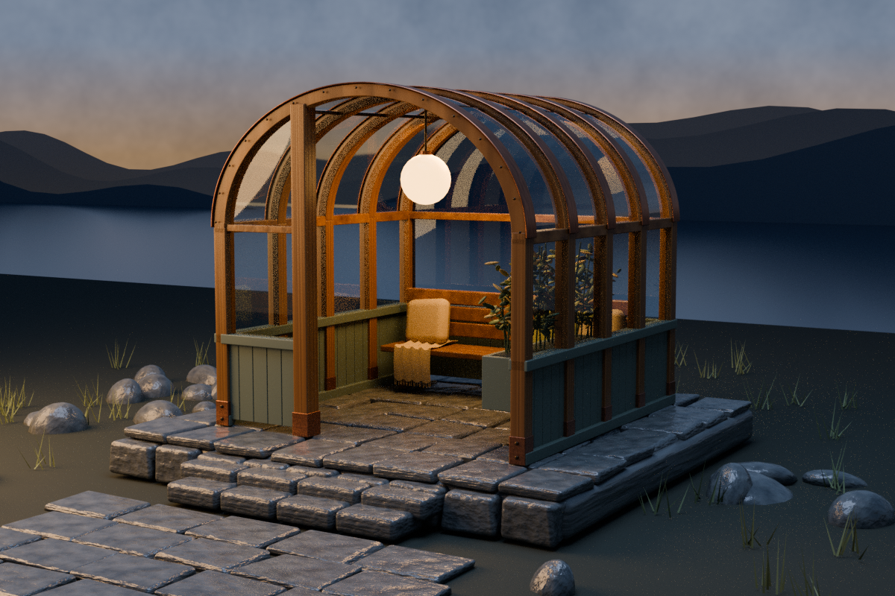
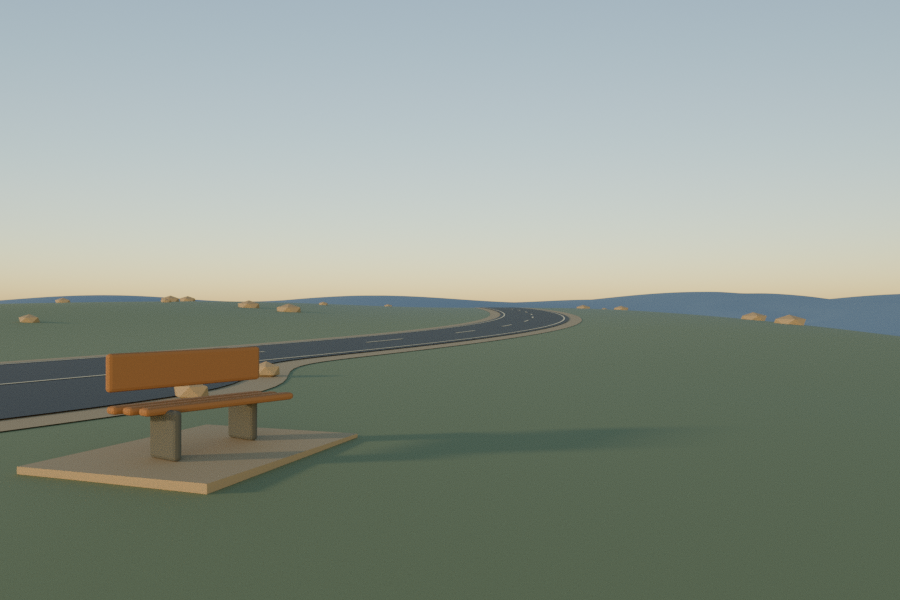
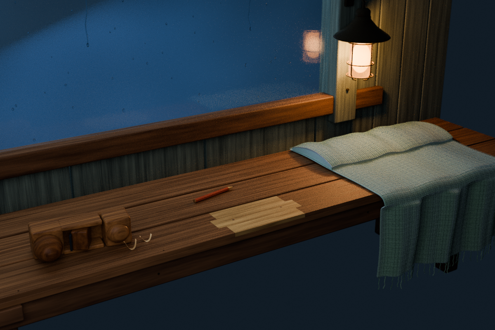
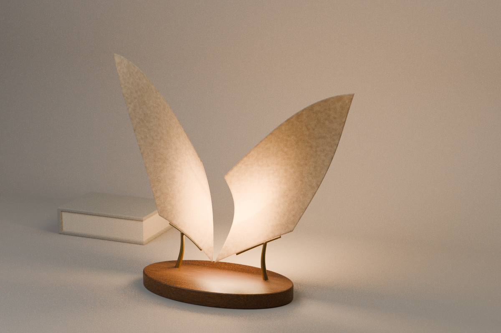
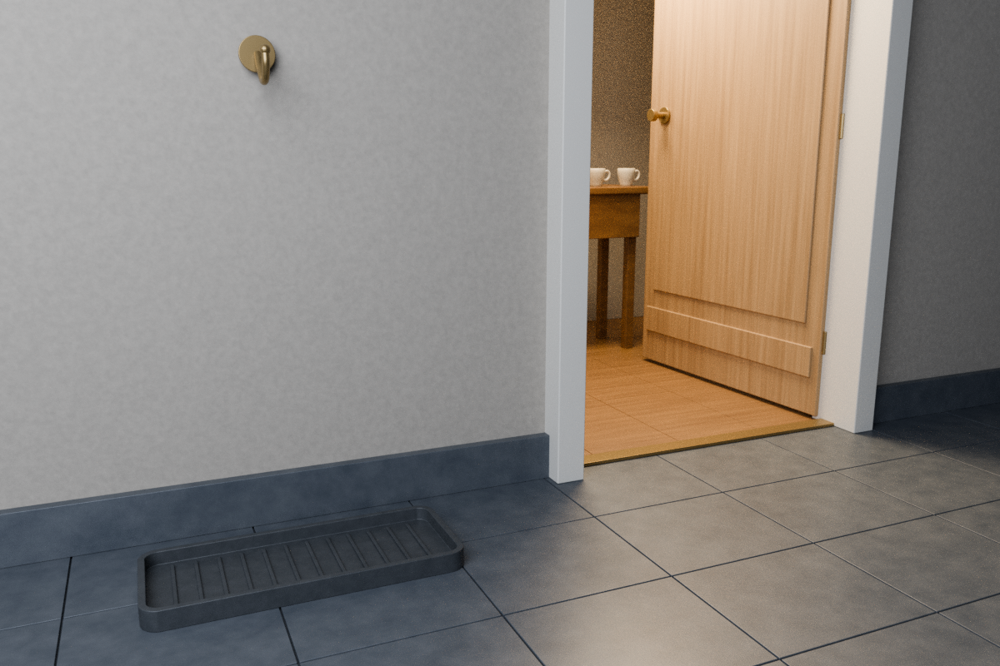
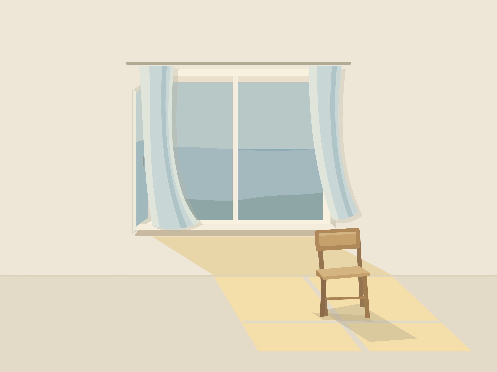

# 잠깐 머무는 작은 세계

비를 피하는 공간, 천천히 움직이는 빛, 길가의 빈 벤치.
이미지와 짧은 영상으로 먼저 둘러볼 수 있는 열한 작업을 골랐습니다.
편집 가능한 장면과 제작 소스는 각 작품의 안내에 함께 있습니다.

세 정물을 이어 읽는 동반 그림책 [《비가 지나가는 동안》](quiet-storybook/README.md)도 있습니다. [3쪽 PDF로 읽기](quiet-storybook/While-the-Rain-Passes.pdf).

## 1. Glass Refuge · 유리 쉼터

곡선 목재와 유리 아래, 저녁빛을 담은 작은 자리를 만들었습니다.

**위 이미지는 실제 Blender 모델의 렌더입니다. 게임 화면이나 GPT Image 콘셉트 이미지가 아닙니다.**

하나의 공간을 서로 다른 방식으로 이어 보았습니다.

- **출발 — 생성 이미지:** [GPT Image 콘셉트 원본](glass-refuge/reference/gpt_image_concept.png). 공간의 분위기와 형태를 위한 참고 이미지입니다.
- **모델 — 편집 가능한 3D:** [Blender 장면·제작 소스](glass-refuge/README.md) · [구조 둘러보기 영상](glass-refuge/renders/06_structural_inspection.mp4). 한 장의 그림을 해석해 만든 모델로, 치수는 추정이며 시공용 설계가 아닙니다.
- **뷰어 — 직접 돌려보기:** [Godot 실행·조작 안내](glass-refuge-viewer/README.md). 모델에서 내보낸 실제 3D 형상을 회전하고 조명·유리를 켜고 끕니다. 재질은 단순화했고 식물과 배경 풍경은 제외했습니다.
- **게임 — 안으로 걸어 들어가기:** [After the Rain](after-the-rain/README.md)에서는 같은 파생 모델의 쉼터에 들어가 앉고, 코코아를 마시며 기다릴 수 있습니다. 역시 단순화된 실시간 표현이며 위 렌더와 같지 않습니다. 등장인물과 동네 이야기는 허구입니다.

## 2. Rain Clock · 비를 세는 창

따뜻한 창 주위로 작은 빗방울들이 서로 다른 박자로 흔들립니다.

[8초 반복 영상](rain-clock/rain_clock_loop.mp4) · [Blender 장면·제작 소스](rain-clock/README.md)

가상 키네틱 조각입니다. 움직임은 키프레임 애니메이션이며, 실제 시계나 검증된 기계 장치는 아닙니다.

## 3. Garden of Light · 빛의 정원

살구색, 청록색, 연보라색 필터 사이로 빛이 한 바퀴 돌아갑니다.

[4초 반복 영상](garden-of-light/Garden-of-Light-loop.mp4) · [Blender 장면·제작 소스](garden-of-light/README.md)

가상의 빛 설치 작업입니다. 색 투과를 근사한 렌더이며 실제 유리의 광학 성능을 재현한 실험은 아닙니다.

## 4. Fading Shore · 사라지는 해안

청록색 띠가 바닥에서 멀어질수록 그림자의 경계가 흐려집니다.

[원본 이미지](fading-shore/Fading-Shore.png) · [Blender 장면·제작 소스](fading-shore/README.md)

한 장의 이미지로 남긴 디지털 조각입니다. 떠 있는 형태는 의도된 가상 표현이며 제작 도면이나 정량 광학 측정이 아닙니다.

## 5. A Place to Pause · 잠깐 멈춘 길

멀어지는 도로 옆에 벤치 하나와 넓은 여백을 남겼습니다.

[원본 이미지](a-place-to-pause/a_place_to_pause.png) · [Blender 장면·제작 소스](a-place-to-pause/README.md)

단순한 기하 형태로 만든 가상 풍경입니다. 도로·벤치의 실물 안전이나 시공 가능성을 보증하는 설계는 아닙니다.

## 6. Mended Corner · 수선이 남긴 자리

고친 벤치 끝, 접힌 담요와 짧은 연필 곁에 작은 작업등을 켜 두었습니다.

**위 이미지는 실제 3D 장면의 렌더이며 GPT Image 콘셉트나 게임 화면이 아닙니다.**
[작품·편집 가능한 장면·제작 소스](mended-corner/README.md) · [출발점인 생성 콘셉트](mended-corner/reference/gpt_image_concept.png)

유리 쉼터와 같은 허구의 동네에서 가져온 독립 정물입니다. 게임에 새로 배치된 소품이나 실제 목공·전기 안전을 검증한 제작안은 아닙니다.

## 7. 두 잔의 자리 · The Second Cup

한 잔에는 먼저 차를 따르고, 다른 잔과 빵 접시 두 개는 비워 두었습니다. 비 오는 동네의 승객이 소보로를 가져올 집 안을 상상한 독립 정물입니다.

[편집 가능한 장면·제작 과정](second-cup/README.md) · [키보드로 돌려보는 독립 Godot 뷰어](second-cup-viewer/README.md) · [실제 Blender 렌더의 6초 무음 영상](second-cup-film/renders/The_Second_Cup_Silent_Film.mp4) · [별도로 보존한 GPT Image 콘셉트](second-cup/reference/gpt_image_concept.png)

위 이미지는 절차적 재질과 직접 만든 메시의 실제 Blender 렌더입니다. 실물 사진이나 게임 화면, 생성 콘셉트 자체가 아닙니다. 물리적 유체·열 시뮬레이션이나 실제 식기의 안전 검증을 뜻하지 않습니다.

## 8. 머무는 페이지 · A Page at Rest

두 장의 얇은 곡면 아래 황동 받침을 놓고, 뒤편의 따뜻한 빛이 책상에 머물게 했습니다.

[편집 가능한 CAD·Blender 장면과 검증](page-at-rest/README.md) · [키보드로 관찰하는 3D 뷰어](page-at-rest-viewer/README.md) · [별도로 보존한 생성 콘셉트](page-at-rest/reference/gpt_image_concept.png)

위 이미지는 FreeCAD의 받침·지지부를 Blender로 옮긴 실제 CPU 렌더입니다. 생성 콘셉트 자체가 아니며 미세한 렌더 입자가 남습니다. 가상 조형물로, 실물 전기·제조·안전 검증을 뜻하지 않습니다.

## 9. 비가 머물 자리 · A Place for Rain

아직 돌아오는 길에 있는 사람을 위해, 빈 물받이와 훅 옆에 따뜻한 불을 남겼습니다. 문 너머 두 잔은 조금 뒤의 저녁을 기다립니다.

[독립 장면·제작 소스와 검증](a-place-for-rain/README.md) · [별도로 보존한 생성 콘셉트](a-place-for-rain/reference/gpt_image_concept.png)

위 이미지는 실제 Blender 렌더이며 생성 콘셉트나 게임 화면이 아닙니다. 미세한 렌더 입자가 남습니다. 실물 건축·배수·전기·안전 검증을 뜻하지 않습니다.

## 10. 볕이 돌아온 창턱 · Morning on the Sill

작은 청회색 도자기 고양이와 부채꼴을 본뜬 낙엽 두 장에 아침볕이 닿습니다. 열린 창 곁의 여백을 남긴 독립 정물입니다.

[편집 가능한 장면·제작 소스와 검증](morning-on-the-sill/README.md) · [별도로 보존한 생성 콘셉트](morning-on-the-sill/reference/gpt_image_concept.png)

위 이미지는 직접 만든 메시와 절차적 재질의 실제 Blender 렌더입니다. 생성 콘셉트 자체나 게임 화면이 아니며 미세한 렌더 입자가 남습니다. 실물 도자기 제작·식물학적 복원·제품 안전 검증을 뜻하지 않습니다.

## 11. 바람이 앉는 자리 · A Seat for Wind

열린 창과 푸른 커튼, 황토색 빈 의자 사이에 긴 오후빛을 놓았습니다. 종이를 오려 겹친 듯한 여백의 장면입니다.

[편집 가능한 SVG·PNG와 재현 스크립트](a-seat-for-wind/README.md) · [커튼만 움직이는 12초 무음 영상](a-seat-for-wind-motion/a_seat_for_wind_motion.mp4) · [움직임 연구·재현](a-seat-for-wind-motion/README.md)

위 이미지는 직접 작성한 벡터 도형을 Inkscape로 렌더한 그림입니다. 생성형 이미지나 Blender 3D 렌더가 아니며 외부 이미지·폰트·텍스처를 사용하지 않았습니다.

---

더 자세한 실험과 실행 환경은 [전체 작업 목록](README.md)에 있습니다.
출처와 이용 조건은 각 프로젝트의 안내를 따릅니다. 게임에 포함된 외부 에셋의 라이선스도 별도로 보존되어 있으며, 이 갤러리는 저장소 전체에 하나의 라이선스를 부여하지 않습니다.
