# 잠깐 머무는 작은 세계

비를 피하는 공간, 천천히 움직이는 빛, 길가의 빈 벤치.
이미지와 짧은 영상으로 먼저 둘러볼 수 있는 32개 작업을 골랐습니다.
편집 가능한 장면과 제작 소스는 각 작품의 안내에 함께 있습니다.

세 정물을 이어 읽는 동반 그림책 [《비가 지나가는 동안》](projects/quiet-storybook/README.md)도 있습니다. [3쪽 PDF로 읽기](projects/quiet-storybook/While-the-Rain-Passes.pdf).

## 1. Glass Refuge · 유리 쉼터

곡선 목재와 유리 아래, 저녁빛을 담은 작은 자리를 만들었습니다.

**위 이미지는 실제 Blender 모델의 렌더입니다. 게임 화면이나 GPT Image 콘셉트 이미지가 아닙니다.**

하나의 공간을 서로 다른 방식으로 이어 보았습니다.

- **출발 — 생성 이미지:** [GPT Image 콘셉트 원본](projects/glass-refuge/reference/gpt_image_concept.png). 공간의 분위기와 형태를 위한 참고 이미지입니다.
- **모델 — 편집 가능한 3D:** [Blender 장면·제작 소스](projects/glass-refuge/README.md) · [구조 둘러보기 영상](projects/glass-refuge/renders/06_structural_inspection.mp4). 한 장의 그림을 해석해 만든 모델로, 치수는 추정이며 시공용 설계가 아닙니다.
- **뷰어 — 직접 돌려보기:** [Godot 실행·조작 안내](projects/glass-refuge-viewer/README.md). 모델에서 내보낸 실제 3D 형상을 회전하고 조명·유리를 켜고 끕니다. 재질은 단순화했고 식물과 배경 풍경은 제외했습니다.
- **게임 — 안으로 걸어 들어가기:** [After the Rain](projects/after-the-rain/README.md)에서는 같은 파생 모델의 쉼터에 들어가 앉고, 코코아를 마시며 기다릴 수 있습니다. 역시 단순화된 실시간 표현이며 위 렌더와 같지 않습니다. 등장인물과 동네 이야기는 허구입니다.

## 2. Rain Clock · 비를 세는 창

따뜻한 창 주위로 작은 빗방울들이 서로 다른 박자로 흔들립니다.

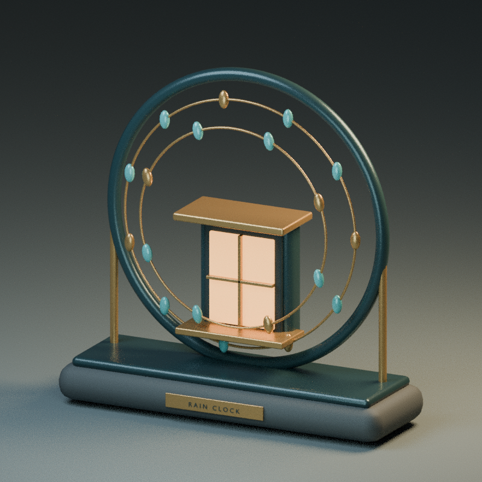

[8초 반복 영상](projects/rain-clock/rain_clock_loop.mp4) · [Blender 장면·제작 소스](projects/rain-clock/README.md)

가상 키네틱 조각입니다. 움직임은 키프레임 애니메이션이며, 실제 시계나 검증된 기계 장치는 아닙니다.

## 3. Garden of Light · 빛의 정원

살구색, 청록색, 연보라색 필터 사이로 빛이 한 바퀴 돌아갑니다.

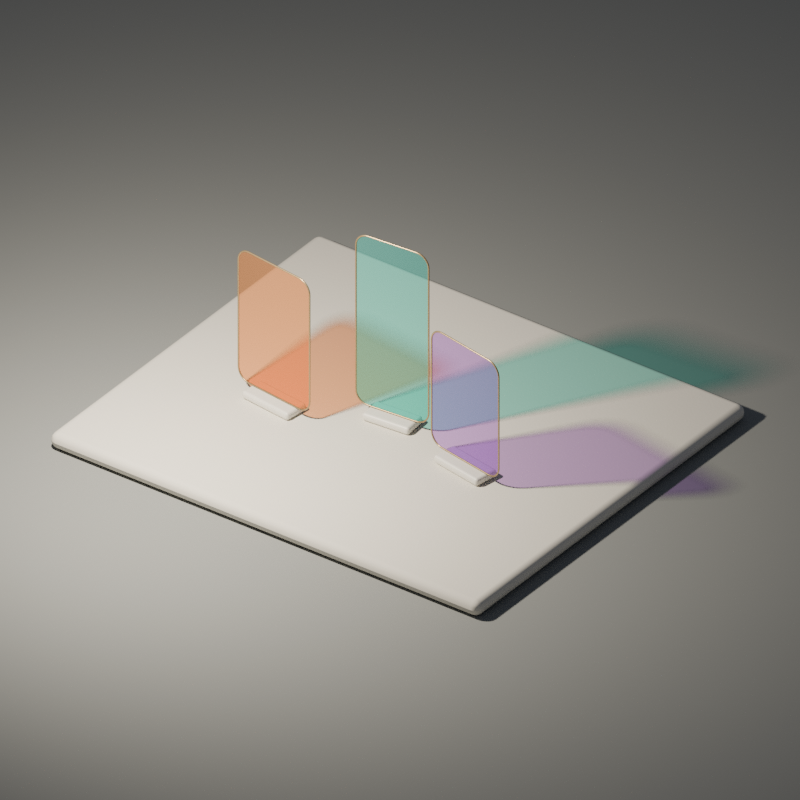

[4초 반복 영상](projects/garden-of-light/Garden-of-Light-loop.mp4) · [Blender 장면·제작 소스](projects/garden-of-light/README.md)

가상의 빛 설치 작업입니다. 색 투과를 근사한 렌더이며 실제 유리의 광학 성능을 재현한 실험은 아닙니다.

## 4. Fading Shore · 사라지는 해안

청록색 띠가 바닥에서 멀어질수록 그림자의 경계가 흐려집니다.

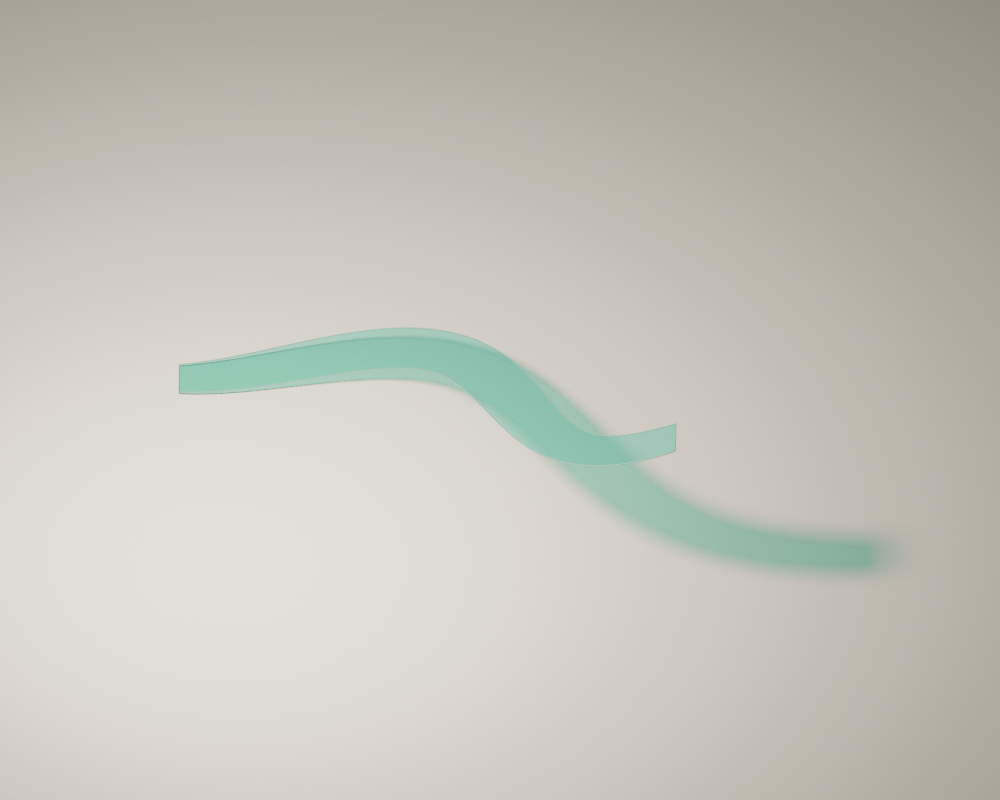

[원본 이미지](projects/fading-shore/Fading-Shore.png) · [Blender 장면·제작 소스](projects/fading-shore/README.md)

한 장의 이미지로 남긴 디지털 조각입니다. 떠 있는 형태는 의도된 가상 표현이며 제작 도면이나 정량 광학 측정이 아닙니다.

## 5. A Place to Pause · 잠깐 멈춘 길

멀어지는 도로 옆에 벤치 하나와 넓은 여백을 남겼습니다.

[원본 이미지](projects/a-place-to-pause/a_place_to_pause.png) · [Blender 장면·제작 소스](projects/a-place-to-pause/README.md)

단순한 기하 형태로 만든 가상 풍경입니다. 도로·벤치의 실물 안전이나 시공 가능성을 보증하는 설계는 아닙니다.

## 6. Mended Corner · 수선이 남긴 자리

고친 벤치 끝, 접힌 담요와 짧은 연필 곁에 작은 작업등을 켜 두었습니다.

**위 이미지는 실제 3D 장면의 렌더이며 GPT Image 콘셉트나 게임 화면이 아닙니다.**
[작품·편집 가능한 장면·제작 소스](projects/mended-corner/README.md) · [출발점인 생성 콘셉트](projects/mended-corner/reference/gpt_image_concept.png)

유리 쉼터와 같은 허구의 동네에서 가져온 독립 정물입니다. 게임에 새로 배치된 소품이나 실제 목공·전기 안전을 검증한 제작안은 아닙니다.

## 7. 두 잔의 자리 · The Second Cup

한 잔에는 먼저 차를 따르고, 다른 잔과 빵 접시 두 개는 비워 두었습니다. 비 오는 동네의 승객이 소보로를 가져올 집 안을 상상한 독립 정물입니다.

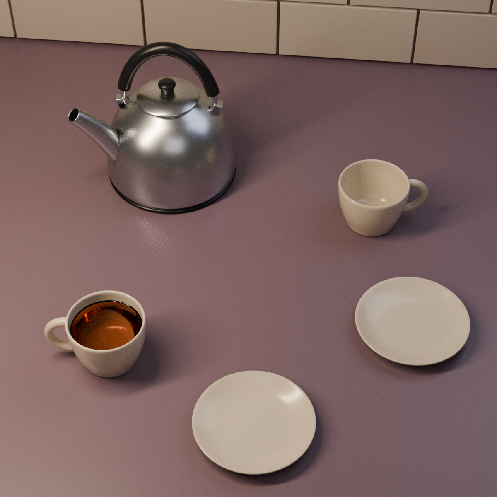

[편집 가능한 장면·제작 과정](projects/second-cup/README.md) · [키보드로 돌려보는 독립 Godot 뷰어](projects/second-cup-viewer/README.md) · [실제 Blender 렌더의 6초 무음 영상](projects/second-cup-film/renders/The_Second_Cup_Silent_Film.mp4) · [별도로 보존한 GPT Image 콘셉트](projects/second-cup/reference/gpt_image_concept.png)

위 이미지는 절차적 재질과 직접 만든 메시의 실제 Blender 렌더입니다. 실물 사진이나 게임 화면, 생성 콘셉트 자체가 아닙니다. 물리적 유체·열 시뮬레이션이나 실제 식기의 안전 검증을 뜻하지 않습니다.

## 8. 머무는 페이지 · A Page at Rest

두 장의 얇은 곡면 아래 황동 받침을 놓고, 뒤편의 따뜻한 빛이 책상에 머물게 했습니다.

[편집 가능한 CAD·Blender 장면과 검증](projects/page-at-rest/README.md) · [키보드로 관찰하는 3D 뷰어](projects/page-at-rest-viewer/README.md) · [별도로 보존한 생성 콘셉트](projects/page-at-rest/reference/gpt_image_concept.png)

위 이미지는 FreeCAD의 받침·지지부를 Blender로 옮긴 실제 CPU 렌더입니다. 생성 콘셉트 자체가 아니며 미세한 렌더 입자가 남습니다. 가상 조형물로, 실물 전기·제조·안전 검증을 뜻하지 않습니다.

## 9. 비를 내려놓을 자리 · A Place for Rain

아직 돌아오는 길에 있는 사람을 위해, 빈 물받이와 훅 옆에 따뜻한 불을 남겼습니다. 문 너머 두 잔은 조금 뒤의 저녁을 기다립니다.

[독립 장면·제작 소스와 검증](projects/a-place-for-rain/README.md) · [별도로 보존한 생성 콘셉트](projects/a-place-for-rain/reference/gpt_image_concept.png)

위 이미지는 실제 Blender 렌더이며 생성 콘셉트나 게임 화면이 아닙니다. 미세한 렌더 입자가 남습니다. 실물 건축·배수·전기·안전 검증을 뜻하지 않습니다.

## 10. 볕이 돌아온 창턱 · Morning on the Sill

작은 청회색 도자기 고양이와 부채꼴을 본뜬 낙엽 두 장에 아침볕이 닿습니다. 열린 창 곁의 여백을 남긴 독립 정물입니다.

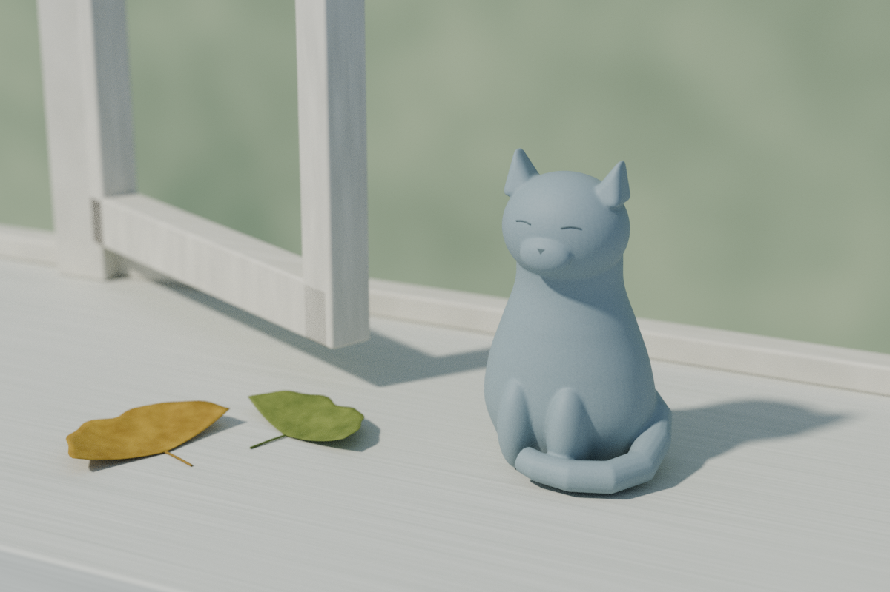

[편집 가능한 장면·제작 소스와 검증](projects/morning-on-the-sill/README.md) · [별도로 보존한 생성 콘셉트](projects/morning-on-the-sill/reference/gpt_image_concept.png)

위 이미지는 직접 만든 메시와 절차적 재질의 실제 Blender 렌더입니다. 생성 콘셉트 자체나 게임 화면이 아니며 미세한 렌더 입자가 남습니다. 실물 도자기 제작·식물학적 복원·제품 안전 검증을 뜻하지 않습니다.

## 11. 바람이 앉는 자리 · A Seat for Wind

열린 창과 푸른 커튼, 황토색 빈 의자 사이에 긴 오후빛을 놓았습니다. 종이를 오려 겹친 듯한 여백의 장면입니다.

[편집 가능한 SVG·PNG와 재현 스크립트](projects/a-seat-for-wind/README.md) · [커튼만 움직이는 12초 무음 영상](projects/a-seat-for-wind-motion/a_seat_for_wind_motion.mp4) · [움직임 연구·재현](projects/a-seat-for-wind-motion/README.md)

위 이미지는 직접 작성한 벡터 도형을 Inkscape로 렌더한 그림입니다. 생성형 이미지나 Blender 3D 렌더가 아니며 외부 이미지·폰트·텍스처를 사용하지 않았습니다.

## 12. 돌아올 페이지 · Returning Page

읽던 책 사이에 작은 황동 창을 남겼습니다. 돌아와 다시 펼칠 문장을 기다리는 가상의 책갈피입니다.

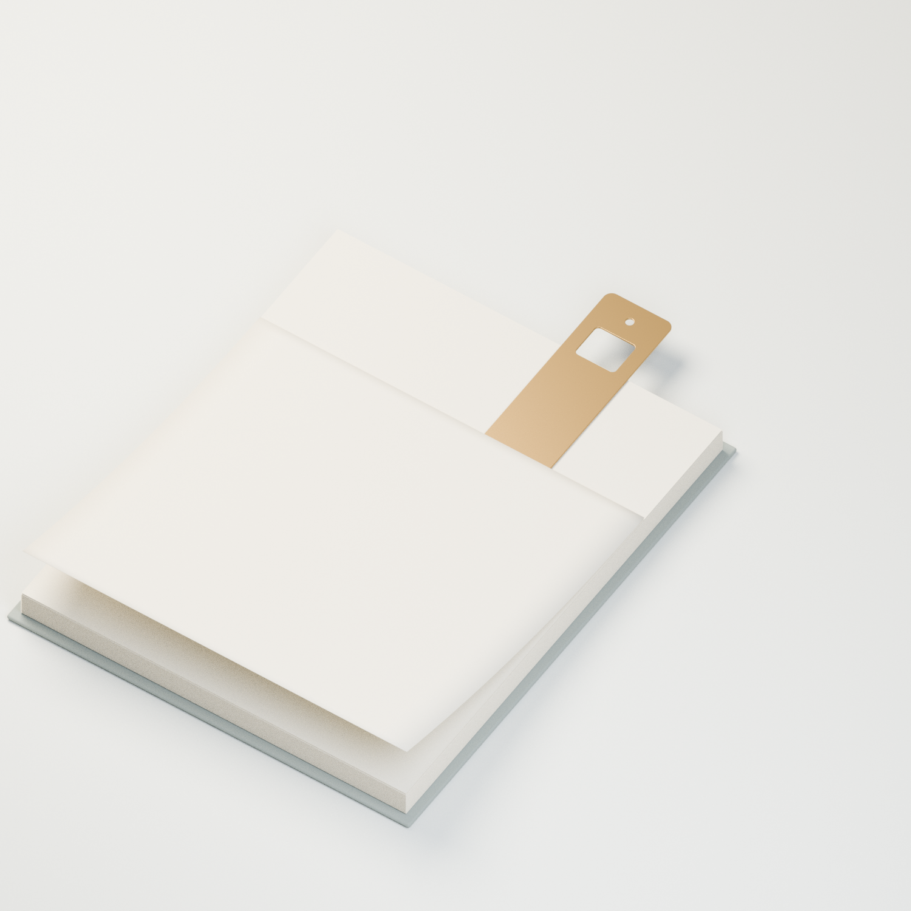

[편집 가능한 FreeCAD·STEP·Blender 장면과 재현](projects/returning-page/README.md)

직접 만든 FreeCAD 솔리드를 메시로 옮긴 실제 Blender 렌더입니다. 생성형 이미지나 제품 사진이 아니며, 실물 제조·강도·모서리 안전·책 호환성을 검증한 물건은 아닙니다.

## 13. 다음 정거장 · Next Stop

08번 버스의 귀갓길을 종이 한 장으로 이어 보았습니다. 작은 창과 시장길·강변·종점의 이름이 남은 가상의 승차권입니다.

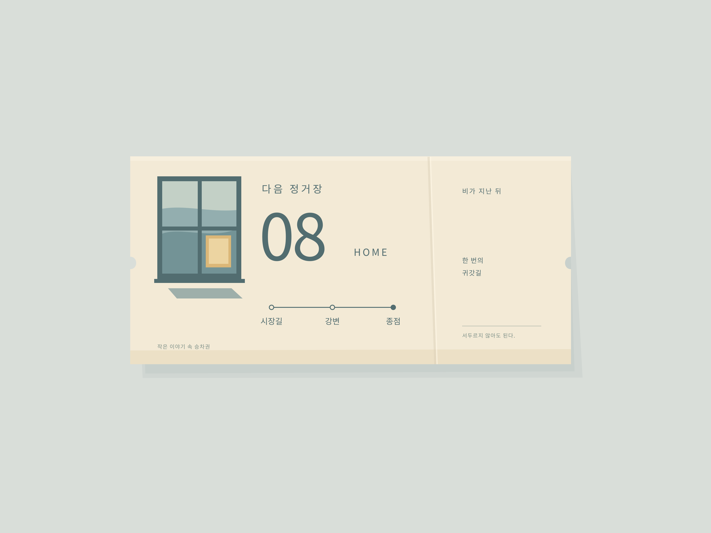

[편집 가능한 벡터 원본·재현과 글꼴 안내](projects/next-stop/README.md)

직접 작성한 도형과 편집 가능한 문자를 Inkscape로 렌더했습니다. 생성형 이미지·실제 교통권이 아니며 게임에 발권 기능을 추가한 것은 아닙니다. 글꼴은 배포물에 포함하지 않았습니다.

## 14. 돌아온 수레 · Returned Cart

작업실 처마 아래 빈 수레와 풀린 천끈이 남았습니다. 벤치를 옮긴 뒤를 상상한, 닫힌 문 앞의 조용한 정물입니다.

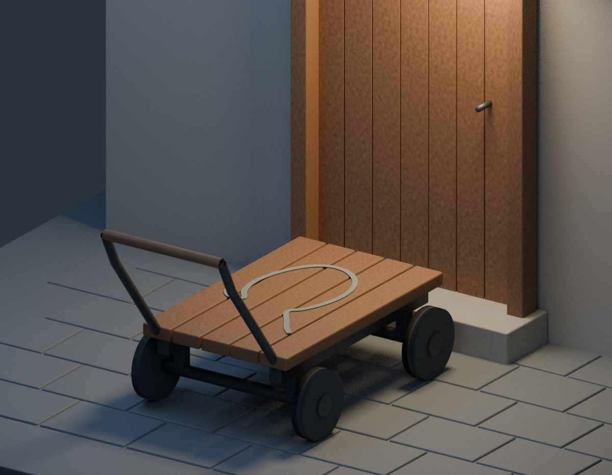

[편집 가능한 장면·재현과 검증 범위](projects/returned-cart/README.md)

직접 만든 메시·곡선·절차적 재질의 실제 Blender 렌더입니다. 수레로 벤치를 운반했다는 세부는 새 동반 장면의 상상이며 기존 게임 설정으로 확정하지 않습니다. 실물 운반 장치의 하중·안정성·동선 안전을 검증한 설계가 아닙니다.

## 15. 저울을 덮어 둔 밤

시장길의 셔터 앞에 빈 저울과 접어 둔 천이 남았습니다. 내일 다시 쓸 물건을 오늘의 자리에 놓아 둔 작은 정물입니다.

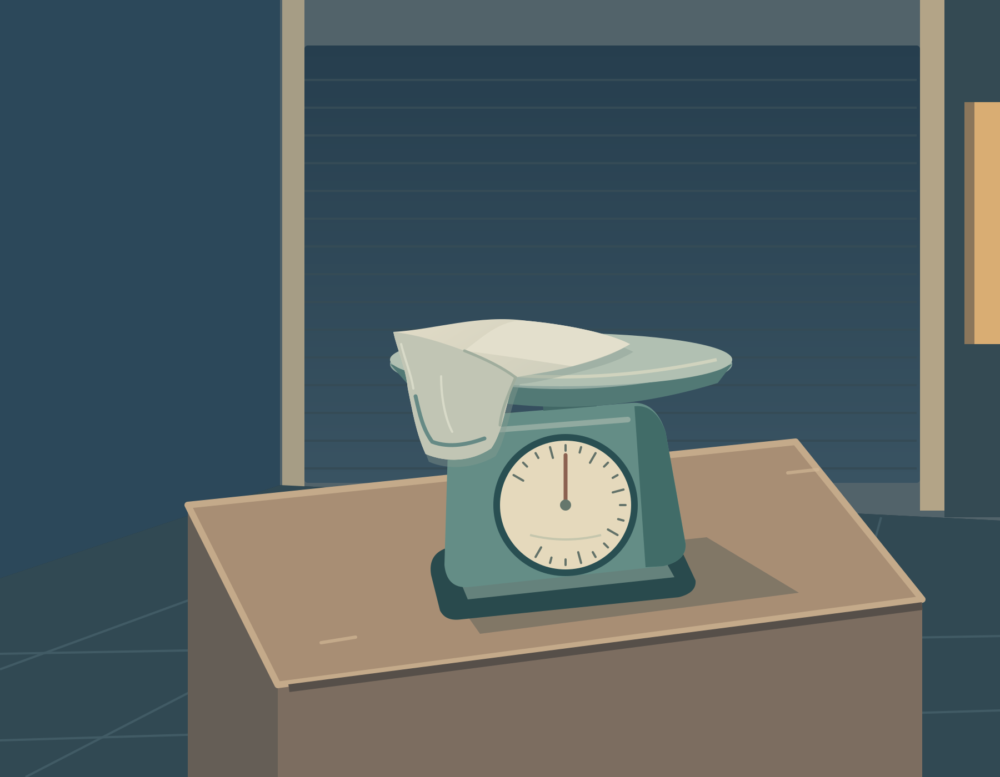

[편집 가능한 벡터 원본·재현과 표현 범위](projects/market-scale/README.md)

직접 작성한 도형을 Inkscape로 렌더했습니다. 과일가게와 천을 접어 놓은 일은 새 동반 상상이며 게임에 구현된 장소나 사건으로 단정하지 않습니다. 생성형 이미지·실제 직물 물리·저울 측정 시뮬레이션이 아닙니다.

## 16. 강이 지나가는 동안

창의 가장자리 너머로 밤의 강이 넓게 흐릅니다. 먼 다리의 네 불빛과 끊어진 색면의 반영을 담은 조용한 풍경입니다.

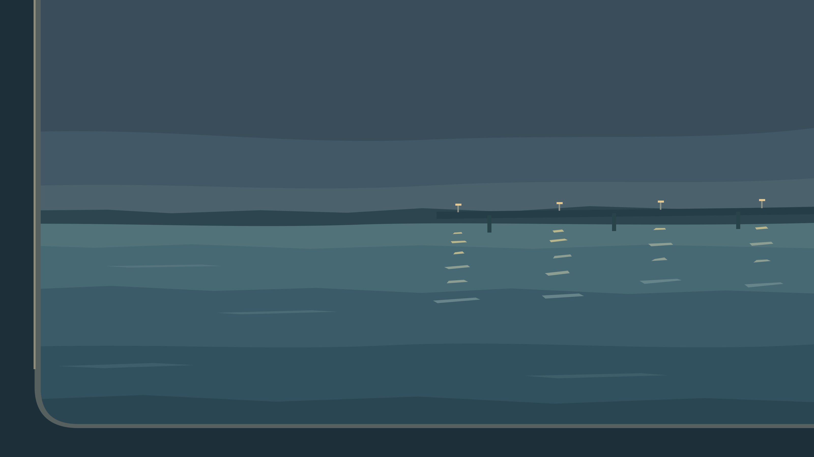

[편집 가능한 벡터 원본·재현과 설정 범위](projects/river-between-stops/README.md)

08번 가상 노선의 강변에서 이어 상상한 독립 그림입니다. 특정 인물이 실제로 지나간 장면이나 게임 화면이 아니며, 색종이 같은 물 표현은 반사·굴절·유체 시뮬레이션이 아닙니다. 외부 이미지·폰트·생성형 이미지를 사용하지 않았습니다.

## 17. 아직 출발하지 않은 밤

차 밖에서 앞유리 너머 두 사람을 바라봅니다. 빗물 선 아래로 낮은 히터 표시등이 작은 온기를 남깁니다.

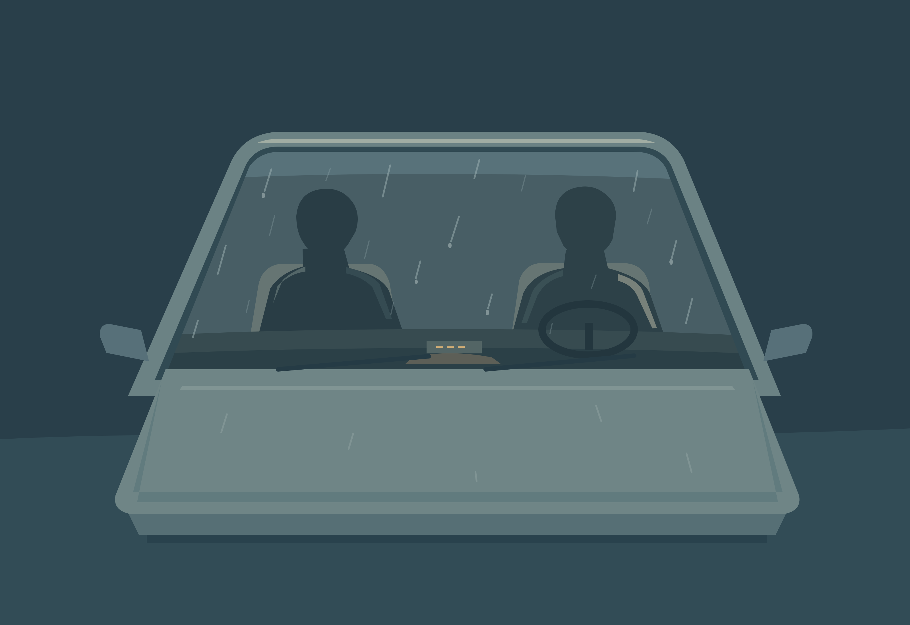

[편집 가능한 벡터 원본·재현과 설정 범위](projects/still-together/README.md)

정차한 차와 두 사람에서 출발한 독립 동반 상상입니다. 외부 정면 관찰자 기준 운전대는 오른쪽에 있으며, 인물의 얼굴이나 대사를 확정하지 않습니다. 실제 사진·게임 화면·유리 굴절이나 젖음의 물리 시뮬레이션이 아니며 외부 이미지·폰트·생성형 이미지를 사용하지 않았습니다.

## 18. 비 오는 밤의 정류장 · 08 정류장

따뜻한 정류장 창과 앞 도로를 지나는 버스의 옆모습을 작은 픽셀로 그렸습니다.

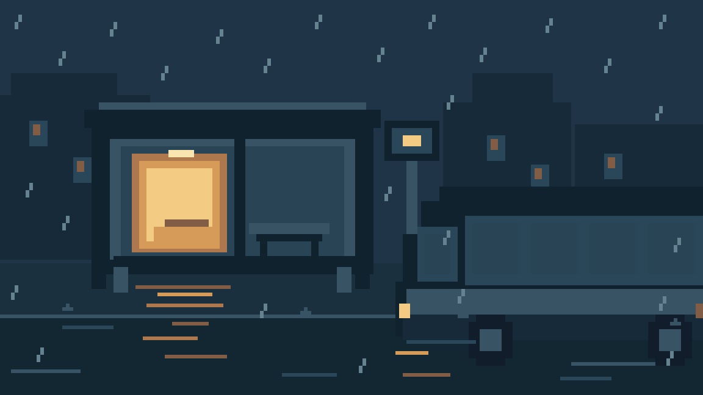

[원본 픽셀·제작 코드·재현](projects/pixel-busstop/README.md)

좌표·도형·제한 팔레트를 직접 지정한 독립 작품입니다. 실제 게임 화면이나 외부 스프라이트가 아니며, 새로운 인물이나 게임 사건을 확정하지 않습니다.

## 19. 회전이 멎은 뒤

열린 세탁기 문과 빈 빨래 바구니 사이에 여백을 남겼습니다. 오른쪽 창 밖에서 들어온 빛이 바닥을 가로지릅니다.

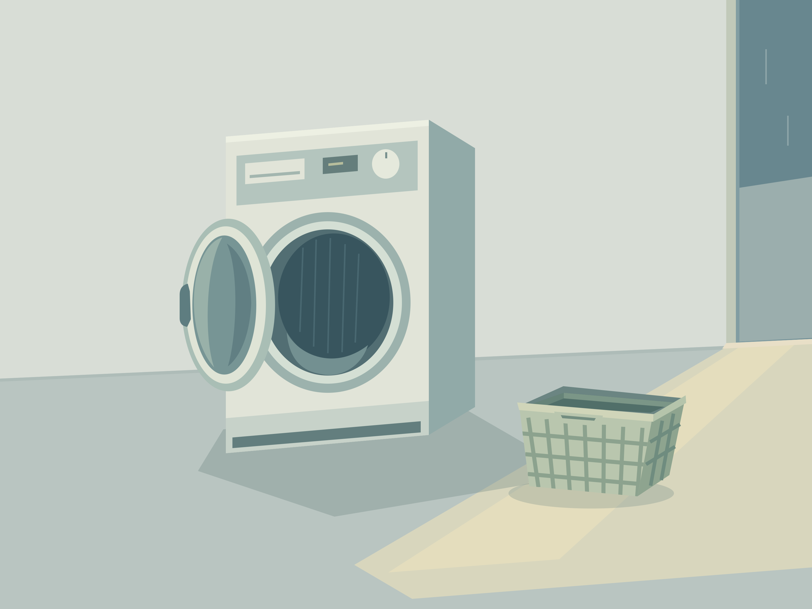

[편집 가능한 벡터 원본·재현과 공간 구성](projects/after-the-turn/README.md)

직접 그린 독립 벡터 정물입니다. 양식화한 사선 구도이며 실제 제품 사진·정확한 3D 투영·게임의 새 장소가 아닙니다. 인물의 관계나 방문을 확정하지 않으며 외부 이미지·폰트·생성형 이미지를 사용하지 않았습니다.

## 20. 꽃이 떠난 자리

접힌 포장지 위에 잘라낸 잎줄기 하나가 남았습니다. 작은 끈 실패에서 풀린 선이 빈 작업대의 여백을 두릅니다.

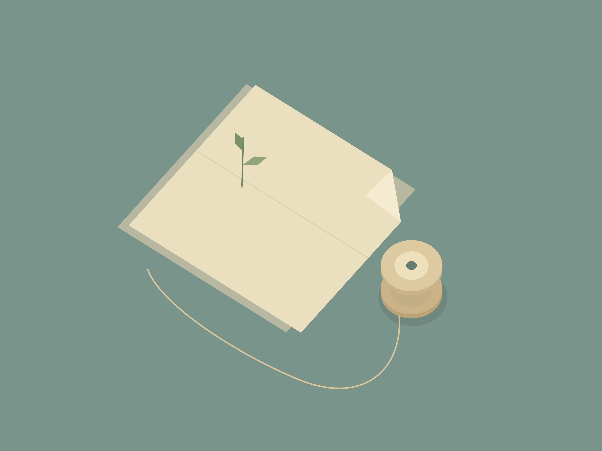

[편집 가능한 원본·재현과 검증 범위](projects/after-the-flowers/README.md)

비 오는 동네의 꽃집에서 이어 상상한 독립 벡터 정물입니다. 누가 어떤 꽃을 포장했는지 확정하지 않으며 실제 사진이나 게임 구현이 아닙니다. 같은 카메라의 배치·접지와 유한 표본의 가림 순서를 검사했지만 종이·끈·빛의 물리 시뮬레이션이나 모든 픽셀의 완전한 증명은 아닙니다. 외부 이미지·폰트·생성형 이미지를 사용하지 않았습니다.

## 21. 골목 끝 작은 세탁소

둥근 세탁기 문 세 개 너머로 따뜻한 빛이 남아 있습니다. 옆 골목의 빈 벤치와 낮은 입구 계단이 작은 가게의 크기를 알려 줍니다.

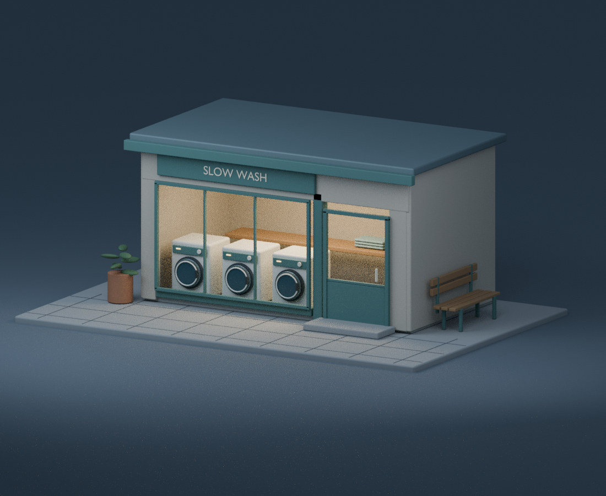

[편집 가능한 3D 장면·제작 코드·재현 범위](projects/quiet-laundrette/README.md)

직접 만든 독립 3D 작품입니다. 실제 가게·제품 사진이나 기존 게임에 추가된 장소가 아니며 인물의 방문을 확정하지 않습니다. 창은 내부가 보이는 단순화된 열린 형태로, 유리 굴절 시뮬레이션이 아닙니다. 외부 이미지·모델·다운로드한 글꼴을 사용하지 않았습니다.

## 22. 마지막 우산

닫힌 문 앞, 펼쳐 말리는 우산과 처마의 불빛.

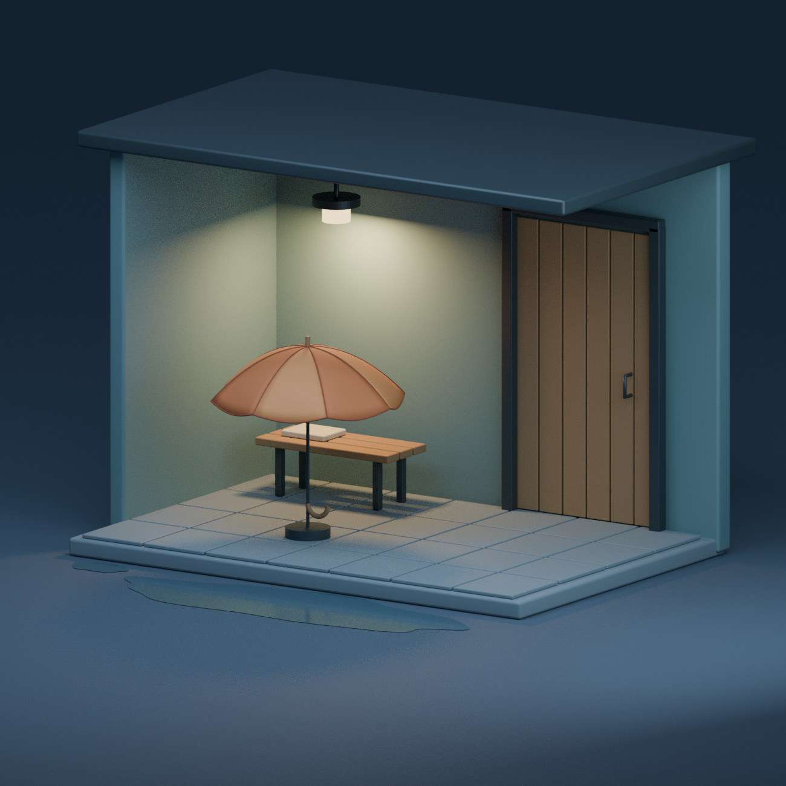

[완성 이미지](projects/last-umbrella/Last-Umbrella.png) · [작품·소스와 재현 안내](projects/last-umbrella/README.md)

Blender 4.3.2의 실제 Cycles 렌더. 독립 가상 정물이며 게임 장면이나 건축·제품 안전 검증이 아닙니다.

## 23. 문턱에 남은 빛

등을 껐다 다시 켜고, 문턱 쪽으로 천천히 가까이 갑니다.

[무음 영상 보기](projects/threshold-film/Light-on-the-Threshold.mp4) · [작품·소스와 재현 안내](projects/threshold-film/README.md)

Blender 4.3.2·FFmpeg. 12초, 640×640, 12fps 무음 영상이며 실제 조도·안전 검증이 아닙니다.

[제작 전 구성안과 조명 시험](projects/one-step-lit/README.md)은 완성 영상과 별도로 보존합니다.

## 24. 접힌 파도

일곱 면으로 접힌 파란 띠와 주황색 구의 대비.

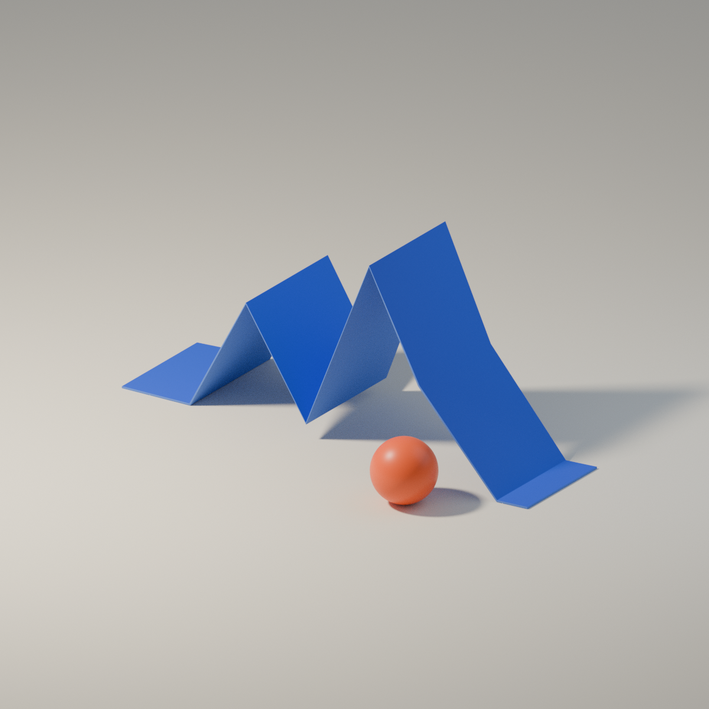

[완성 이미지](projects/folded-wave/Folded-Wave.png) · [작품·소스와 재현 안내](projects/folded-wave/README.md)

Blender 4.3.2의 실제 Cycles 렌더. 접힘·중력 시뮬레이션이나 제작 가능한 구조물의 설계가 아닙니다.

## 25. 한 자리에서만 원

정면의 원이 옆으로 이동하는 시선에서 여덟 조각으로 풀립니다.

[무음 영상 보기](projects/one-view-circle/One-View-Circle.mp4) · [작품·소스와 재현 안내](projects/one-view-circle/README.md)

Blender 4.3.2·FFmpeg. 8초, 640×640, 12fps 무음 영상. 시점과 화각을 함께 바꾼 가상 조각입니다.

[후속 32초 연구 미리보기](projects/one-view-circle-development/README.md)는 저해상도 시험이며, 고해상도 제작을 보류했습니다.

## 26. 한 줄의 바깥

같은 선 주위에 집, 길, 눈금을 놓았다가 지우는 다섯 장의 그림책.

[PDF 읽기](projects/unchanged-line/output/pdf/Outside-One-Line.pdf) · [작품·소스와 재현 안내](projects/unchanged-line/README.md)

Python·ReportLab과 Noto CJK 글꼴을 사용한 벡터 PDF. 지각 실험의 결과나 실제 경로·측정 기록이 아닙니다.

## 27. 여덟 칸의 여유

규칙적으로 엮은 종이띠 사이, 황토색 한 줄이 반복을 쉽니다.

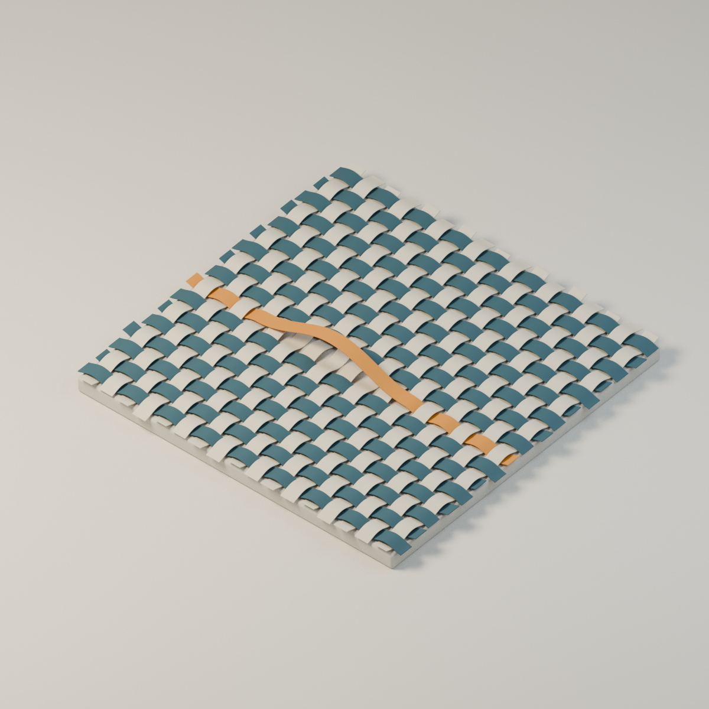

[완성 이미지](projects/eight-spaces/Eight-Spaces.png) · [작품·소스와 재현 안내](projects/eight-spaces/README.md)

Blender 4.3.2의 실제 Cycles 렌더. 메시 교차를 검사했으며 실제 종이의 장력·접촉 안정성이나 제작 가능성은 검증하지 않았습니다.

## 28. 길을 남기는 일

네 조각을 놓고, 남은 아홉 칸으로 길을 만드는 종이 퍼즐.

[PDF 읽기](projects/a-path-left-open/output/pdf/A-Path-Left-Open.pdf) · [작품·소스와 재현 안내](projects/a-path-left-open/README.md)

Python·ReportLab. 해답 수와 PDF 치수를 검사했습니다. 단면 100%로 인쇄하고 기준선을 확인하세요. 실물 재단·플레이 테스트는 하지 않았습니다.

[별도 해답 PDF](projects/a-path-left-open/output/pdf/A-Path-Left-Open-Answers.pdf)

## 29. 옮기는 동안

벤치를 내려놓은 두 사람이 잠깐 함께 앉는 대사 없는 네 칸 만화.

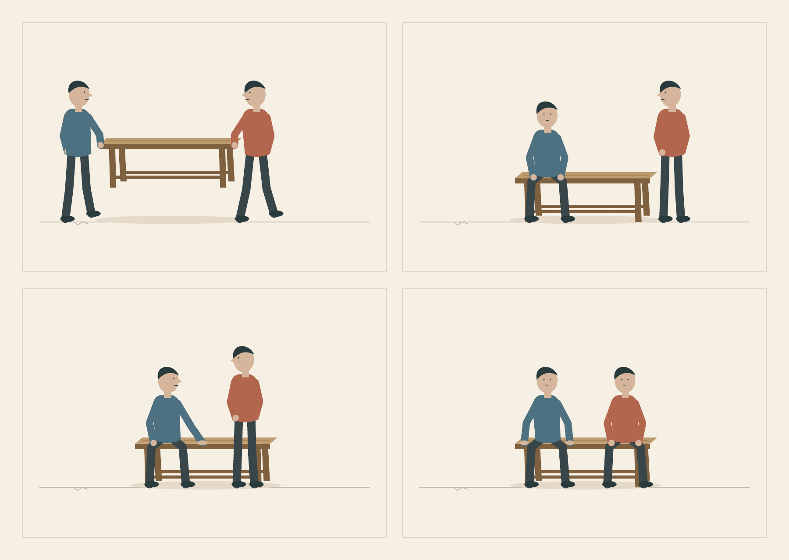

[완성 이미지](projects/while-carrying/While-Carrying.png) · [작품·소스와 재현 안내](projects/while-carrying/README.md)

직접 작성한 벡터 도형의 최종 PNG·PDF. 실제 독자 집단 반응 조사나 신체 동작의 물리적 검증은 아닙니다.

[벡터 PDF](projects/while-carrying/output/pdf/While-Carrying.pdf) · [그림의 텍스트 설명](projects/while-carrying/description.txt)

## 30. 각자의 수평

서로를 향해 기울어진 두 그릇 안에 같은 높이의 수면이 남습니다.

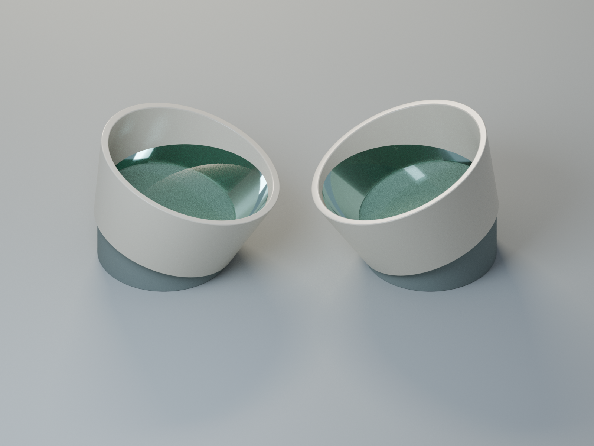

[완성 이미지](projects/separate-horizons/Separate-Horizons.png) · [작품·소스와 재현 안내](projects/separate-horizons/README.md)

Blender 4.3.2의 실제 Cycles 렌더. 정적 형상 검사이며 유체·모세관 현상·받침 내구성 시뮬레이션은 아닙니다.

## 31. 그림자가 모르는 것

비어 있는 몸 하나가 서로 직각인 두 방향으로 집과 나무의 그림자를 만듭니다.

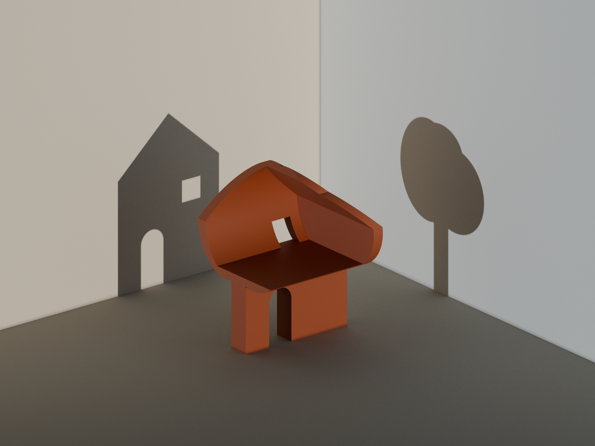

[완성 이미지](projects/one-body-two-shadows/One-Body-Two-Shadows.png) · [작품·소스와 재현 안내](projects/one-body-two-shadows/README.md)

Blender 4.3.2의 실제 렌더. 원본 장면과 형상·투영 검사, 영역별 렌더 조립 소스를 함께 보존합니다.

## 32. 가벼운 쪽의 거리

크기가 다른 청록색 조각 세 개와 붉은 삼각형 하나가 얇은 막대 아래에서 모였다가 다시 벌어집니다. 카메라는 움직이지 않습니다.

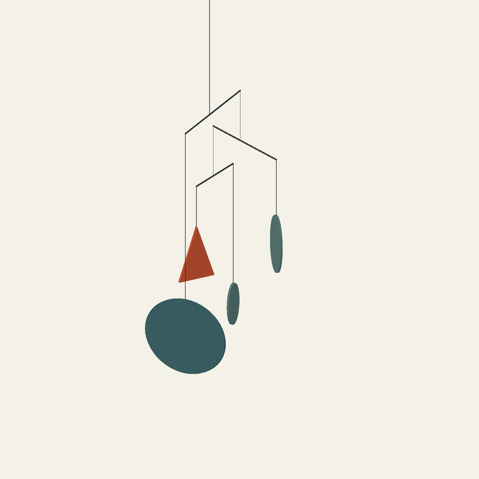

[16초 무성 영상](projects/the-lighter-side/The-Lighter-Side.mp4) · [정지 이미지](projects/the-lighter-side/The-Lighter-Side.png) · [3D 형상·제작 소스와 검사 범위](projects/the-lighter-side/README.md)

직접 만든 3D 형상과 주기 함수를 사용했습니다. 각 가지의 정적 균형과 표본 자세의 간섭을 검사했지만, 바람·관성의 동역학이나 실물 제작 안전을 검증한 모빌은 아닙니다. OBJ와 MTL은 정지 이미지와 같은 8초 지점을 담습니다.

## 읽기·듣기

시각 작품과 별도로 읽고 들을 수 있는 완성 작업입니다.

- [통째로 · 한 쪽 PDF](projects/whole-watermelon/Whole-Watermelon.pdf): 수박을 냉장고에 넣으라는 명령형으로 이루어진 짧은 낭독문. [텍스트](projects/whole-watermelon/Whole-Watermelon.txt)와 [제작 안내](projects/whole-watermelon/README.md)도 있습니다.

- [불을 끄는 순서](projects/lights-out-order/story.md): 《마지막 우산》에서 이어 쓴 독립 단편.
- [맨 앞 · 6쪽 PDF](projects/front-of-the-line/output/pdf/Front-of-the-Line.pdf): 홍보 촬영의 줄과 실제 손님을 다룬 소설.
- [고객 역할 · 5쪽 PDF](projects/the-customer-role/output/pdf/The-Customer-Role.pdf): 상담 실습의 대본 밖으로 나아가는 소설의 완성본.
- [확인 중 · 5쪽 PDF](projects/under-observation/output/pdf/Under-Observation.pdf): 수리점 주인과 손님이 등장하는 짧은 희곡. 실제 공연 검사는 하지 않았습니다.
- [다시 만나는 박자 · 33초 MP3](projects/returning-beats/Returning-Beats.mp3): 직접 합성한 5:3 박자의 기악곡. 기술 검사는 했지만 실제 청취 평가는 하지 않았습니다.

---

더 자세한 실험과 실행 환경은 [전체 작업 목록](README.md)에 있습니다.
출처와 이용 조건은 각 프로젝트의 안내를 따릅니다. 게임에 포함된 외부 에셋의 라이선스도 별도로 보존되어 있으며, 이 갤러리는 저장소 전체에 하나의 라이선스를 부여하지 않습니다.
