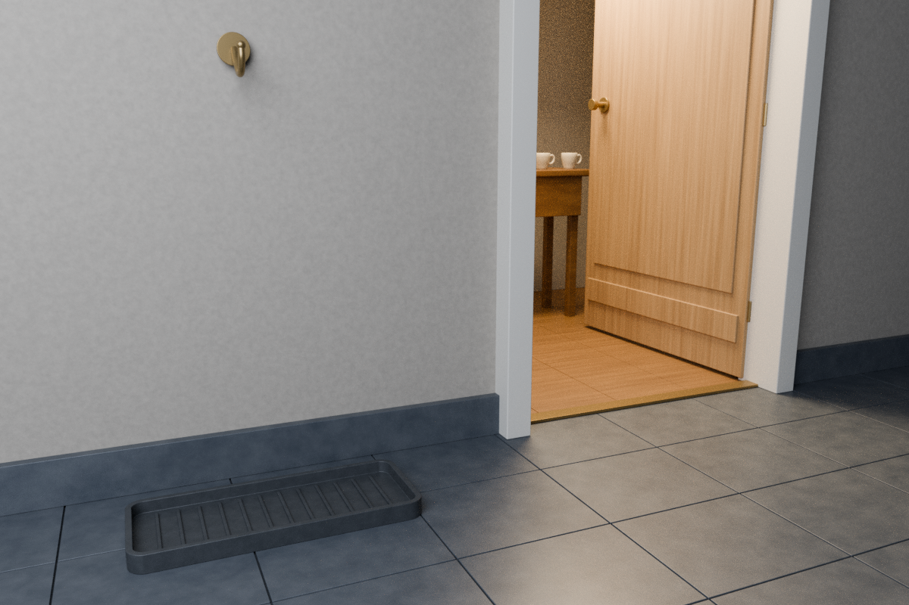

# 비가 머물 자리 · A Place for Rain

아직 돌아오는 길에 있는 승객을 기다리는, 작은 가상 현관입니다. 빈 물받이와 빈 황동 훅, 문 너머의 따뜻한 빛, 멀리 놓인 두 잔만 남겼습니다. 이미 도착한 젖은 우산·신발·외투·소보로 봉투를 놓지 않았습니다.

앞선 [두 잔의 자리](../second-cup/README.md)와 연결되는 독립 정물이며 기존 게임에 통합하지 않았습니다. 실제 집·주소·인물·개인사를 묘사하지 않습니다. 긴 이별이나 비극의 암시가 아니라 비를 받아 둘 자리가 준비된 순간입니다.

## 실제 Blender 렌더



**1200×800 / Cycles CPU 2 threads / 최대 192 samples**로 렌더했습니다. 콘셉트 생성 이미지와 달리 직접 만든 메시·재질·광원·카메라로 계산한 결과입니다. 빈 tray의 두께와 rib, 문틈의 두 잔을 실제 픽셀로 확인했습니다. 문 안쪽과 바닥에는 미세한 path-tracing 입자가 남습니다. 설치 Blender에 OpenImageDenoise가 없어 denoising을 적용하지 않았습니다.

## 파일

- `A_Place_for_Rain.blend`: 독립 편집 가능한 native 장면. 외부 모델·텍스처 의존성이 없습니다.
- `parameters.json`, `build.py`: 치수·카메라·렌더 설정과 기하 생성 코드.
- `reference/gpt_image_concept.png`, `reference/concept_prompt.txt`: 모델링 전에 확인한 생성 콘셉트 원본과 정확한 프롬프트. **콘셉트는 실제 3D 렌더가 아닙니다.** C2PA를 보존했습니다.
- `renders/a_place_for_rain_final.png`: 최종 실제 렌더.
- `renders/draft_01.png`–`draft_04.png`: 초기 카메라·문 각도·빛의 변화 기록. 과거 설정이므로 현재 코드로 네 장을 그대로 재생성하지는 않습니다.
- `geometry_validation.json`, `reopen_validation.json`, `bundle_validation.json`: 생성 시 기하 검사, 별도 background native 재개봉, 공개 PNG 처리·픽셀 비교 결과.
- `inspect_scene.py`, `verify_bundle.py`: 재검사 도구. 아래 쓰기 동작과 실행 순서에 유의하세요.
- `ARTIFACT_MANIFEST.json`: 공개 파일의 정확한 경로·크기·SHA-256·Git blob 해시 목록.

초기 source-only checkpoint를 대신하는 전체 작품 패키지입니다. 기존 프로젝트와 게임은 수정하지 않았습니다.

## 이미지에서 실제 기하로

1. `reference/concept_prompt.txt`로 built-in image generation을 사용하고 생성 이미지를 직접 확인했습니다. 원본 PNG의 C2PA `caBX`를 보존합니다.
2. 이미지를 붙여 놓거나 깊이를 꾸미지 않고 `build.py`에서 독립적인 Blender 기하를 만들었습니다. 정확한 치수 복원이나 실재 건축 공간의 측량이 아닙니다.
3. 빈 tray는 두께 있는 닫힌 메시와 낮은 rib, 컵은 닫힌 lathe bowl, 문짝·손잡이·세 경첩은 하나의 실제 회전 pivot을 공유합니다. 문은 기능·제조 인증이 없는 단순한 건축 소품입니다.
4. 바닥의 습한 느낌은 절차적 거칠기·요철 표현입니다. 사람의 발자국이나 방금 도착했다는 증거를 그리지 않았습니다. 배수·물방울·유체 시뮬레이션이 아닙니다.
5. 조명은 넓은 따뜻한 면광원과 약한 차가운 fill입니다. 재질 emission, compositor bloom, 사진 배경 투사를 사용하지 않습니다.

## 재현

Blender **4.3.2**에서 새 background 프로세스로 실행합니다. 먼저 이 폴더의 **작업 사본**을 만들고 그 안에서 실행하세요. 생성 명령은 이 프로젝트의 native 파일·검사 JSON·렌더를 덮어씁니다. 특히 `--draft`도 native 파일을 draft 설정으로 저장하므로 최종 검사 전에는 최종 생성 명령을 다시 실행해야 합니다. 다른 프로젝트나 기존 GUI는 열지 않습니다.

```sh
blender --background --factory-startup --threads 2 --python-exit-code 1 --python build.py -- --draft
blender --background --factory-startup --threads 2 --python-exit-code 1 --python build.py
# 최종 생성 후 문서를 다시 열어 검사(JSON만 기록)
blender --background --factory-startup --threads 2 --python-exit-code 1 --python inspect_scene.py
# Pillow 필요. PNG 원본을 따로 보존하고 개인 경로 텍스트를 제거하며 QA JSON을 기록
python3 verify_bundle.py
```

`inspect_scene.py`는 native 파일을 변경하지 않고 JSON을 기록합니다. `verify_bundle.py`는 Pillow가 필요하며 PNG를 별도 원본으로 보존한 뒤 개인 경로 텍스트를 제거하고 보고서를 기록합니다. 따라서 전체 흐름은 읽기 전용이 아닙니다. 보고서는 해당 실행의 검사 결과이지 독립적인 보안 인증이 아닙니다.

`private_originals/`, 로그, `.blend1`, 캐시는 공개하지 않습니다. 공개 PNG는 개인 경로 텍스트를 제거하더라도 IDAT와 디코딩 픽셀을 보존하고, 콘셉트 C2PA는 수정하지 않습니다.

## 검증 범위와 한계

별도 background Blender에서 native 재개봉과 입력 파일 무변경, 221개 오브젝트, 두 컵 bowl의 닫힌 manifold·양의 체적·상판 내부 footprint·접촉(수치 gap 0), tray의 닫힌 manifold·양의 체적, 세 경첩 축과 문짝·하드웨어 pivot 일치, 카메라·최종 렌더 설정·소스 해시 일치를 확인했습니다. 생성 단계에서는 유한 평가 좌표, tray 바닥 접촉과 프레임 포함, 재질 emission·compositor·외부 이미지가 없음을 확인했습니다.

공개 PNG에서는 개인 경로가 든 텍스트 청크만 제거했고, IDAT와 디코딩 픽셀이 처리 전 원본과 동일합니다. 최종 8-bit PNG에서 값 255에 도달한 RGB 채널은 0%입니다(장면의 모든 광학적 clipping이 없다는 의미는 아닙니다). 생성 콘셉트 원본과 C2PA는 그대로입니다. native GUI 조작 검사는 하지 않았습니다.

**실제 건축·배수·문 작동·전기·발열·구조·제조 안전을 검증한 설계가 아닙니다.** 모든 표면과 소품은 이 작은 가상 장면을 위한 해석입니다. 외부 모델·텍스처·사진을 사용하지 않았고, 원래의 Second Cup 파일과 게임은 변경하지 않았습니다. 자세한 출처는 `provenance.json`에 있습니다.
