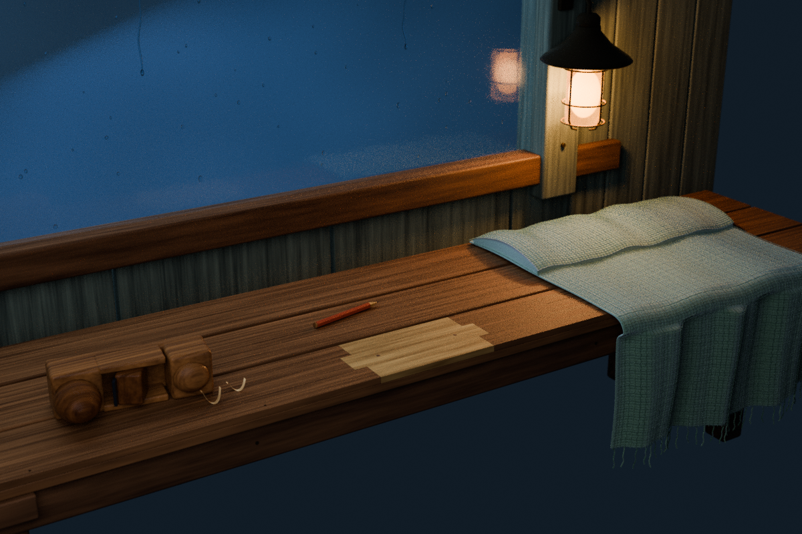

# Mended Corner · 수선이 남긴 자리

오래된 벤치의 한쪽 끝에, 고친 자리를 숨기지 않고 남겼습니다.
작은 대패와 짧아진 연필 옆으로 이웃이 보탠 담요가 접혀 있고,
온실에서 가져온 유리 너머에는 비가 내립니다. 작은 작업등은 켜 둡니다.



**위 이미지는 실제 Blender 장면의 Cycles 렌더입니다. GPT Image 콘셉트, 게임 화면, 실물 사진이 아닙니다.**

## 하나의 쉼터, 더 가까운 시점

[Glass Refuge](../glass-refuge/README.md)의 전경을 다시 만들기보다,
[가상의 동네 설정](../after-the-rain/narrative/WORLD_BIBLE.md)에 있는 작은 수선의 흔적을 독립 정물로 옮겼습니다.
동네 목수는 집에서 쓰던 벤치를 작업실에서 수리했습니다. 새로 만든 작업대나,
작업실 목재로 처음부터 만든 벤치라는 두 번째 기원을 추가하지 않습니다.
사람, 사건의 증거, 읽어야 하는 쪽지 없이 물건과 빛으로만 이야기합니다.
실제 인물이나 장소, 사용자의 개인사를 재현하지 않습니다.

소품은 네 묶음입니다: 옆으로 눕힌 나무 대패, 짧은 목수 연필, 접어 걸친 울 담요, 작은 작업등.
대팻밥은 두 가닥만 두었습니다. 좌판·창틀·유리는 이 소품들이 놓이는 배경입니다.

## 콘셉트와 실제 모델의 구분

- **GPT Image 콘셉트 원본:** [생성 이미지](reference/gpt_image_concept.png). 모델링 전에 픽셀을 직접 확인했습니다.
- **정확한 생성 프롬프트:** [concept_prompt.txt](reference/concept_prompt.txt). 요약이나 역추정 프롬프트가 아닙니다.
- **실제 3D 결과:** 위 최종 렌더, `Mended_Corner.blend`, `build.py`.

콘셉트는 따뜻한 작업등, 차가운 빗물 유리, 네 소품의 위치와 재료감을 위한 참고입니다.
참고 이미지의 두꺼운 작업대 같은 앞판은 그대로 복제하지 않았습니다.
모델은 **34 mm 두께의 세 줄 좌판과 별도 앞틀**로 벤치임을 명료하게 하고,
밝은 수리목은 앞쪽 좌판의 **14 mm 깊이 얕은 이음**으로 절제했습니다.
52 mm 카메라, 치수, 숨은 면, 수리목 경계, 담요 접힘과 등 위치는 새로 선택한 조형입니다.
정확한 이미지→메시 변환, 사진 복원, CAD 도면 또는 검증된 목공 방식이 아닙니다.

원본 생성 PNG의 바이트와 포함된 출처 메타데이터를 유지했습니다.
같은 이미지를 `.blend` 안에도 참고용으로 패킹했지만, **재질·배경·합성에 투영하거나 사용하지 않았습니다.**
모든 최종 픽셀은 새로 만든 3D 지오메트리, 절차적 재질과 조명에서 렌더됩니다.
다운로드한 메시, 텍스처, HDRI 또는 제3자 에셋은 사용하지 않았습니다.

## 편집 가능한 파일

| 파일 | 역할 |
| --- | --- |
| `Mended_Corner.blend` | 이름 있는 컬렉션, 분리된 소품, 저장된 카메라, 패킹한 참고 이미지가 있는 원본 장면 |
| `build.py` | 장면·재질·조명·렌더를 다시 만드는 결정론적 제작 소스 |
| `renders/mended_corner_final.png` | 1200 × 800, 3:2 최종 실제 렌더 |
| `renders/01_blockout.png` | 비교용으로 남긴 첫 600 × 400 저샘플 조명 시험; 최종 결과가 아님 |
| `audit.py` / `geometry_audit.json` | 저장 장면을 다시 열어 측정한 메시·접촉·경로·참고 이미지 검사 |
| `checks.json` | 제작 설정, 소품 구성, 렌더 설정과 명시적 한계 |
| `provenance.json` | 생성 콘셉트와 독립 3D 작업의 출처 및 해시 |
| `manifest.json` | 공개 산출물의 SHA-256 및 크기 |
| `verify_bundle.py` | Blender 실행 없이 공개 파일의 해시·이미지 크기·감사 기록을 확인하는 도구 |

## 다시 만들기

Blender **4.3.2**에서 확인했습니다. Python 외부 패키지는 필요하지 않습니다.
이 디렉터리에서 실행합니다. 임시 파일도 프로젝트 안의 `work/`에 둡니다.

```sh
mkdir -p work renders
TMPDIR="$PWD/work" blender -b -t 2 --python build.py -- --draft
TMPDIR="$PWD/work" blender -b -t 2 --python build.py
TMPDIR="$PWD/work" blender -b Mended_Corner.blend -t 2 --python audit.py
python3 verify_bundle.py
```

- `--draft`: 별도 `Mended_Corner_Draft.blend`와 `renders/draft.png`, 600 × 400, 최대 24샘플.
- 기본 실행: 최종 `.blend`와 최종 렌더를 교체합니다. 최대 128샘플, 적응형 샘플링, CPU 두 스레드.
- `--no-render`: 장면과 설정을 저장하되 렌더하지 않습니다. `--draft`와 함께 쓸 수 있습니다.
- 첫 시험 `01_blockout.png`는 재실행으로 교체하지 않습니다.
- 감사는 JSON만 기록하고 검사한 `.blend`는 다시 저장하지 않습니다.

렌더와 참고 이미지 경로는 상대 경로이며, 외부 `.blend` 라이브러리는 연결하지 않습니다.
최종 카메라 시점이 저장되어 있고 모델을 구성하는 메시와 곡선은 개별 편집할 수 있습니다.

## 반복 검토와 렌더 절충

처음에는 보조광이 유리에 큰 흰 원으로 보였고, 창 여백이 너무 넓었습니다.
광원 자체의 카메라·반사·투과 가시성을 끄고, 시점을 벤치 쪽으로 낮추며 작업등 위치를 조정했습니다.
얇아 보이던 담요 접힘에는 아래 천을 따라 놓이는 닫힌 울 부피를 더하고, 위 접힌 면에도 같은 실 요철을 이어 놓았습니다.
수리목 색과 결을 다듬고, 연필이 좌판에 0.9 mm 들어가던 점과 이음 베벨의 극소 면을 수정했습니다.

렌더는 AgX, CPU Cycles, 디노이저 없음, 직접 샘플 클램프 12 / 간접 2입니다.
반사·굴절 코스틱은 끄고, 창 유리·등 유리·전구의 그림자 가시성을 끕니다.
전구 위치의 점광원과 두 개의 약한 실내 보조광을 사용합니다.
이것은 작은 광원과 유리의 노이즈를 줄이는 예술적 근사이며, 물리적으로 정확한 광학 측정이 아닙니다.
빗방울과 세 줄기 빗물은 정적인 지오메트리입니다. 담요는 직접 만든 메시와 실 곡선이며 천·유체 시뮬레이션이 아닙니다.

## 검증 범위와 한계

`geometry_audit.json`은 저장한 최종 장면을 다시 열어 좌표 유한성, 면적 0인 메시 면,
모디파이어 적용 후 메시 닫힘과 방향, 대패·연필·담요의 좌판 접촉,
수리목 윗면과 받침 높이, 원본 참고 이미지의 바이트 일치, 상대 경로를 검사합니다.
곡선 장식의 모든 교차나 모든 물체 쌍의 충돌을 검사하는 것은 아닙니다.
대패 부품과 벤치 접합부에는 조립을 위한 의도적인 숨은 겹침이 있습니다.

이 작업은 디지털 정물 작품입니다. 목재 접합 강도, 지지 하중, 전기·화재 안전,
유리 안전 사양, 방수와 건축 법규는 검증하지 않았으며 제작·시공 안내로 사용할 수 없습니다.
실제 유리 쉼터 모델이나 게임 파일을 수정한 작업도 아닙니다.
저장소 다른 작업의 외부 에셋 라이선스는 그 작업의 범위에 남으며, 이 안내가 저장소 전체의 라이선스를 바꾸지 않습니다.

## 공개 사본의 메타데이터

두 Blender 렌더 PNG는 파일 경로와 렌더 시각·통계가 담긴 텍스트 메타데이터만 제거했습니다. IDAT 압축 데이터와 디코딩 픽셀은 원본과 동일하며 해상도 메타데이터는 유지했습니다. 저자·저작권 표시는 해당 텍스트 항목에 없었습니다. 제작 환경과 샘플 수는 위 설명 및 검사 기록에 보존됩니다. `provenance.json`은 원본 파일 해시와 현재 공개 사본 해시를 구분합니다. 생성 콘셉트 PNG와 내장 C2PA는 원본 그대로입니다.
