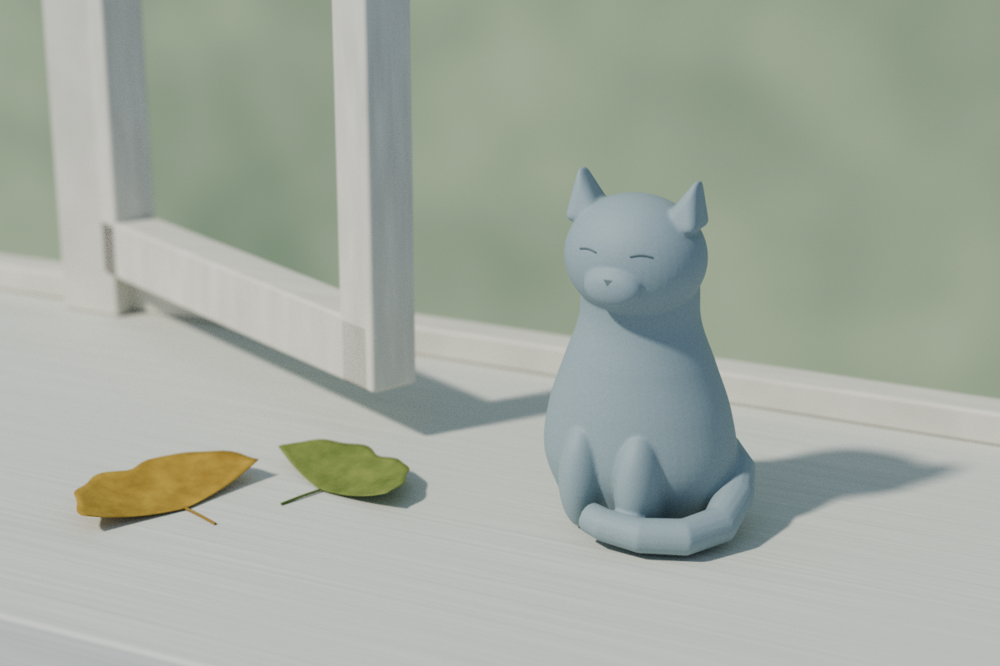

# 볕이 돌아온 창턱 · Morning on the Sill

비가 지난 아침, 작은 청회색 도자기 고양이와 부채꼴을 본뜬 낙엽 두 장에 볕이 닿는 가상의 창턱입니다. 사람을 직접 등장시키는 대신 비어 있는 여백과 손으로 빚은 듯한 형태로 조용한 편안함을 남겼습니다. 기존 게임과 무관한 독립 작품이며 실재 집이나 사람을 묘사하지 않습니다.

## 실제 Blender 렌더



**1200×800 / Cycles CPU 2 threads / 최대 128 samples**로 렌더했습니다. 약 1분 41초가 걸렸으며 별도의 raster denoise나 bloom은 적용하지 않았습니다. 고양이·낙엽·창턱은 직접 만든 기하이고, 생성 콘셉트를 배경으로 붙인 이미지가 아닙니다. 그림자와 창틀 근처에는 미세한 입자가 남습니다.

고양이의 조용한 눈과 단순한 청회색 표면을 중심에 두었습니다. 잎은 둥근 부채꼴에서 가져온 양식화된 낙엽이며, 특정 식물의 정확한 복제품으로 설명하지 않습니다.

## 파일

- `Morning_on_the_Sill.blend`: 독립 편집 가능한 native 장면.
- `renders/morning_on_the_sill_final.png`: 실제 최종 렌더.
- `renders/draft_01.png`–`draft_03.png`: 몸통-목 연결, 주인공 크기, 잎 윤곽을 다듬은 과정. 과거 설정이므로 현재 코드로 이전 draft들을 그대로 재생성하지는 않습니다.
- `geometry_validation.json`, `reopen_validation.json`, `bundle_validation.json`: 생성·native 재개봉·PNG 공개본 처리의 해당 실행 결과.
- `ARTIFACT_MANIFEST.json`: 공개 파일의 정확한 경로·크기·SHA-256·Git blob 해시 목록.

## 원본과 편집

- `reference/gpt_image_concept.png`와 `reference/concept_prompt.txt`: 생성 콘셉트 원본과 정확한 프롬프트. C2PA를 보존합니다. 실제 Blender 렌더와는 별개의 이미지입니다.
- `build.py`, `parameters.json`: 직접 만든 기하·재질·카메라·빛의 재생성 코드와 설정.
- 고양이는 연속된 몸통-목, 머리, 귀, 앞발, 꼬리로 만들고 하나의 연결된 표면으로 합쳤습니다. 숨겨진 construction collection에 편집 가능한 소스 부품도 남깁니다.
- 잎 두 장은 얇은 곡면·두께·줄기·잎맥으로 구성했습니다. 정확한 식물학적 복원이 아닙니다.
- 창틀 일부와 절차적인 sage 배경만 있으며 전체 실내·외부 풍경을 만든 것은 아닙니다.

## 재현과 검사

Blender 4.3.2와 Python/Pillow를 사용합니다. 작업 사본의 이 폴더 안에서 실행하세요. 생성 명령은 이 프로젝트의 native·렌더·검사 JSON을 덮어씁니다. `--draft`도 native를 draft 설정으로 저장하므로 최종 검사 전에는 최종 생성 명령을 실행해야 합니다.

```sh
blender --background --factory-startup --threads 2 --python-exit-code 1 --python build.py -- --draft
blender --background --factory-startup --threads 2 --python-exit-code 1 --python build.py
blender --background --factory-startup --threads 2 --python-exit-code 1 --python inspect_scene.py
python3 verify_bundle.py
```

`inspect_scene.py`는 native를 변경하지 않고 재개봉 결과 JSON을 기록합니다. `verify_bundle.py`는 Pillow가 필요하며 원본 PNG를 별도로 보존하고 공개본의 개인 경로 텍스트를 제거한 뒤 IDAT·디코딩 픽셀 일치를 확인합니다. 전체 검사는 읽기 전용이 아닙니다. 원시 로그·캐시·백업·비공개 원본은 공개하지 않습니다.

## 검증 결과와 한계

별도 background Blender에서 native를 다시 열어 입력 파일 무변경과 코드·매개변수 해시, 최종 해상도·128 samples·CPU 2 threads를 확인했습니다. 고양이는 닫힌 manifold·양의 체적을 가진 연결체 1개이며 바닥 gap은 수치상 0입니다. 편집용 소스 부품 8개도 숨겨진 collection에 남아 있습니다.

평가한 메시·curve 46개에서 유한 좌표를 확인했습니다. 두 낙엽 곡면의 두께는 0.25 mm이며 닫힌 manifold·양의 체적을 확인했습니다. 줄기의 바닥 gap은 약 0.030 mm로, 검사 허용 오차 0.1 mm 안에 있습니다. 잎의 휘어진 면 전체가 바닥에 붙어 있다는 뜻은 아닙니다. 주인공과 두 잎의 프레임 포함, 외부 이미지·linked library 의존성 없음, 재질 emission·compositor 없음도 확인했습니다.

공개 PNG는 개인 경로가 든 텍스트 청크만 제거했고 IDAT·디코딩 픽셀은 처리 전과 동일합니다. 콘셉트 PNG와 C2PA는 그대로입니다. 최종 8-bit PNG에서 255에 도달한 RGB 채널은 0%입니다. 이는 모든 광학적 clipping이 없다는 주장은 아닙니다. 검사는 background 재개봉에 한정되며 native GUI 조작 검사는 하지 않았습니다. 설치 Blender에 OpenImageDenoise가 없어 denoising을 하지 않았습니다.

실제 도자기 제작·재료 안전·건축·구조·전기·발열 검증이나 제품 인증이 아닙니다. 외부 모델·텍스처·사진은 사용하지 않았습니다. 자세한 출처와 해석 범위는 `provenance.json`에 있습니다.
