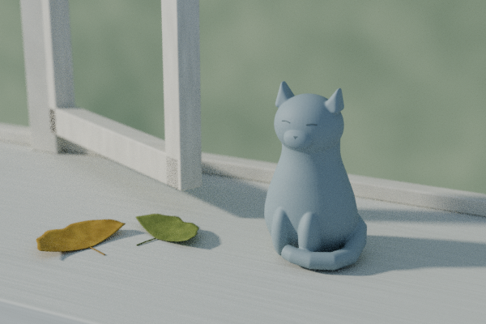
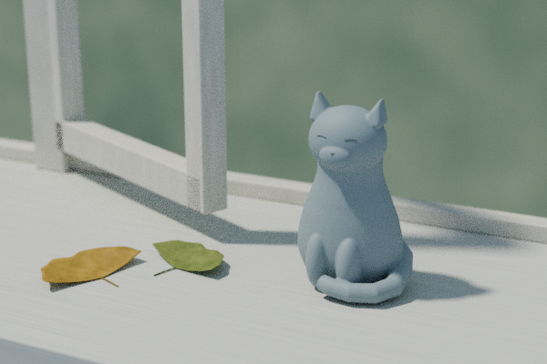
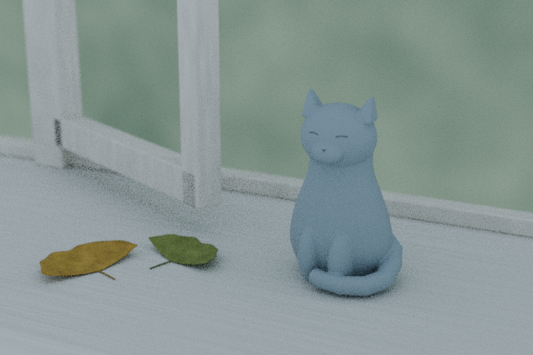

# 같은 고양이, 세 가지 아침빛

상위 작품 ‘볕이 돌아온 창턱’의 고양이·낙엽·창틀·카메라·재질을 고정하고 조명만 바꾼 작은 비교입니다. 승인된 최종 작품은 그대로입니다. 이 장면에서 관찰한 차이이며 보편적인 조명 규칙이나 실제 장소의 날씨·시각을 주장하지 않습니다.

## 세 장의 실제 Blender 렌더

**낮은 측광, 약 24.9°**



볼에서 가슴으로 이어지는 밝기 변화가 자연스럽지만, 긴 그림자가 오른쪽 화면 밖까지 이어집니다.

**높은 측광, 약 59.1°**



같은 방위·광량·광색에서 고도만 높였습니다. 그림자가 짧아지고, 턱 아래 경계는 더 강조됩니다.

**부드러운 하늘빛 비교**



직사광을 끄고 균일한 차가운 하늘빛을 사용했습니다. 그림자는 약해지지만 몸통 부피와 배경 분리도 덜 또렷합니다. 이 안은 하늘빛 세기와 색도 바꿨으므로 동일 조도 비교가 아닙니다.

## 이 장면에서 배운 점

조용함을 만들기 위해 그림자를 모두 없앨 필요는 없었습니다. 방향 있는 측광과 부드러운 하늘빛을 함께 두면 청회색을 유지하면서 둥근 형태가 읽힙니다. 낮은 빛을 쓸 때는 물체뿐 아니라 길어진 그림자까지 구도에 고려해야 했습니다. 이번에는 기존 최종 작품의 중간 정도 고도가 좋은 절충이었습니다.

세 장은 600×400 / 최대 24 samples / CPU 2 threads로 직렬 렌더했고 약 11.36초·11.75초·8.08초가 걸렸습니다. 입자가 남는 draft이며 denoising이나 색 보정은 하지 않았습니다.

## 재현

이 폴더만 따로 복사하지 말고 상위의 `Morning_on_the_Sill.blend`와 함께 보관하세요. native를 중복 포함하지 않고 `../Morning_on_the_Sill.blend`를 읽습니다. Blender 4.3.2가 필요하며 PNG 검사에는 Python/Pillow가 필요합니다.

이 폴더의 작업 사본에서 실행합니다.

```sh
# 렌더 없이 원본·기하·재질·카메라 불변 검사. reproduced/에 검사 JSON 기록
blender --background --factory-startup --threads 2 --python-exit-code 1 --python study.py -- --check-only
# 새 reproduced/에 세 장과 실행 보고서 기록
blender --background --factory-startup --threads 2 --python-exit-code 1 --python study.py
# 공개된 세 PNG와 검사 기록을 읽기 전용으로 확인
python3 verify_pngs.py
```

`--output 다른_빈_폴더`로 재현 출력 위치를 바꿀 수 있습니다. 기존 렌더 PNG는 덮어쓰지 않고 중단합니다. 원본 native는 저장하지 않습니다. 재개봉 검사도 JSON은 기록하므로 전체 흐름이 읽기 전용인 것은 아닙니다. 다른 Blender 버전·하드웨어에서 재현 파일의 바이트까지 같다고 보장하지는 않습니다.

`parameters.json`은 의도적으로 바꾼 수치와 고정 설정, `study_report.json`은 최초 실제 렌더와 관찰, `reproduction_check.json`은 렌더 없이 재현 스크립트를 확인한 결과입니다. 원본 파일 SHA-256은 `e3aa59075ec731e7b7e78dcbd02d6801053c22b7f98615d298f0e7004790d273`입니다. 정의된 검사 범위인 평가 메시/curve 좌표·면·transform, 재질 입력값·연결, 카메라 값의 해시도 세 안에서 동일했습니다.

## 공개 PNG와 한계

개인 경로가 든 텍스트 청크만 제거했고 IDAT와 디코딩 픽셀은 원본과 같습니다. `png_validation.json`에 입력·공개본 해시와 픽셀 검사를 기록했습니다. `verify_pngs.py --sanitize`는 최초 처리 시 원본 보관·공개본·검사 JSON을 쓰는 명령이며 기본 검사는 읽기 전용입니다. 이미 검사 기록이 있으면 이를 확인하고 덮어쓰지 않습니다.

원시 로그·로컬 메타데이터 원본·전달 기록은 제외했습니다. 일반 보안 인증이나 기상·식물·도자기 제조 검증이 아닙니다. 공개 파일은 `STUDY_MANIFEST.json`의 정확한 목록을 따릅니다.

검사기는 이 묶음의 고정된 세 PNG를 위한 것입니다. 현재 파일의 tEXt 경로 정리는 확인했으나, 압축 iTXt 텍스트는 파서가 오류로 중단하는 알려진 한계가 있습니다. 임의 PNG 메타데이터 형식을 모두 검증하는 도구로 사용하지 마세요.
