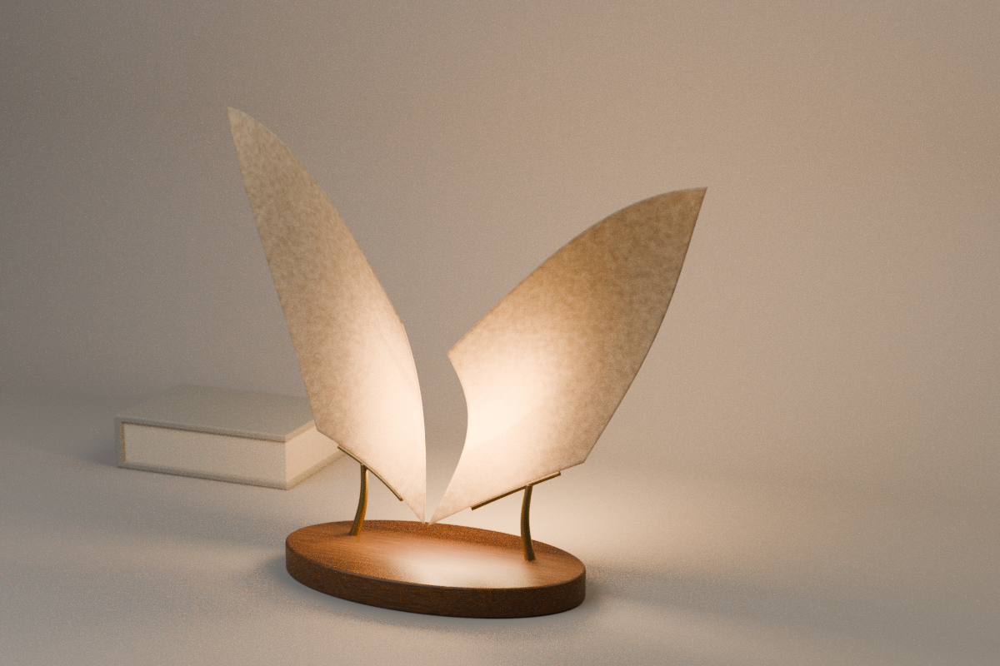

# 머무는 페이지 · A Page at Rest

두 장의 얇은 곡면이 넓게 벌어지고, 그 뒤의 따뜻한 빛이 책상에 머무는 작은 가상 조형물입니다. 낮은 호두나무 타원 받침과 황동 cradle 두 개, 뒤편의 작은 린넨 책 한 권만 놓았습니다.

이미지 콘셉트의 날개 같은 인상을 독립적인 수학 곡면으로 해석했습니다. 이미지의 정확한 치수·형상 복원이나 실물 제품 설계가 아닙니다.



## 제작 경로

### 포함된 파일

- `renders/a_page_at_rest_final.png`: 승인된 1200×800 최종 CPU 렌더.
- `A_Page_at_Rest.blend`: 외부 텍스처·linked library 없이 열리는 전체 편집 장면.
- `cad/A_Page_at_Rest.FCStd`, `.step`, `parts_mesh.json`: 받침·황동의 native 원본, 교환본, 정확한 메시 전달 데이터.
- `reference/`: 생성 콘셉트 PNG 원본과 정확한 프롬프트. C2PA를 그대로 보존합니다.
- `*_validation.json`, `cad/*_validation.json`: 실제 실행한 재개봉·기하·이미지·메타데이터 확인 결과.
- `ARTIFACT_MANIFEST.json`: 이 최종 공개 패키지의 정확한 파일 목록·크기·SHA-256. 앞선 source-only 스냅샷을 대체하며 초기 소스 이력은 Git에 남습니다.

초기 draft·128-sample 중간본과 caustics-off 비교도 과정 기록으로 보존했습니다. 이들은 최종 재료·기하 상태를 검증하는 결과가 아니라 시각적 비교본입니다. 빌드에 콘셉트 이미지를 텍스처로 읽어들이지 않으므로 이미지 없이도 기하 생성은 실행할 수 있습니다. 반드시 FreeCAD → Blender 순서로 실행하세요.

1. `reference/concept_prompt.txt`의 정확한 프롬프트로 만든 이미지 콘셉트를 눈으로 확인했습니다.
2. `parameters.json`과 `geometry.py`가 mm 단위의 공통 기하 정의입니다.
3. `build_freecad.py`는 **FreeCAD 1.0.0**의 네이티브 Ellipse → Extrusion → Fillet, Circle → Loft → MultiFuse를 사용합니다. **49개 네이티브 parametric 객체**로 만든 FCStd이며 외부 Python proxy를 복원할 필요가 없습니다.
4. 받침과 두 지지부의 실제 FreeCAD shape를 메시 JSON으로 내보냅니다. **Blender 4.3.2**가 해당 정점과 삼각형을 그대로 읽고 mm → m 변환을 **한 번** 적용합니다. Blender에서 받침·지지부를 다시 모델링하지 않습니다.
5. Blender에서 공통 곡면 정의로 두께 있는 종이, 절차적 재질, 카메라, 면광원을 추가합니다. 종이에는 emission이 없고 compositor bloom이나 칠해 넣은 빛무리를 사용하지 않습니다.

**FCStd/STEP은 받침과 황동 지지부 2개만** 담습니다. 종이 곡면·책·렌더 조명·카메라를 포함한 전체 장면은 `A_Page_at_Rest.blend`입니다.

## 재현

프로젝트 폴더에서 실행합니다. 이 환경의 FreeCAD 모듈 ABI는 Python 3.13입니다.

```sh
PYTHONDONTWRITEBYTECODE=1 OPENBLAS_NUM_THREADS=2 OMP_NUM_THREADS=2 \
PYTHONPATH=/usr/lib/freecad-python3/lib /usr/bin/python3 -B build_freecad.py
blender --background --factory-startup --threads 2 --python-exit-code 1 --python build_blender.py -- --draft
# 최종: --draft 없이 실행 (1200 × 800, 최대 512 samples)
blender --background --factory-startup --threads 2 --python-exit-code 1 --python build_blender.py
```

다른 설치 위치·FreeCAD Python ABI에서는 실행 명령의 경로를 조정해야 합니다. 렌더는 CPU 2 threads로 직렬 수행합니다.

두 앱은 실시간 연결이 아닙니다. 공통 매개변수를 바꿨다면 FreeCAD 내보내기와 Blender 가져오기를 순서대로 다시 실행하세요. FCStd의 native 치수·단면은 편집 가능하지만 그 변경이 이미 저장된 Blender 메시를 자동 갱신하지는 않습니다. 설치된 Blender 빌드에는 OpenImageDenoise가 없어 denoising을 사용하지 않습니다.

128-sample 중간본에서 남은 노이즈 때문에 최종은 최소 128 / 최대 512 adaptive samples, threshold 0.005로 높였습니다. Caustics를 끈 별도 draft 비교는 효과가 작아 최종에서는 채택하지 않았습니다. 조명·카메라·재질을 밝게 바꾸거나 후처리 glow를 추가한 것은 아닙니다.

산출물을 만든 다음에 별도 background Blender로 `inspect_blend.py`를 실행하면 저장 파일 재개봉·외부 의존성·렌더 설정을 검사하고 JSON 결과를 씁니다. `verify_bundle.py`는 **Pillow**가 필요하며 읽기 전용이 아닙니다. 현재 PNG의 원본을 content-addressed 이름으로 `private_originals/`에 보존하고, 공개 PNG에서 개인 경로가 담긴 텍스트 청크만 제거한 뒤 검증 JSON을 씁니다. 압축 IDAT, 디코딩 픽셀, C2PA caBX는 변경하지 않는지 확인합니다. `private_originals/`와 로그·백업 파일은 공개 대상이 아닙니다.

`inspect_freecad.py`는 FCStd를 재개봉하고 받침 반지름·황동 단면 반지름을 메모리에서 각각 바꿔 재계산한 뒤 원래 값으로 돌려 parametric 연결을 검사합니다. CAD 입력 파일을 저장하지 않으며 검사 JSON만 씁니다. 이 검사도 렌더와 겹치지 않게 직렬로 실행합니다.

## 기하 확인 범위

- FreeCAD 최종 부품 3개는 각각 유효한 단일 solid입니다.
- FCStd 재개봉 및 STEP 재독해 후 유효성을 확인합니다.
- 두 황동 부품끼리는 겹치지 않습니다.
- 황동 발은 나무 받침에 0.5mm, 종이 밑단은 cradle에 약 0.12mm 의도적으로 들어갑니다. 이는 가상 장면의 시각적 접촉을 분명히 하기 위한 얕은 자리이며 접합·제조 공차 검증이 아닙니다.
- Blender는 전송 정점 오차, 유한 좌표, 닫힌 종이 메시, 종이와 지지부 접촉이 밑단에만 있는지, 기타 부품 간 간섭을 확인합니다.
- 자세한 수치는 `cad/geometry_validation.json`, `blender_validation.json`에 기록합니다.

**전기·발열·구조·실물 제작·제조 공차·안전 인증을 검증한 설계가 아닙니다.** 면광원은 화면의 빛을 만드는 렌더 요소이며 실제 광원·회로·열 관리 구조를 모델링하지 않았습니다.

## 출처와 보존

모든 모델·스크립트·절차적 재질은 이 작품을 위해 독립 제작했습니다. 생성 이미지와 정확한 프롬프트는 `reference/`에 보존합니다. 원본 이미지의 C2PA `caBX` 청크는 제거하지 않습니다. 외부 텍스처, 상업 제품 CAD, 타인 모델을 사용하지 않았습니다. 상세 이력은 `provenance.json`을 참조하세요.

## 최종 확인 결과와 남은 한계

- FreeCAD 문서 재개봉·재계산 후 native 받침 반지름과 황동 단면 반지름을 각각 변경하고 되돌리는 검사를 통과했습니다. 입력 FCStd는 변경하지 않았습니다.
- STEP 재독해는 유효 solid 3개를 보존하며, 총부피 왕복 오차는 약 **0.000198mm³**입니다.
- Blender 재개봉은 외부 이미지·linked library **0개**, 상대 render 경로, CPU 2 threads, non-emissive paper, compositor 비활성을 확인했습니다.
- 전체 조형물은 카메라 프레임 안에 들어오고 상단 여백은 약 **15.96%**입니다. 베이스와 책상 사이의 기하 틈은 부동소수점 오차 범위의 0입니다.
- 최종 PNG의 3채널 동시 255 픽셀은 **0%**, 어느 한 채널이 255인 픽셀은 약 **0.519%**입니다. 이는 이미지 수치 검사이며 실제 광학·안전 측정이 아닙니다.
- 배경의 고주파 잔차 진단값은 128-sample 중간본의 **7.02 → 최종 3.71**로 줄었습니다. 벽과 베이스에는 미세한 CPU path-tracing 입자가 남으며, 이를 숨기는 denoising·bloom·픽셀 편집을 하지 않았습니다.
- 공개 PNG는 개인 경로 텍스트 청크를 제거했지만 압축 **IDAT와 디코딩 픽셀은 원본과 동일**합니다. 생성 콘셉트의 C2PA도 변하지 않았습니다.

문서 재개봉·계산 검사는 별도의 background native 앱 프로세스에서 수행했습니다. 수동 GUI 편집·실물 제작 테스트는 수행하지 않았습니다.
