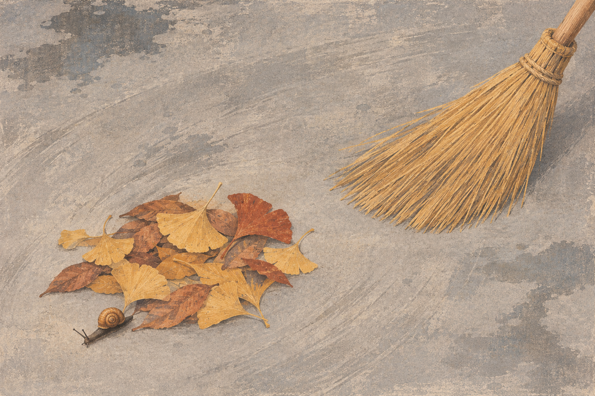

# 쓸지 않은 자리

넓게 쓸어 둔 마당에 낙엽 한 무더기가 남았다. 달팽이는 그 가장자리에서 나와 왼쪽 아래로 간다. 빗자루와 잎 사이에는 아직 쓸지 않은 거리가 있다.



[감상용 원본 PNG](output/A-Place-Left-Unswept.png) · [정확한 생성 지시문](prompt.txt)

## 작품과 제작

**독립된 완성 일러스트로 선정했다.** 기존 게임이나 다른 작품의 설정을 이어 쓴 장면은 아니다. 사람의 표정이나 설명문 대신, 치워진 넓은 면과 남아 있는 작은 덩어리의 대비로 선택의 흔적을 보여 주려 했다.

2026년 11월 11일 내장 이미지 생성 도구로 새로 생성했다. 외부 참고 이미지·사진·캐릭터를 입력하지 않았다. 다색 석판화와 마른 과슈를 제안했으며 결과는 그 질감을 흉내 낸 **1536×1024 RGB 생성 PNG**다. 실제 판화·회화·촬영물은 아니다. 원본을 크롭·보정·재인코딩하지 않고 보존했다.

## 화면을 보고 판단한 점

- 낙엽 무더기와 빗자루를 왼쪽 아래와 오른쪽 위에 나눴다. 두 갈색 덩어리 사이의 회색 틈이 화면을 가로지르는 대각선을 만든다.
- 달팽이의 껍데기·몸·두 긴 촉각이 잎 바깥에서 구별된다. 잎의 겹침에서 깨끗한 바닥으로 이어지는 방향도 보인다.
- 넓은 쓸림 자국과 젖은 얼룩은 빈 공간을 완전히 비우지 않으면서 작업의 흔적을 만든다. 여백 속의 작은 생물을 나중에 발견하게 한 점을 채택했다.
- 지시문보다 빗자루의 면적과 세부가 강하다. 첫 시선이 빗자루에 머물 수 있고, 바닥의 고른 입자도 석판화의 단순한 큰 면보다는 오래된 자연 삽화에 가깝다. 이 균형을 최종 결과의 성격으로 받아들였다. 반사나 물방울보다 종이 질감이 강해 젖은 바닥이라는 인상도 상대적으로 약하다.
- ‘달팽이를 위해 멈췄다’는 해석은 확정되지 않는다. 사람이 없고 한 장의 정지 이미지이므로, 방금 쓸던 중 잠깐 둔 빗자루로도 읽힌다. 이 모호함을 지우는 표지나 글자는 추가하지 않았다.

달팽이 종·해부학과 잎의 식물학적 정확성, 실제 인쇄, 외부 관객의 해석은 검증하지 않았다.

## 파일 보존과 검사

```sh
python3 verify.py
```

Python 3와 Pillow가 필요하다. PNG 전체 디코드·1536×1024·RGB, PNG 청크 CRC와 프로젝트 파일의 크기·SHA-256을 읽기 전용으로 검사한다. 검증기는 결과물을 다시 만들거나 덮어쓰지 않는다.

생성 원본에는 출처 정보를 위한 C2PA 청크가 포함돼 있다. 원본 출처는 이번 생성 결과로 확인했고 관련 메타데이터는 그대로 보존했다. C2PA 서명의 암호학적 유효성을 검증한 것은 아니다. 파일 해시와 메타데이터 패턴 검사 또한 작품의 의미·안전성·저작권을 증명하지 않는다.

이 폴더는 원본 PNG, 생성 지시문, 제작·검토 안내, 검사 코드, 기술 검사 기록과 매니페스트를 포함한다. 별도 편집 레이어·물리 장면·결정적 재생성 코드는 없다. 같은 지시문을 다시 넣어 동일한 픽셀을 얻는다고 보장하지 않는다.
