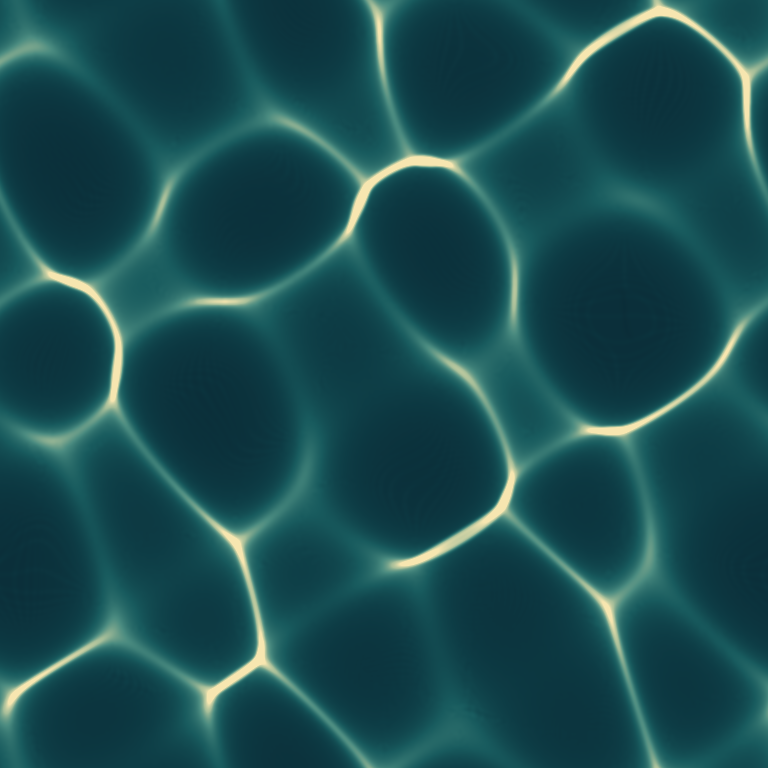

# 가만한 바닥 · A Still Floor

바닥은 움직이지 않고, 물결을 지난 빛만 모였다가 흩어집니다. 여섯 방향의 주기적 수면을 통과한 광선을 계산해 청록색 바탕과 옅은 금색 선으로 옮겼습니다.



**절차적 빛 연구로 보존합니다.** 첫 시험의 대각선 반복을 줄이고, 크기가 다른 빈 공간과 밝은 선의 연결이 함께 변하는 구성을 선택했습니다. 정지 그림과 영상의 1초 간격 표본은 직접 확인했지만, 정상 속도로 영상을 끝까지 재생해 보지는 못했습니다. 따라서 움직임까지 검토를 마친 완성 작품으로 소개하지 않습니다.

- [정지 그림](output/A-Still-Floor.png): 768×768 RGB
- [10초 무성 영상](output/A-Still-Floor.mp4): 512×512, 24fps, 240프레임
- [파형·광학·출력 매개변수](model.json)
- [정지 그림의 상대 광선밀도](output/irradiance.npz) · [정지 계산 요약](output/still_data.json)

## 어떻게 만든 무늬인가

6×6 장면 영역에 여섯 코사인파를 합쳤습니다. 파마다 방향·진폭·위상·시간 주기가 다릅니다. 수면 높이와 기울기를 계산한 뒤 공기에서 물로 수직 입사하는 평행광의 굴절 방향을 스넬 관계로 구했습니다. 공기 굴절률은 1, 물은 1.333, 평균 수면에서 바닥까지 거리는 2.2 장면 단위입니다.

굴절한 광선과 고정 바닥의 교차점을 구하고, 경계를 넘은 좌표는 반대쪽으로 감쌉니다. 정지 그림은 1536²개 광선, 영상은 매 프레임 768²개 광선을 씁니다. 각 광선의 가중치는 같고 바닥 픽셀에 모인 개수를 셉니다. 이 분포에 σ=2픽셀의 주기적 가우스 흐림을 적용하고 평균이 1이 되도록 정규화했습니다.

청록에서 옅은 금색으로 가는 색은 작화용 팔레트입니다. 상대값 8 이상은 같은 가장 밝은 색으로 표시합니다. 실제 물의 색·빛의 스펙트럼·노출·실측 조도를 재현한 그림이 아닙니다. 보존한 `irradiance.npz`는 정지 그림의 색 적용 전 상대 밀도를 float32로 담으며, 물리량의 절대 단위를 갖지 않습니다.

수면은 유체 방정식의 해가 아니라 직접 지정한 함수입니다. 물결 사이 상호작용, 반사 손실, 흡수·산란, 프레넬 투과율, 수면 반사나 실물 물통 경계는 계산하지 않았습니다. 광선 수를 보존하는 검사와 실제 투과 에너지를 검증하는 일은 다릅니다.

## 구성 선택과 확인

네 파형과 얕은 바닥의 초기 시험은 비슷한 밝은 고리가 대각선으로 반복됐습니다. 여섯 방향의 파형과 더 깊은 바닥으로 바꿔 각 구역의 크기와 연결이 달라지도록 했습니다. 초기 고해상도 배열과 계산·인코딩 동시 실행에서는 종료 코드 137이 발생했습니다. 원인을 확정하지는 않았으며, 메모리 사용량을 줄이기 위해 이후 16행씩 나누어 계산하고, 영상 프레임 계산과 인코딩을 별도 프로세스로 순서대로 실행해 출력을 완료했습니다.

[독립 광학 검사](OPTICS_CHECK.md)에서는 별도 각도식·유한차분·작은 격자 집계를 사용했습니다. 스넬 관계, 방향 벡터 길이, 하향 진행, 바닥 교차, 평탄 수면, 주기성, 경계 감싸기와 광선 수 보존의 열 가지 검사를 통과했습니다. 수치는 [optics_qa.json](optics_qa.json)에 있습니다.

영상은 전 프레임을 디코드하고 다섯 시점의 압축 프레임을 제작 소스의 RGB와 대조했습니다. 0~255 채널값의 평균 절대 오차는 약 1.55~1.74였습니다. 오디오 트랙이 없으며 프레임 수·크기·길이를 확인했습니다. 0초와 10초의 영상용 소스 밀도 배열은 완전히 같았습니다. 모든 시간 주기가 10초의 정수 약수이므로 수면 함수도 돌아옵니다. 이는 **수학적 주기 확인**이며, 압축 영상의 이음새가 느껴지지 않는다는 육안 재생 판정은 아닙니다.

[검사 요약](qa.json)에 압축 프레임 차이와 검토 범위를 기록했습니다. 정지 그림은 영상과 해상도·광선 표본 수가 달라 첫 영상 프레임을 그대로 확대해 저장한 파일이 아닙니다.

## 재현

Python 3, NumPy, SciPy, Pillow와 libx264가 포함된 FFmpeg가 필요합니다. 외부 이미지·글꼴·모델은 사용하지 않았습니다.

기존 결과를 덮어쓰지 않으려면 별도 사본에서 실행하거나 출력 경로를 지정합니다.

```sh
OPENBLAS_NUM_THREADS=1 python3 build.py --output-root /tmp/still-floor-check
OPENBLAS_NUM_THREADS=1 python3 build_video.py --output-root /tmp/still-floor-check
```

영상 프레임은 임시 폴더에서 만들고 인코딩이 끝나면 지웁니다. `build_video.py`가 `render_frames.py`를 실행합니다. 정지 제작과 영상 제작을 동시에 실행할 필요가 없습니다.

읽기 전용 검사:

```sh
OPENBLAS_NUM_THREADS=1 python3 verify_optics.py
OPENBLAS_NUM_THREADS=1 python3 verify.py
```

`verify.py`는 임시 폴더에 영상을 풀어 검사한 뒤 지웁니다. 보존 파일은 변경하지 않습니다. 명시적인 `--preview-dir 경로`는 해당 경로에 검토용 표본 모음을 만듭니다.

제작 소스와 매개변수만 옮긴 별도 사본에서 정지 PNG·밀도 NPZ·계산 JSON이 바이트까지 동일하게 재생성됐습니다. 영상 전체를 다시 인코딩한 바이트 비교는 하지 않았습니다. 라이브러리나 인코더 버전이 달라지면 출력이 달라질 수 있습니다. `manifest.json`은 자신을 제외한 정식 보존 파일의 크기·SHA-256을 기록하며 임시 프레임·캐시는 제외합니다.
