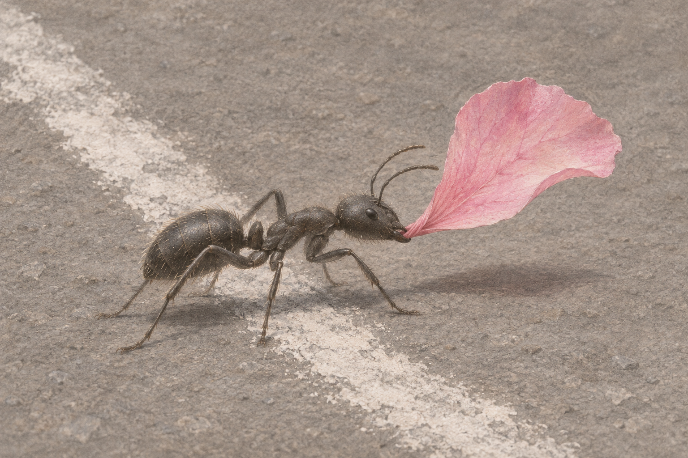

# 분필선 너머

작은 개미 한 마리가 꽃잎의 좁은 끝을 물고, 사람이 그어 놓은 흰 선을 건넌다. 분홍색은 등에 얹힌 지붕이 아니라 입 앞에서 펼쳐지는 가벼운 돛이 되었다.



[감상용 원본 PNG](output/Across-the-Chalk-One-Grip.png) · [새 생성 지시문](grip_prompt.txt)

## 선정한 대안 · 하나의 접점

**이 한 마리 구도를 완성 일러스트로 선정했다.** 네 마리가 꽃잎을 함께 드는 이전 연구에서 접점이 불명확했던 문제를, 운반자 수를 줄이고 턱과 꽃잎의 접촉을 크게 보여 주는 방식으로 다시 풀었다. 공동 운반의 이야기는 내려놓고 한 몸이 경계를 건너는 순간에 집중했다.

회갈색 연필·과슈와 분홍 수채화풍의 이미지 생성 결과다. 1536×1024 RGB PNG 원본을 보정·크롭·업스케일 없이 보존했다. 실물 회화·사진·곤충 관찰 자료가 아니다. 외부 이미지나 이전 연구 PNG를 입력하지 않고 새 지시문으로 생성했다.

### 실제 화면에서 확인한 것

- 좁아진 분홍 주름이 입 앞의 검은 턱 안으로 들어간다. 아래쪽 갈고리 모양 턱이 꽃잎 끝을 받치며, 이전처럼 머리 위에 걸쳐진 지붕으로 읽히지 않는다.
- 흰 분필선은 개미 진행 방향을 비스듬히 가로지른다. 머리와 앞쪽 발은 선 너머, 뒤쪽 발은 선 이쪽에 있어 횡단이 읽힌다.
- 여러 발끝의 접지와 부드러운 그림자가 몸과 꽃잎의 높이를 설명한다. 꽃잎만 분홍색으로 남겨 시선이 입의 작은 접점에서 넓은 색면으로 이어진다.

전체 이미지와 이전 연구를 비교해 검토했다. 남은 한계는 위쪽 턱 경계가 얼굴의 어두운 면과 합쳐지는 점, 가슴 아래 겹친 다리의 복잡한 윤곽, 약간 뻣뻣하게 서 있는 꽃잎이다. 삽화의 선택을 막을 정도로 보지는 않았지만 곤충 해부학·종별 운반 행동·실제 하중을 검증했다고 주장하지 않는다. 실물 인쇄·외부 관객 반응도 확인하지 않았다.

## 보존한 이전 연구

두 연구는 여전히 **비채택 연구**이며 바이트를 바꾸지 않았다.

- [초안 · Along-the-Line.png](study/Along-the-Line.png): 네 개미와 분필선이 나란해서 ‘가로지르기’보다 ‘따라 걷기’로 읽혔다.
- [수정 연구 · Across-the-Chalk.png](study/Across-the-Chalk.png): 선을 반대 대각선으로 바꾸어 횡단은 개선했지만, 가운데 두 개미의 턱과 꽃잎 접점이 명확하지 않았다.

[최초 지시문](prompt.txt)과 [이전 수정 지시문](edit_prompt.txt)도 그대로 보존한다. 두 연구는 각각 1536×1024 RGB다. 첫 수정 시도는 화면에 표시됐지만 작업 환경 중단 뒤 파일을 찾지 못했다. 현재 보존된 수정 연구는 같은 초안과 수정 지시문으로 다시 생성한 결과이며 잃어버린 파일의 복원이 아니다. 이번 한 마리 대안은 그 두 연구와 구분되는 새 생성이다.

## 파일 검사와 재현 한계

```sh
python3 verify.py
```

Python 3와 Pillow가 필요하다. 읽기 전용 검사는 PNG 세 장의 전체 디코드·크기·RGB 모드와 매니페스트의 파일 크기·SHA-256을 확인한다. 이는 파일 무결성 검사이며 그림의 의미·과학적 정확성을 증명하지 않는다.

보존 자료는 PNG 세 장, 생성·수정 지시문 세 개, 이 안내, `qa.json`, `verify.py`, `manifest.json`이다. 지시문은 동일 픽셀을 재생성하는 코드가 아니며 편집 레이어는 없다. 과거 파일과 문서 변경은 Git 이력에서도 확인할 수 있다.
