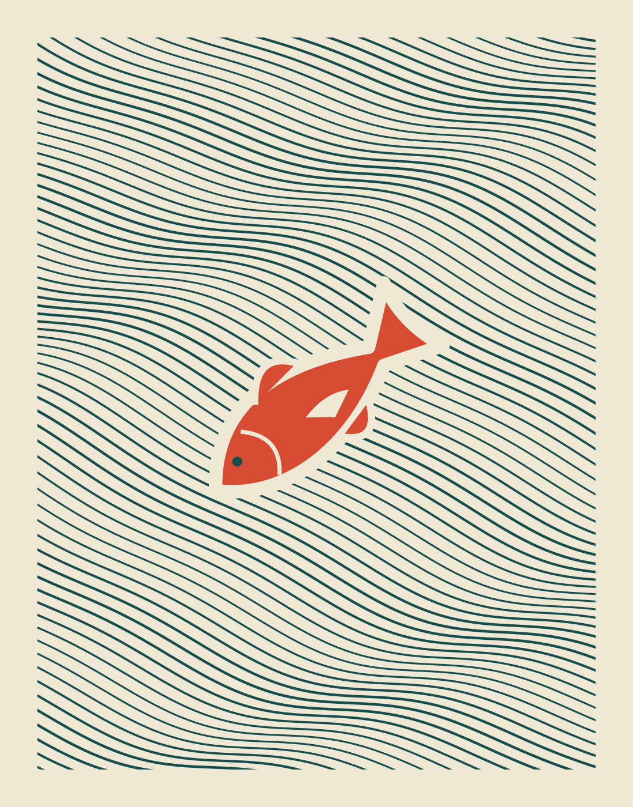

# 물살을 가로질러 · Across the Current

밝은 바탕을 가득 채운 청록색 선 사이로 주홍색 물고기 한 마리가 비스듬히 건너갑니다. 선은 오른쪽 아래로 이어지고 물고기는 왼쪽 아래를 향합니다. 흐름의 방향과 몸의 방향을 어긋나게 놓은 **독립 벡터 그래픽 소품**입니다.



- [감상용 PNG](output/Across-the-Current.png), 1100×1400
- [편집 가능한 SVG](output/Across-the-Current.svg)
- [제작 소스](build.py) · [검사 기록](qa.json)

## 구성과 선택

두 종류의 사인 곡선과 기울어진 직선을 합쳐 107개의 물결을 만들고, 선 굵기도 천천히 바꾸었습니다. 물고기는 베지에 곡선·다각형·원으로 직접 구성했습니다. 외부 이미지·글꼴·모델이나 이미지 생성 도구는 사용하지 않았습니다.

초기에는 크기와 각도가 다른 물고기 네 마리를 흩어 놓았으나 반복 무늬처럼 보였습니다. 하나를 크게 남기고 몸을 선의 방향과 교차시켜, 무늬보다 하나의 움직임이 먼저 읽히도록 고쳤습니다. 두 번째 각도에서는 물결과 몸이 비슷한 방향이 되어 다시 조정했습니다. 최종 화면의 한 마리와 주변 선의 간격을 직접 확인했습니다.

판화의 제한된 색면에서 출발한 디지털 그림입니다. 실제 판을 새기거나 인쇄하지 않았으며, 특정 어종이나 유체 역학을 묘사한 자료가 아닙니다. 물고기 가장자리의 밝은 띠는 그림을 읽기 위한 여백이며 물결의 물리적 굴절이나 항적을 뜻하지 않습니다. 기존 게임·소설의 설정과 연결하지 않습니다.

## 재현과 확인

Python 3, Inkscape, 검사에는 Pillow가 필요합니다. 생성 명령은 출력을 덮어쓰므로 별도 사본에서 실행합니다.

```sh
python3 build.py
python3 verify.py
```

제작 소스만 옮긴 별도 사본에서 SVG와 PNG가 바이트까지 동일하게 재생성되었습니다. PNG 전체 디코드·크기, SVG의 물고기 그룹과 경로 수, 외부 이미지가 없는 구조, 보존 파일의 SHA-256을 검사했습니다. 해시 검사는 미적 평가나 실물 인쇄 품질 검사가 아닙니다. `manifest.json`은 자신을 제외한 정식 파일을 기록하며, 임시 비교 출력은 보존하지 않습니다.
