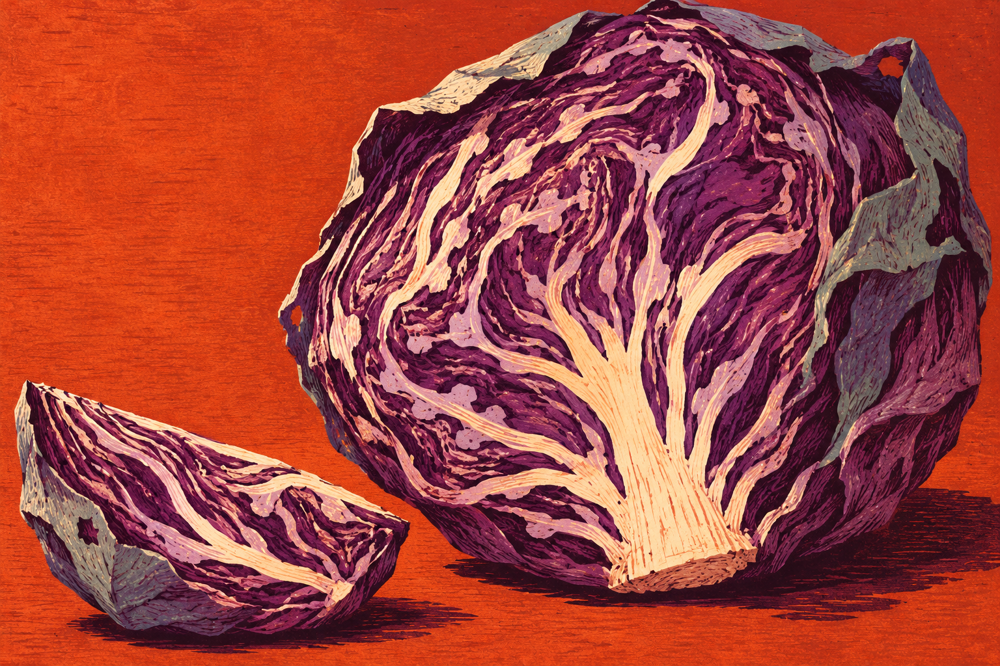

# 자른 뒤의 무늬 · After the Cut

큰 붉은 양배추 반쪽과 작은 쐐기를 주황색 바탕에 놓았습니다. 밑동에서 뻗는 밝은 잎맥과 보랏빛 잎의 겹침이 화면을 채우고, 왼쪽 위에는 넓은 빈 곳을 남겼습니다.



**독립 정물 이미지로 채택했습니다.** 규칙적인 반복 대신 두 덩어리의 크기 차이와 자연물의 불규칙한 내부 무늬를 중심에 두었습니다. 큰 단면에서는 잎맥이 위로 갈라지고 작은 쐐기에서는 옆으로 흐르며, 같은 재료가 다른 리듬으로 보이게 했습니다.

- [원본 PNG](output/After-the-Cut.png), 1536×1024 RGB
- [실제 사용한 생성 지시문](prompt.txt)
- [검토·파일 검사 기록](qa.json)

## 제작과 선택

내장 이미지 생성 도구로 참조 이미지 없이 한 번 생성했습니다. 다색 목판화의 평평한 잉크 면과 불규칙한 칼자국을 닮게 요청한 **생성 이미지**입니다. 실제 판목·손으로 찍은 인쇄물·사진은 아닙니다. 편집 레이어나 3D 장면은 제공하지 않습니다.

최종 화면을 직접 확인했습니다. 밑동에서 이어지는 밝은 잎맥, 회녹색 겉잎, 작은 쐐기의 곡면 덕분에 양배추 단면으로 읽힙니다. 배경의 주황과 짙은 자주색이 대비하고, 밝은 잎맥이 두 덩어리 사이를 연결합니다. 실물 식물의 정확한 단면이나 특정 품종을 기록한 도감은 아닙니다.

지시문에서는 주요 형태를 자르지 않기를 요청했으나, 결과에서는 큰 반쪽의 상단 겉잎 일부가 화면 밖으로 나갔습니다. 왼쪽 위의 여백과 대조되어 큰 덩어리의 밀도를 강조하고 단면을 읽는 데 문제가 없다고 판단해 유지했습니다. 배경도 요청한 어두운 녹슨 색보다 선명한 주황에 가깝습니다. 생성 결과가 지시문의 모든 세부사항과 일치한다는 뜻은 아닙니다.

## 보존과 검사

생성 원본을 자르거나 보정·리사이즈하지 않았습니다. 보존 PNG는 생성 도구가 저장한 원본과 바이트가 같습니다. 같은 지시문을 다시 실행해도 동일한 픽셀을 재생성한다고 보장하지 않습니다.

Python과 Pillow가 있으면 다음 읽기 전용 검사를 실행할 수 있습니다.

```sh
python3 verify.py
```

PNG 전체 디코드·크기·색상 모드와 보존 파일의 SHA-256을 확인합니다. 장면 의미·미적 판단·식물학적 정확성·실물 인쇄 품질을 자동 검증하는 검사는 아닙니다. `manifest.json`은 자신을 제외한 보존 파일을 기록합니다. 기존 작품이나 게임의 설정과 연결하지 않은 독립 이미지입니다.
