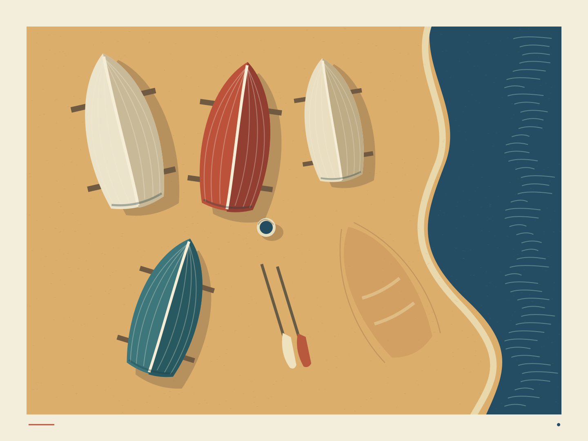

# 배를 말리는 오후 · An Afternoon Ashore

물에 떠 있지 않은 배를 그리고 싶었습니다. 네 척은 뒤집혀 햇빛을 받고, 물가에는 한 척이 빠져나간 듯한 자리만 있습니다. 누가 먼저 나갔는지, 돌아올 자리를 비워 둔 것인지는 정하지 않았습니다.



- [완성 PNG](An-Afternoon-Ashore.png): 1440×1080
- [편집 가능한 SVG](An-Afternoon-Ashore.svg)
- [제작 코드](make.py) · [검사 코드](check.py) · [검토 기록](REVIEW.md)

## 제작

황토색 해변, 짙은 파란 물, 밝은 배 두 척과 붉은 배·청록색 배를 제한된 색으로 배치한 독립 벡터 일러스트입니다. Python으로 직접 작성한 곡선과 고정 시드의 짧은 모래 흔적을 SVG에 기록하고 Inkscape로 PNG를 만들었습니다. 외부 이미지·글꼴은 사용하지 않았습니다.

```sh
python3 make.py
inkscape An-Afternoon-Ashore.svg --export-filename=An-Afternoon-Ashore.png
python3 check.py
```

Python 3, Pillow, Inkscape가 필요합니다. 검사기는 임시 디렉터리에서 재생성하여 보관된 원본을 덮어쓰지 않습니다. 배의 구조와 그림자는 그림을 위한 단순화이며 설계도가 아닙니다. 화면용 완성 일러스트로 선정했고 실물 인쇄는 검사하지 않았습니다.
