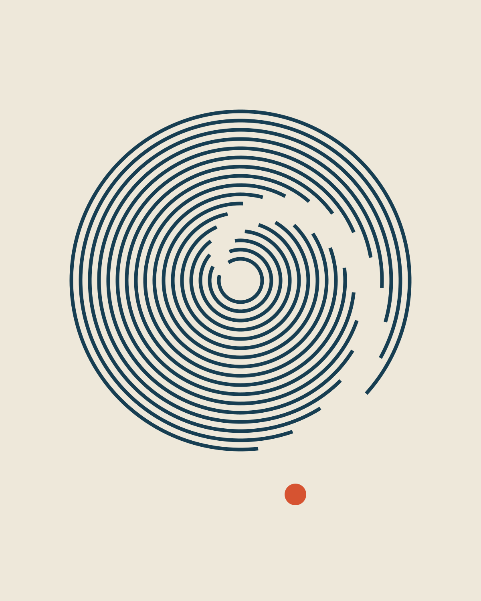

# 서로 다른 출구 · Different Exits

열일곱 개의 원은 같은 중심을 가지지만, 열린 쪽은 조금씩 다릅니다. 빈틈을 따라 시선이 돌다가 원 바깥의 작은 주홍 점에 닿도록 만든 추상 그래픽입니다. 점이 밖으로 나온 것인지, 이제 들어가려는 것인지는 정하지 않았습니다.



- [완성 PNG](Different-Exits.png): 1200×1500
- [편집 가능한 SVG](Different-Exits.svg)
- [제작 코드](make.py) · [검사 코드](check.py) · [검토 기록](REVIEW.md)

## 제작과 재생성

Python 표준 라이브러리로 원호를 배치하고 Inkscape로 PNG를 렌더링했습니다. 각 원호의 열린 각도는 42도, 다음 원의 틈은 13도씩 돌아갑니다. 외부 이미지·글꼴·생성 이미지 도구는 사용하지 않았습니다.

```sh
python3 make.py
inkscape Different-Exits.svg --export-filename=Different-Exits.png
python3 check.py
```

검사는 Python과 Pillow, Inkscape를 사용합니다. 화면용 완성 그래픽이며 미로 문제나 길찾기 게임은 아닙니다. 실물 인쇄 색상은 별도 확인이 필요합니다.
