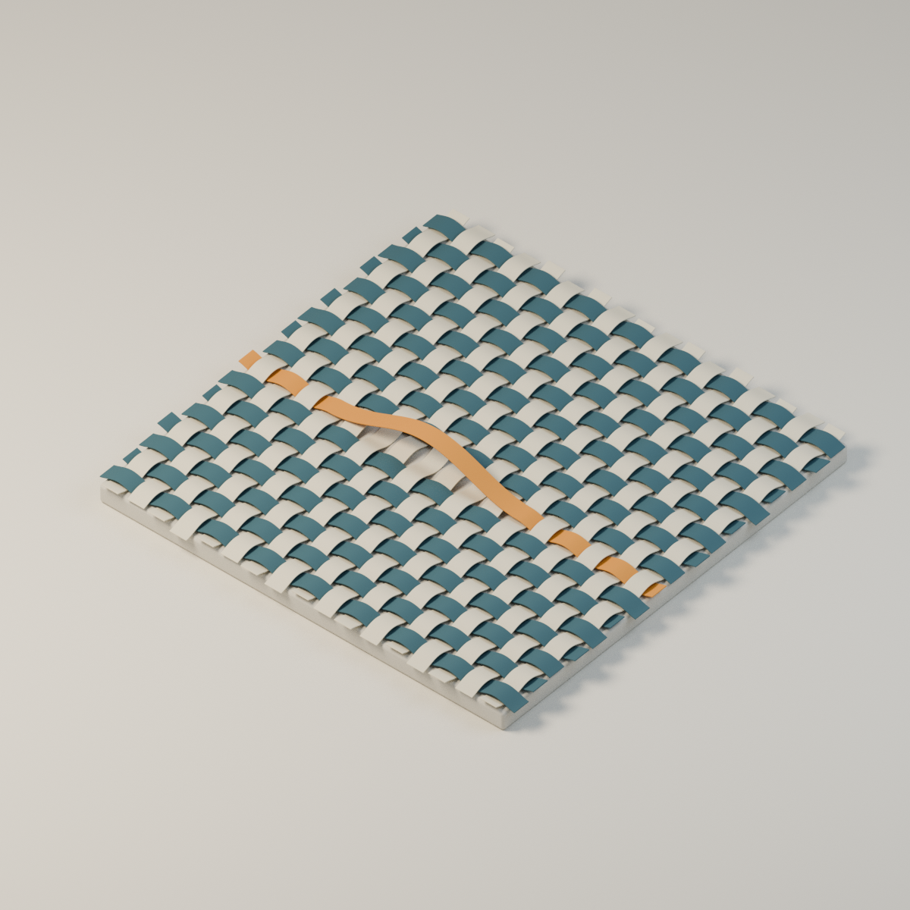

# 여덟 칸의 여유



종이띠를 엮은 디지털 정물입니다. 아이보리색과 푸른색 띠가 일정한 간격으로 위아래를 바꾸며 교차합니다. 황토색 한 줄만 여덟 칸의 구간에서 그 반복을 쉬고, 느슨하게 들린 채 건너갑니다.

처음에는 규칙적인 굴곡이 너무 높아 종이보다 체커 타일처럼 보였습니다. 굴곡과 두께를 낮추고, 21 × 21이던 조직을 17 × 17로 줄였습니다. 중앙의 띠도 조금 낮춰 손잡이보다 종이의 느슨한 곡선으로 보이게 다듬었습니다. 별도의 장식이나 설명을 그림에 넣지 않았습니다.

## 결과

- `Eight-Spaces.png`: 최종 1200 × 1200 이미지.
- `Eight-Spaces.blend`: 실제로 교차하는 34개 종이띠와 촬영 장면.
- `build.py`: 메시, 재질, 조명, 카메라와 기하 검사.
- `render.py`: 저장 장면을 별도 프로세스에서 렌더하고 PNG 텍스트 메타데이터를 정리.
- `geometry-check.json`, `readback.json`, `qa.json`: 검사 기록.

그림과 기하 형태는 직접 만들었습니다. 외부 모델·그림·텍스처를 사용하지 않았으며, 종이 표면의 작은 변화는 절차적 노이즈입니다.

## 구조

가로 17줄, 세로 17줄로 교차점은 289개입니다. 띠의 폭은 0.13, 간격은 0.18, 두께는 0.007이며 모두 장면 안의 상대 단위입니다. 황토색 띠가 뜨는 구간은 −0.9에서 0.54까지이므로 간격 여덟 개에 해당합니다. 양 끝을 포함하면 세로 띠의 중심선 아홉 개를 지납니다. '여덟 칸'을 여덟 가닥이라는 뜻으로 쓰지 않았습니다.

띠의 표면은 삼각함수로 만든 곡선을 따라 구성했습니다. 들린 구간과 규칙적인 구간의 높이·기울기는 해석식에서 연속이며, 실제 메시는 이를 유한한 선분으로 근사합니다.

## 다시 만들기

Blender 4.3.2를 사용했습니다. 제작·기하 검사와 렌더를 별도 프로세스로 실행합니다. 둘을 동시에 실행하지 마세요.

```sh
blender -b --factory-startup -t 2 --python build.py -- final
blender -b --factory-startup -t 2 --python render.py
blender -b --factory-startup -t 2 --python readback.py
```

빠른 시험은 첫 명령의 `final`을 `probe`로 바꾼 뒤 두 번째 `render.py` 명령까지만 실행합니다. 640 × 640, 24표본 시험 이미지가 생성됩니다. `readback.py`는 최종 설정 전용 검사입니다. 이후 최종본을 만들 때는 반드시 `final`로 다시 제작해야 합니다. 최종본은 128표본이며 디노이징은 사용하지 않았습니다.

## 검증과 한계

두께와 모서리 처리를 적용한 메시에서 모든 가로·세로 띠 쌍의 BVH 표면 교차 검사를 수행했습니다. 검출된 교차는 없습니다. 교차 중심의 높이 차이도 따로 검사했습니다. 이는 전체 메시의 최소 최근접 거리 계산이 아니며, 모든 종류의 충돌 검사를 포괄하지는 않습니다.

물체의 평가된 경계 상자로 화면 안에 보수적으로 최소 약 6.7% 여백이 남는 것을 확인했습니다. 지지대와 바닥면의 명목 높이도 맞췄습니다.

실제 종이의 강성, 장력, 중력에 따른 변형이나 접촉 안정성을 시뮬레이션하지 않았습니다. 실제로 제작 가능한 종이 공예 도면으로 제시하는 작업은 아닙니다.

기존 작품은 수정하지 않았고 GitHub 게시 요청이나 재시도는 하지 않았습니다.

최종 1200px 이미지를 직접 확인하고 저장 장면을 다시 열었습니다. 한 프레임의 조형 결과이며 실제 제작 또는 촬영 기록은 아닙니다.
