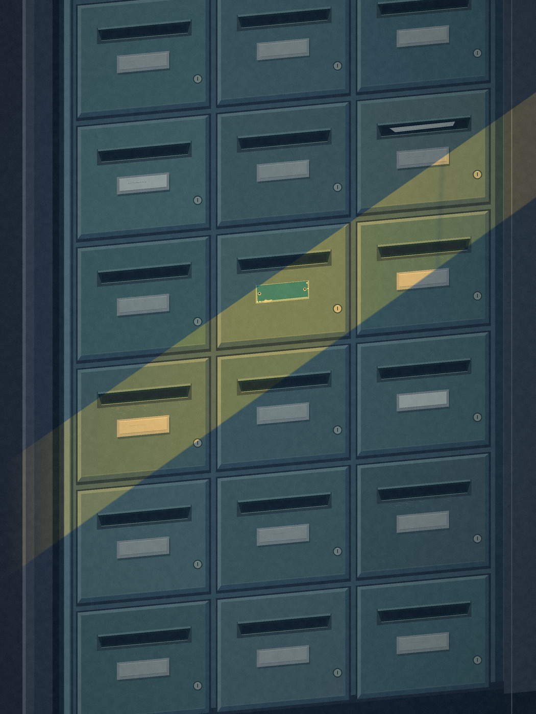

# 먼저 닿는 빛

이름표가 떨어진 칸에만, 처음 칠한 초록이 남아 있었다.



## 제작

닫힌 우편함마다 도막의 색을 조금 달리하고, 이름표가 없어진 한 칸에는 작은 나사 구멍 둘과 덜 바랜 도막을 남겼습니다. 빛이 스치는 아래쪽과 떨어진 도막의 모서리는 따로 그렸습니다. 우편함 이름표에는 실제 인명이나 주소를 넣지 않았습니다.

`build.py`에서 면과 테두리를 그리고, 시드를 고정한 마찰 자국과 도막의 결, 문틀 그림자를 합성합니다. 외부 이미지·서체 없이 재현하는 독립 일러스트입니다.

## 재생성·확인

Python 3, Pillow 13.0.0, NumPy 2.3.5 환경에서 아래처럼 새 경로에 그릴 수 있습니다.

```sh
python3 build.py /tmp/First-Light.jpg
cmp First-Light.jpg /tmp/First-Light.jpg
```

같은 환경의 별도 사본에서 JPEG가 바이트 단위로 일치했습니다. 1050×1400 원본과 375×500 축소 화면을 보고, 우편함 틈과 빛이 겹치는 지점, 가운데 이름표 자국이 구분되는지 확인했습니다.
