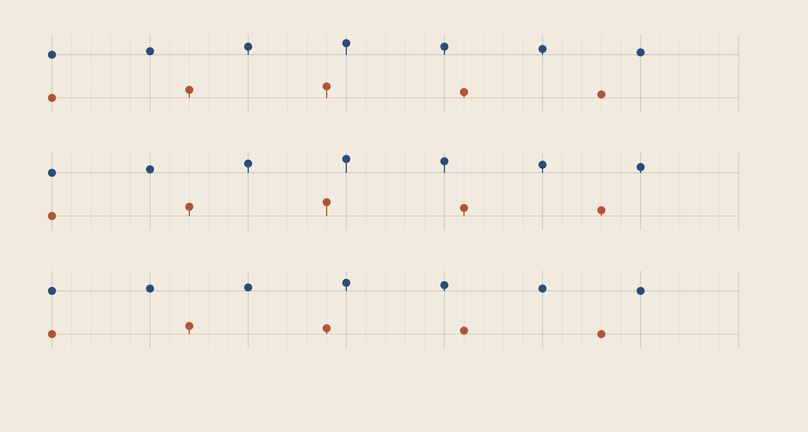

# 다섯 걸음, 일곱 걸음 · Five and Seven

**청취 검토 전 소리 연구입니다. 완성된 음악으로 채택하지 않았습니다.**

같이 출발한 두 성부가 서로 다른 간격으로 걸어가다가 다시 만납니다. A는 기본 간격 다섯 칸마다, B는 일곱 칸마다 소리를 냅니다. 35칸마다 시작점이 다시 겹칩니다. 세 차례에 걸쳐 음높이를 바꾸고, 마지막에는 D음의 옥타브로 함께 끝납니다.

- [33.4초 스테레오 WAV](output/Five-and-Seven.wav)
- [음표 편집용 MIDI](output/Five-and-Seven.mid)
- [전체 음표·시간 데이터](output/events.json)
- [제작 코드](build.py)

## 무엇을 만들었나

기본 칸은 0.28초입니다. A의 발음 간격은 1.4초, B는 1.96초이고, 한 주기는 9.8초입니다. 따라서 한 주기에 A가 7번, B가 5번 발음합니다. 두 성부를 합쳐 세 주기 동안 36음, 끝음 2음까지 총 38음입니다. 마지막 발음은 29.4초이며 전체 파일은 잔향을 포함해 33.4초입니다.

A는 짧게 감쇠하는 기본음과 비정수 배음으로, B는 조금 더 긴 기본음과 약한 고차 배음으로 직접 합성했습니다. A를 왼쪽, B를 오른쪽에 약하게 배치하고 세 개의 작은 교차 지연을 더했습니다. 실제 악기 녹음·외부 샘플·생성형 음악 서비스는 사용하지 않았습니다. 재료 이름을 붙여 특정 악기의 사실적인 재현이라고 주장하지 않습니다.

MIDI에는 음표·발음 시점과 짧은 게이트만 보존합니다. 일반 MIDI의 마림바·뮤직박스 프로그램을 지정했으므로, 재생기의 음색은 WAV와 다릅니다. WAV의 긴 감쇠와 교차 지연도 MIDI에 포함되지 않습니다.

## 리듬 지도



위에서 아래로 첫째·둘째·셋째 주기입니다. 각 패널에서 파란색은 A, 주황색은 B입니다. 가로 한 칸이 0.28초이며, 점은 발음 시점입니다. 점이 높을수록 음높이도 높습니다. A의 기준선은 D4, B의 기준선은 D3이며 반음당 2픽셀입니다. 따라서 서로 다른 기준선 사이의 절대 높이를 그대로 음정으로 비교하면 안 됩니다. 마지막 옥타브 두 음과 잔향은 이 지도에서 생략했습니다.

## 검토 상태

리듬 지도를 렌더하여 직접 확인했고 WAV 구조, 음표·MIDI 일치, 양 끝의 0 샘플, 클리핑 여부를 검사했습니다. 피크는 약 −3.10dBFS, 전체 샘플 RMS는 약 −17.51dBFS입니다. RMS는 지각 음량 LUFS가 아닙니다.

**실제로 들어 보지는 못했습니다.** 음색의 쾌적함, 선율의 설득력, 리듬의 인지 가능성, 클릭이나 거슬리는 잔향의 유무는 아직 판단하지 않았습니다. 파일의 수치 검사를 청감·미적 완성도 검증으로 대신하지 않습니다. 그 이유로 재현 가능한 청취 전 연구 상태로 보존합니다.

## 재현과 검사

Python 3와 NumPy가 필요합니다. WAV·MIDI·SVG·JSON 생성은 외부 에셋이나 다른 실행 파일을 요구하지 않습니다. `build.py`가 출력 파일을 덮어쓰므로 별도 사본에서 실행합니다.

```sh
python3 build.py
python3 verify.py
```

제작 소스 하나만 복사한 별도 폴더에서 출력 네 파일을 재생성하여 모두 바이트가 일치했습니다. 같은 NumPy·Python 환경에서의 결과이며 다른 환경의 수치 연산까지 보장하지는 않습니다. WAV는 ffprobe로도 48kHz·16비트·스테레오·33.4초임을 확인했습니다. SVG 확인에 사용한 Inkscape 중간 PNG는 보존 범위에 포함하지 않습니다.

`verify.py`는 기본 실행에서 파일을 바꾸지 않습니다. `--report 경로.json`을 지정할 때만 보고서를 저장합니다. [qa.json](qa.json)은 수치 검사 기록이며, `manifest.json`은 자신을 제외한 보존 파일의 크기·SHA-256입니다.
