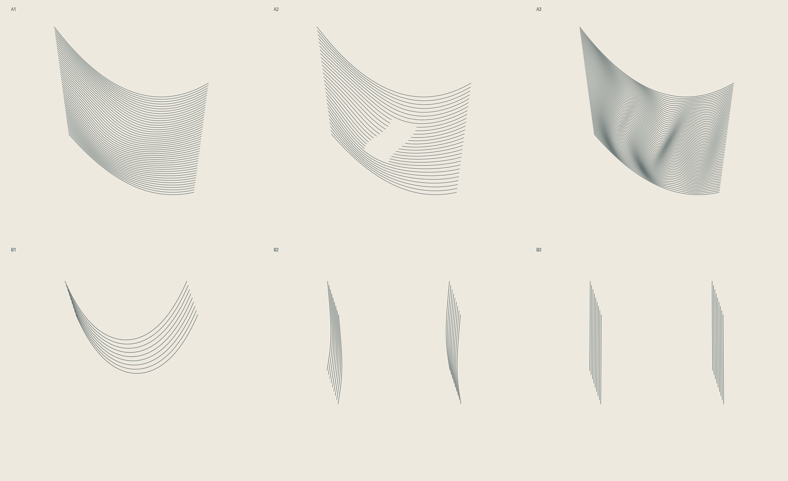

# 매달린 선

**상태: 보류 연구. 완성 작품으로 선정하지 않았습니다.**

평행한 선만으로 매달린 재료의 무게를 보일 수 있는지, 그리고 선의 일부를 지우는 것과 실제로 연결을 끊는 것이 화면에서 어떻게 달라지는지 시험했습니다.



## 두 시험

- A1: 기울어진 높이와 휜 아랫변을 가진 평행선 46개.
- A2: 선을 29개로 줄이고 가운데 일부를 삭제한 변형.
- A3: 선을 67개로 늘리고 굴곡을 더한 변형.
- B1–B3: 매달린 줄의 가운데를 나눈 순간, 0.5초 뒤, 10초 뒤의 계산 표본. 각 화면은 같은 줄의 두 절반을 아홉 번 평행 이동해 그렸습니다. 아홉 줄을 서로 연결하거나 상호작용시킨 모델은 아닙니다.

각 원본은 `output/study-1.svg`부터 `study-3.svg`, `output/cut-1.svg`부터 `cut-3.svg`에 있고, 같은 이름의 PNG를 함께 보존합니다.

## 보류한 이유

A1은 천이 늘어진 인상을 만들지만 선 전체가 비슷한 강도로 반복됩니다. A2의 빈 곳은 주변 선을 바꾸지 않아 재료가 찢어진 자리보다 지운 영역으로 보였습니다. A3의 굴곡을 늘려도 표현은 주로 지형도 같은 표면에 머물렀습니다.

B 시험은 절단이 모양을 바꾸게 했지만, 세 시점을 함께 보아야 변화의 이유가 드러났습니다. 가운데 시점만으로는 이전 연결의 흔적이 충분히 보이지 않고, 마지막 시점은 두 선 묶음으로 단순해졌습니다. 이를 길게 움직이거나 더 크게 출력하는 것으로 완성도를 대신하지 않기로 했습니다.

## 계산과 확인 범위

A 시험은 매개변수 곡면의 투영이며 재료 시뮬레이션이 아닙니다. B 시험은 처음에 현수선 모양으로 놓인 41개 점을 중앙에서 두 묶음으로 나눈 뒤 중력, 감쇠, 이웃 점 사이 길이 제약을 적용한 수치 드로잉입니다. 각 절반의 바깥쪽 한 점을 고정했습니다. 간격 1/240초, 매 단계 제약 보정 30회로 10초를 계산했습니다. 휘어짐 강성·공기 흐름·충돌·실제 끈의 물성은 모델링하지 않았으며 독립적인 역학 검증을 마친 모형은 아닙니다.

`output/cut_motion.npz`에는 0·0.5·1.5·10초의 두 절반 위치를 저장했습니다. 1.5초 표본은 후속 검토용으로 보존하며 비교 그림에는 사용하지 않습니다. `output/cut_check.json`은 계산 중 선분 길이 오차 기록입니다.

## 재현과 보존

Python, NumPy, SciPy, Pillow, Inkscape가 필요합니다. 기존 파일을 덮어쓰지 않도록 별도 사본에서 실행합니다.

```sh
python3 build.py
python3 verify.py
```

`build_lines.py`와 `build_cut.py`는 두 시험을 각각 생성하고, `build.py`는 이를 실행한 다음 비교 그림을 만듭니다. `verify.py`의 기본 실행은 파일을 바꾸지 않습니다. 검사 결과를 저장할 때만 `--report 경로.json`을 지정합니다. `qa.json`과 `manifest.json`에 검사 범위와 보존 파일 해시를 기록합니다. `studies/`와 `tmp/`의 중간 작업은 정식 보존 목록에 포함하지 않습니다.

두 시험의 여섯 그림과 비교 이미지를 육안 검토했습니다. 모든 SVG 좌표·PNG 전체 디코드·수치 표본의 고정점을 검사했고, 제작 소스만 옮긴 별도 사본에서 출력 15개 파일이 바이트까지 동일하게 재생성됐습니다. 완성작으로 선정하지 않은 판단은 파일 검사 결과와 별개의 조형적 판단입니다.
