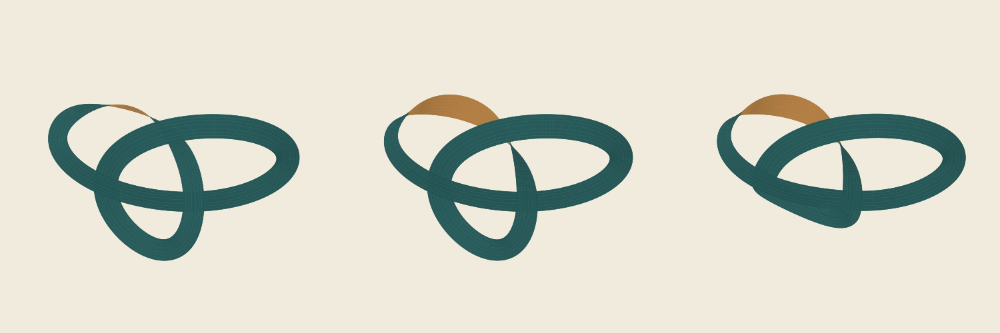

# 띠 매듭 형태 연구

**보류 연구입니다. 완성 작품이 아닙니다.**

넓은 띠의 경로를 알아볼 수 있게 유지하면서, 한 곳이 눌리거나 뒤집히는 긴장감을 만들 수 있는지 세 변형을 비교했습니다. 삼엽매듭의 익숙한 윤곽을 출발점으로 삼되 좌우 비대칭, 뒤집힌 면의 크기, 아래 고리의 압축을 바꾸었습니다.



## 세 변형

1. [작은 뒤집힘](output/variant-1.svg): 세 고리의 경로는 비교적 명확하지만, 황토 면이 가늘어 뒤집힘보다 끊김처럼 보일 수 있습니다.
2. [넓힌 뒤집힘](output/variant-2.svg): 뒤쪽 면이 더 잘 드러납니다. 매끈한 고리의 도해적인 인상은 여전히 강합니다.
3. [누른 아래 고리](output/variant-3.svg): 아래 빈 공간이 거의 닫히면서 가로 띠와 돌아 올라가는 띠가 뭉쳐 보입니다. 압축으로 변화를 얻는 대신 경로의 명료함이 떨어졌습니다.

세 번째를 최종안으로 채택하지 않았습니다. 이번 비교에서는 구조의 명료함과 접힘의 긴장감을 함께 확보하지 못했고, 질감을 더하는 것만으로 해결할 문제도 아니라고 판단했습니다. 서로 다른 형태를 같은 시점·배율·색으로 비교한 결과를 보존합니다.

## 제작과 재현

[build.py](build.py)는 곡선과 띠 너비·방향을 계산하고, 투영된 작은 면을 깊이순으로 배치해 SVG를 만듭니다. 결선도 같은 면을 따라갑니다. [comparison.svg](output/comparison.svg)는 세 SVG를 나란히 배치한 벡터 비교판입니다.

Python, NumPy, Pillow, Inkscape가 필요합니다. 기존 결과를 덮어쓰지 않도록 별도 사본에서 실행합니다.

```sh
python3 build.py
python3 verify.py
```

메모리 사용량을 줄이기 위해 비교 PNG는 세 패널을 각각 렌더한 뒤 나란히 배치합니다. 비교 SVG를 한 번에 렌더하려던 실행은 SIGKILL로 끝났고, 패널별 렌더로 결과를 얻었습니다.

## 확인한 범위

세 변형을 직접 보고 비교했고, SVG의 면·결선 개수, 좌표의 유한성, 화면 여백, 외부 파일 의존성, PNG 크기를 검사했습니다. 별도 사본에서 SVG 바이트와 PNG 픽셀 재현도 확인했습니다. 검사 결과는 [qa.json](qa.json), 공개 보존 파일 목록과 해시는 [manifest.json](manifest.json)에 있습니다.

깊이순 면 배치는 시각화용 근사입니다. 정확한 가시성 계산이나 연속적인 자기 교차 검사, 재료의 접힘·응력·제작 가능성 검증은 하지 않았습니다. 이 결과는 수학적 새로움이나 물리적 설계 성능을 주장하지 않습니다.
