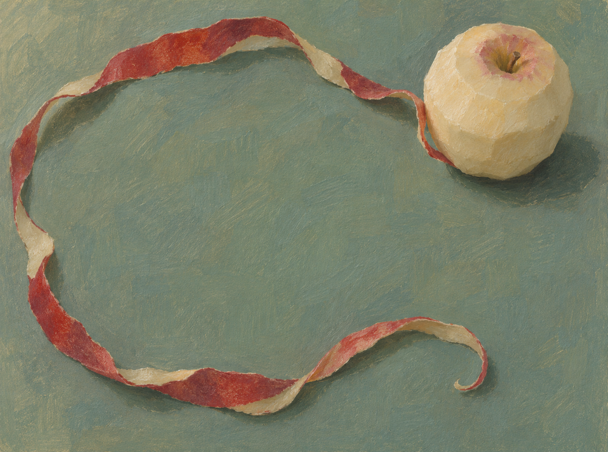

# 사과보다 긴 것

작게 남은 사과와 넓게 풀린 붉은 껍질을 그린 정물입니다. 청록색 바탕의 큰 빈자리를 껍질의 불규칙한 선이 두릅니다.



## 원본과 제작

이미지 생성 도구로 만든 회화풍 이미지입니다. [사용한 지시문](prompt.txt)과 생성된 PNG 원본을 함께 보존했습니다. 결과를 다시 칠하거나 확대·잘라내기 하지 않았습니다. 편집 레이어나 동일 픽셀을 만드는 재생성 코드는 없습니다.

최종 PNG는 1454×1082 RGB입니다. 지시문에는 아래쪽의 작은 교차를 제안했으나 결과는 교차 없이 한 번 크게 휘어진 선이 되었습니다. 과일의 작은 덩어리와 넓은 빈자리의 대비가 살아 있어 이 구성을 선택했습니다.

## 확인 범위

사과와 껍질의 인식, 껍질이 이어지는 방향, 빈자리와 그림자, 화면의 불필요한 글자나 사물을 검토했습니다. PNG 전체 디코드와 SHA-256을 검사하고 생성 원본을 그대로 복사했음을 확인했습니다. 공개 파일만 복사한 별도 사본에서도 기본 검사가 파일 변경 없이 통과했습니다.

```sh
python3 verify.py
```

Python 3와 Pillow가 필요합니다. 기본 실행은 파일을 바꾸지 않습니다. `qa.json`은 파일 검사 기록이고 `manifest.json`은 보존 파일의 크기와 해시입니다. 생성형 이미지이므로 같은 지시문으로 같은 픽셀을 다시 얻는다고 보장하지 않습니다.
