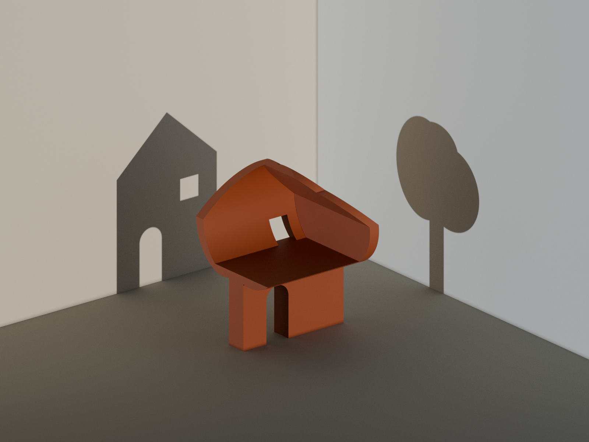

# 그림자가 모르는 것

**What the Shadows Do Not Know** · 직접 만든 조각과 렌더 정지 이미지 · 2026

한쪽에서는 집, 다른 쪽에서는 나무. 가운데에는 비어 있는 몸 하나.



## 작품

밝은 벽 두 개 사이에 테라코타색 몸 하나가 서 있습니다. 한 수평 방향에서 오는 빛은 집 모양의 그림자를, 그와 직각을 이루는 방향에서 오는 빛은 나무 모양의 그림자를 만듭니다. 눈앞의 몸 안쪽은 비어 있습니다. 익숙한 두 실루엣 어느 쪽도 그 빈 공간을 설명하지 못합니다.

이미지는 의도적으로 조용하게 구성했습니다. 이름표나 설명 화살표, 주변 사물, 이야기 속 인물을 두지 않았습니다. 알아볼 수 있는 윤곽과 낯선 내부 사이의 어긋남을 형상 자체로 드러냅니다.

## 제작 과정

첫 번째 몸은 두 윤곽을 돌출시킨 형상의 교집합이었습니다. 필요한 그림자는 만들어 냈지만, 부피가 큰 중심부는 기하 문제를 푸는 것 이상의 역할을 하지 못했습니다. 중심에서 비켜난 내부 형상을 빼내자 두 윤곽을 유지하면서 속이 열린 껍질이 되었습니다. 우연히 돌출된 선반 때문에 내부가 가구를 놓은 공간처럼 보여, 선반을 껍질 안쪽으로 물린 뒤 하나로 이어진 빈 공간만 남겼습니다.

두 번째 카메라 위치에서는 집이 지나치게 좁아지고 나무 주위가 답답해졌습니다. 최종 시점은 세 형태 사이에 여유를 더 남깁니다. 초기 렌더와 채택하지 않은 변형은 Git에서 제외한 로컬 `studies/` 디렉터리에 보존되어 있습니다.

## 파일

- `One-Body-Two-Shadows.png`: 최종 1600 × 1200 이미지.
- `One-Body-Two-Shadows.blend`: 편집 가능한 장면.
- `build.py`: 직접 만든 윤곽, 불리언 구성, 방, 조명과 카메라.
- `render.py`: 일반적인 전체 프레임 렌더링.
- `render_region.py`, `assemble_regions.py`: 최종 이미지에 사용한 메모리 사용량 제한 영역별 렌더링과 무손실 픽셀 조립.
- `check_mesh_and_masks.py`: 모디파이어 적용 후 기하 검사와 직교투영 실루엣 렌더링.
- `compare_profiles.py`: 의도한 윤곽과 독립적인 수식 기반 비교.
- `geometry-qa.json`, `readback-qa.json`, `projection-qa.json`: 생성된 수치 검사 결과.
- `description.txt`: 짧은 한국어 작품 설명.

## 재현

Blender 4.3.2에서 CPU로 렌더링합니다. Python 비교에는 NumPy, SciPy, Pillow가 필요합니다. 내려받은 메시, 텍스처, 글꼴은 사용하지 않았습니다.

```sh
blender -b -t 6 --python-exit-code 1 --python build.py -- final hollow
blender -b -t 6 --python-exit-code 1 --python check_mesh_and_masks.py
python3 compare_profiles.py
for k in $(seq 0 11); do
  blender -b -t 6 --python-exit-code 1 --python render_region.py -- "$k"
done
python3 assemble_regions.py
python3 check_region_overlap.py
python3 verify_delivery.py
```

최종 렌더는 Cycles에서 최대 512샘플과 적응형 샘플링을 사용하며 디노이저는 사용하지 않습니다. 검사기는 진단을 위해 바꾼 내용을 작품 장면에 덮어 저장하지 않습니다. 전체 프레임 저장이 중단되어, 전달한 이미지는 8픽셀 여백을 둔 12개 영역을 각각 렌더링해 만들었습니다. 정확한 내부 픽셀만 조립했으며 크기 변경, 보정, 그림자 덧그리기를 하지 않았습니다. 인접한 17개 겹침 영역 모두에서 RGB 평균 절대 차이는 0–255 척도 기준 0.439 미만이고, 차이의 99백분위수는 2 이하입니다. 최종 경계도 눈으로 확인했습니다.

## 검증과 한계

원본 몸체는 하나로 연결된 닫힌 메시입니다. 베벨을 적용한 평가 메시에는 비매니폴드 모서리가 없고 부호 있는 부피가 양수입니다. 균일한 밀도를 가정한 무게중심은 받침 범위 위에 놓입니다. 이는 제한된 기하 검사이며 하중, 재료, 도자기 소성, 제작 가능성이나 전도 저항을 평가한 것이 아닙니다.

저장된 기하에서 직교투영 실루엣을 렌더링하고, 별도로 표본화한 집과 나무의 수식과 512 × 512 해상도로 비교했습니다. 겹침 비율은 99.6%를 넘습니다. 작은 차이는 다각형 이산화, 베벨, 래스터 경계에서 생깁니다. 집에는 닫힌 창 구멍 하나가 있고 나무에는 없습니다. 아치형 출입구는 바깥 경계로 열려 있습니다.

이 수치는 물체의 실루엣을 평가하며, 원근 투영된 벽 그림자의 픽셀 정합을 평가하지 않습니다. 벽의 두 그림자는 장면 조명으로 생성되었고 눈으로 검토했습니다. 그림자를 받는 벽에 실루엣을 그려 넣지 않았습니다.
