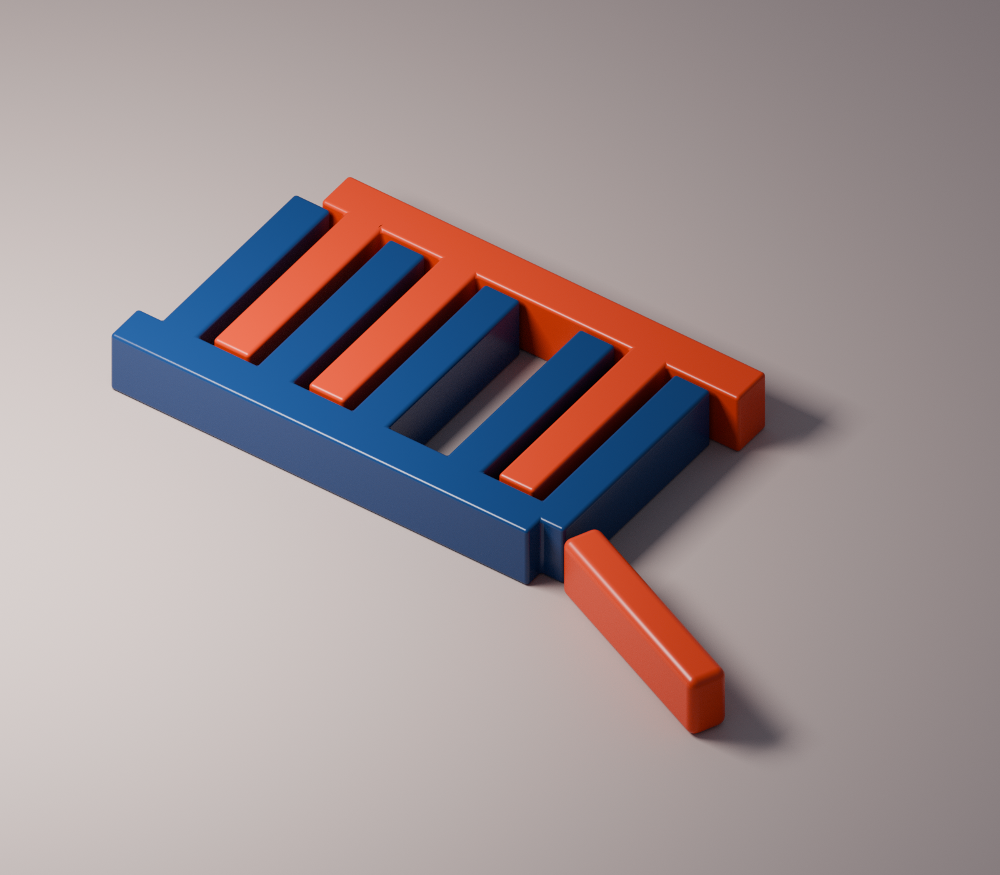

# 한 칸 비워서 · One Tooth Apart

**3D 조형 연구. 완성 작품으로의 채택은 보류합니다.**

군청과 다홍의 빗살이 번갈아 놓입니다. 다홍 이빨 하나가 빠진 칸에서는 바닥이 넓게 드러나고, 같은 길이의 조각은 오른쪽 앞에 따로 놓여 있습니다. 교대하는 색의 리듬을 한 번 끊으면 빈칸이 조형의 중심으로 읽히는지 시험했습니다.



- [감상용 PNG](output/One-Tooth-Apart.png), 1600×1400
- [편집 가능한 Blender 장면](output/One-Tooth-Apart.blend)
- [제작 소스](build.py)
- [장면 검사 기록](scene_qa.json)

## 구성과 판단

배경 설명이나 인물 없이 색·부피·간격으로만 장면을 만들었습니다. 군청은 비교적 광택이 강하고 다홍은 조금 더 무광입니다. 반대 색의 이빨 사이에는 0.12 장면 단위의 간격을 두었습니다. 빠진 이빨은 나머지 다홍 이빨과 같은 직육면체 치수이며, 방향만 바꿨습니다. 미세한 접합 형태까지 동일한 분리 부품을 뜻하지는 않습니다.

초기 렌더에서 서로 겹친 상자의 같은 높이 면이 검은 선으로 나타났습니다. 색마다 실제 메시 합집합을 만든 뒤 가장자리를 둥글게 처리하여 수정했습니다. 최종 PNG에서 이음부와 전체 구도를 직접 확인했습니다.

빈칸과 바깥 조각의 대응은 보이지만, 익숙한 조립 장난감이나 분해도에 가까운 인상도 강합니다. 색 교대의 단절이라는 구성은 남길 만하나, 그 이상의 독립적인 긴장감은 아직 충분하지 않다고 판단했습니다. 질감을 더하거나 소품을 늘려 완성작으로 포장하지 않고 이 연구 단계에서 보존합니다.

## 재현

Blender **4.3.2**, Cycles CPU 192샘플, 고정 난수 시드 17을 사용했습니다. 외부 이미지·모델·폰트는 없습니다. 이 환경의 Blender에는 OpenImageDenoise가 없어 디노이즈를 끈 상태로 렌더했습니다.

제작 명령은 출력 파일을 덮어쓰므로 별도 사본에서 실행합니다. `output/` 폴더를 먼저 만들어 주세요.

```sh
mkdir -p output
blender -b -t 8 --python build.py
```

읽기 전용 검사는 다음과 같습니다. 이미지·해시 검사에는 Python과 Pillow가 필요합니다.

```sh
python3 verify.py
blender -b output/One-Tooth-Apart.blend --python verify_scene.py
```

`verify_scene.py`는 `-- --report 경로.json`을 지정할 때만 보고서를 씁니다. `manifest.json`에는 자신을 제외한 보존 파일의 크기와 SHA-256을 기록합니다.

## 확인 범위와 한계

세 조형물의 베벨 전 메시가 닫힌 매니폴드이며 양의 부피를 갖고, 서로 표면이 교차하지 않는지 확인했습니다. 바닥 위의 조형물 기준 높이는 z=0입니다. 베벨 전 교차 검사를 실제 생산 공차나 내구성 검증으로 해석하지 않습니다. 제조용 CAD·실물 장난감·물리 시뮬레이션·기존 게임의 새 설정이 아닙니다.

제작 소스만 복사한 별도 폴더에서 재생성하여 PNG 전 픽셀이 일치했습니다. 파일 경로·날짜·렌더 시간 메타데이터 때문에 PNG 바이트는 다릅니다. 결과는 [검사 요약](qa.json)에 기록합니다. Blender 파일은 저장 위치 등 내부 정보가 달라질 수 있으므로 별도 재생성본과 바이트 일치를 주장하지 않습니다. 자동 백업 `.blend1`과 중간 렌더는 보존 범위에서 제외합니다.
