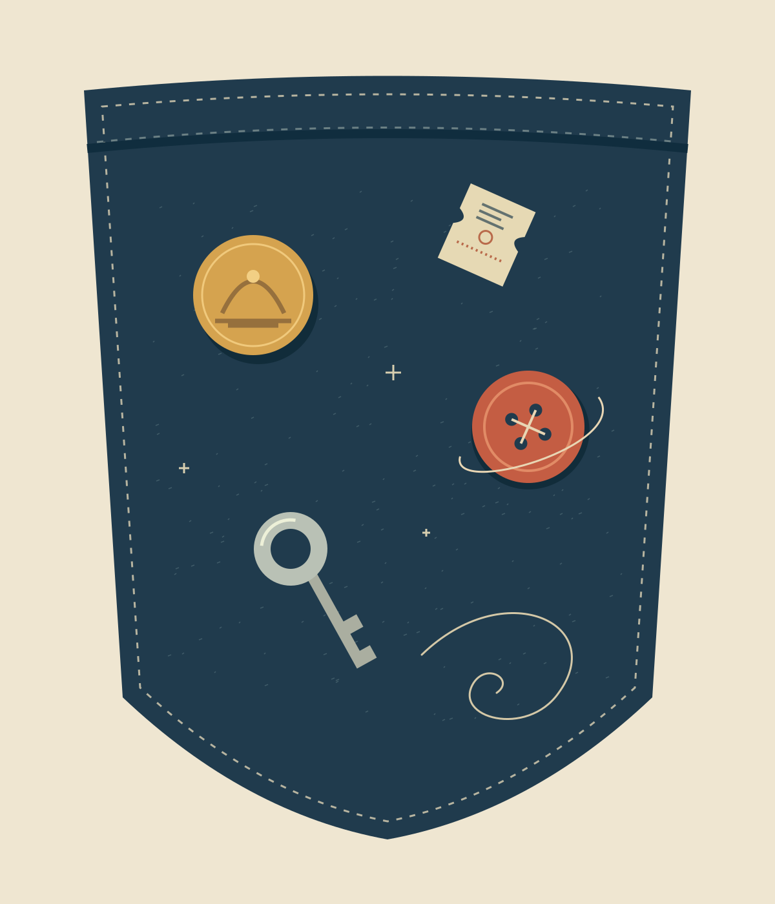

# 주머니의 천문대

주머니를 비우기 직전, 동전은 해가 되고 단추의 풀린 실은 행성의 고리가 됩니다. 작은 표와 열쇠, 구부러진 실밥을 남색 천 위에 띄웠습니다. 별자리가 아니라 하루 동안 가지고 다닌 물건들의 배열입니다.



- [완성 이미지](Pocket-Observatory.png): 1200×1400
- [편집 가능한 벡터 원본](Pocket-Observatory.svg)
- [제작 코드](make.py) · [재현 검사](check.py)

## 제작과 확인

독립 벡터 일러스트입니다. 외부 이미지나 글꼴 없이 Python으로 곡선을 구성하고 Inkscape로 렌더했습니다. 한정된 남색·벽돌색·황토색으로 물건과 천체의 이중 독해를 시도했습니다. 동전 무늬와 표는 가상의 도안입니다.

```sh
python3 make.py
inkscape Pocket-Observatory.svg --export-filename=Pocket-Observatory.png
python3 check.py
```

Python 3, Pillow, Inkscape가 필요합니다. 검사에서는 임시 폴더에 재생성하여 원본을 덮어쓰지 않습니다. 최종 이미지의 여백, 겹침, 소품 구분을 직접 검토했습니다. 화면용 완성작이며 실물 인쇄는 확인하지 않았습니다.
