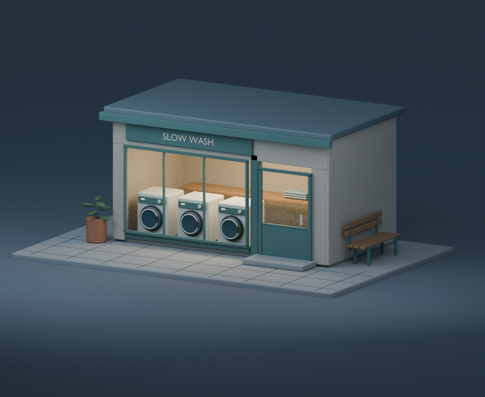

# 골목 끝 작은 세탁소

해가 진 뒤에도 창 안에는 따뜻한 빛이 남아 있습니다. 둥근 세탁기 문 세 개,
입구의 낮은 계단, 옆 골목을 바라보는 빈 벤치로 작은 가게를 만들었습니다.



비 오는 동네에서 이어 상상한 독립 3D 작품입니다. 실제 가게나 제품을 옮긴 것이
아니며, 기존 게임에 새로운 장소나 인물의 방문을 추가한 것도 아닙니다.
생성형 이미지가 아니라 직접 작성한 모델과 재질을 Blender로 렌더한 그림입니다.

## 파일

- `Quiet-Laundrette.png`: 최종 1100 × 900 이미지.
- `Quiet-Laundrette.blend`: 물체·재질·조명·카메라를 편집할 수 있는 장면.
- `build.py`: 장면을 처음부터 만드는 절차형 코드.
- `validation.json`: 최종 렌더 설정과 외부 이미지 의존성 검사.
- `pixel_qa.json`: 해상도·불투명도·화면 아래쪽 검사.
- `REPRODUCTION.md`: 실제로 확인한 재현 범위와 한계.

## 먼저 맞춘 공간 관계

장면 단위는 대략 미터에 대응합니다. 세탁기는 폭 0.88, 높이 1.08이며 출입문
틀은 약 2.2 높이입니다. 벤치는 길이 1.75, 보도에서 좌석까지 약 0.47입니다.
시공이나 제품 설계용 치수는 아니지만, 물체끼리의 크기 관계를 맞추는 기준으로
사용했습니다. 세탁기는 창 안에 놓고 벤치는 오른쪽 벽을 따라 배치해 출입구
계단과 겹치지 않게 했습니다.

카메라는 낮은 사선의 평행투영입니다. 첫 시험 화면에서는 창턱이 세탁기 문
아래를 가리고 창살이 가운데 기계와 겹쳤습니다. 창턱을 낮추고 창살을 기계
사이로 옮겼습니다. 지붕이 지나치게 커 보이지 않도록 시점도 낮췄고, 벤치가
읽히도록 오른쪽에 부드러운 보조광을 더했습니다.

최종 해상도에서는 화면 맨 아래의 검은 띠를 추가로 발견했습니다. 평행투영
카메라 아래쪽 광선이 바닥 아래에서 시작한 문제였습니다. 카메라를 같은 시선
축을 따라 뒤로 이동해 구도와 물체 크기는 유지하고, 광선 시작점만 바닥 위로
옮겼습니다. 이미지를 잘라 숨기지 않았으며 수정된 최종 픽셀을 다시 확인했습니다.

## 표현과 의존성

- 건물·세탁기·벤치·식물·시계·수건은 모두 코드에서 만든 형상입니다.
- 간판은 Blender 내장 글꼴입니다. 외부 이미지·모델·다운로드한 글꼴이 없습니다.
- 창과 문의 윗부분은 내부가 잘 보이는 열린 형태입니다. 실제 유리 굴절을
  시뮬레이션하지 않았고, 세탁기 창도 단순한 재질 표면입니다.
- 바깥의 차가운 빛과 실내의 따뜻한 빛은 Cycles 조명입니다. 사실적인 건축
  시뮬레이션이나 실제 조도 계산은 아닙니다.
- 디노이즈를 사용하지 않아 어두운 부분과 실내에 작은 렌더 입자가 남아 있습니다.

## 다시 만들기

Blender **4.3.2**에서 확인했습니다. 별도 Python 패키지를 설치할 필요는 없습니다.
Python 표준 라이브러리와 Blender에 포함된 `bpy`, `mathutils`만 사용합니다.

이 폴더에서 다음 명령을 실행합니다.

```sh
blender -b -t 2 --python build.py -- --preview
blender -b -t 2 --python build.py
```

시험 렌더는 640 × 520 / 24 samples, 최종 렌더는 1100 × 900 / 64 samples입니다.
둘 다 Cycles CPU 두 스레드를 사용합니다. 출력은 명령을 실행한 위치가 아니라
코드가 있는 폴더에 생성됩니다. 기존 PNG·blend·검증 JSON은 다시 만들 때
덮어쓰므로 수정한 장면을 보존하려면 먼저 폴더를 복사하세요.

`--preview`도 저장된 blend와 `validation.json`을 시험 설정으로 바꿉니다.
최종 설정을 돌려놓으려면 두 번째 명령을 실행하거나 배포본을 다시 복사하세요.
Blender나 렌더러 버전, 시스템에 따라 픽셀 단위 결과와 소요 시간은 달라질 수 있습니다.

## 공개 파일 점검

PNG의 렌더 경로·날짜·EXIF 텍스트를 제거하면서 이미지·색상 청크는 보존했습니다.
Blender 파일 브라우저에 남은 로컬 디렉터리와 문자열 뒤의 잔여 바이트도 지웠습니다.
비어 있는 시퀀서의 이전 이미지 폴더 기록과 PNG의 불필요한 위치 청크도 제거했습니다.
저장된 렌더 경로는 상대 경로이며 외부 이미지 참조가 없습니다.
로그·시험 이미지·자동 백업·캐시는 포함하지 않습니다. 저장소의 다른 작품과
외부 에셋의 이용 조건은 그대로 유지됩니다.
