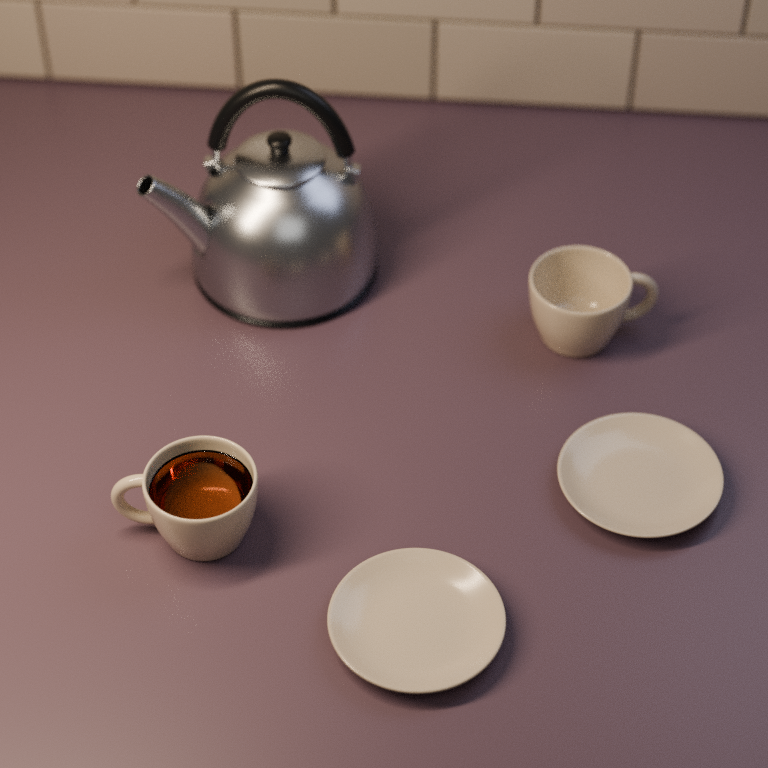

# 두 잔의 자리 · 눈길이 머무는 곳

**[완성 영상 보기 · 6초 무음 MP4](renders/The_Second_Cup_Silent_Film.mp4)**  
768 × 768 · 72프레임 · 12fps · 872,305바이트 · 2026-11-02 UTC

[](renders/The_Second_Cup_Silent_Film.mp4)

가까운 잔에는 차가 있고, 맞은편 잔과 빵 접시 둘은 아직 비어 있습니다. 소보로 두 개를 들고 돌아올 배우자를 기다리는 평범한 부엌입니다. **가상의 동네 이야기이며 실제 사용자의 생활이나 관계를 묘사하지 않습니다.**

처음 약 1초는 가까운 찻잔에 초점을 두고, 빈 잔으로 천천히 옮긴 뒤 마지막 약 1초 머뭅니다. 카메라는 약 **11.3cm** 옆으로 이동합니다. 강한 랙포커스나 시선 유도의 보장보다는 **은은한 초점 이동**입니다. 음악·음향은 없으며, 처음과 끝이 이어지는 루프 영상도 아닙니다.

## 완성 파일

| 파일 | 내용 |
| --- | --- |
| [무음 MP4](renders/The_Second_Cup_Silent_Film.mp4) | H.264 / YUV420p, 6초, 오디오 스트림 없음 |
| [The_Second_Cup_Film.blend](The_Second_Cup_Film.blend) | Blender 4.3.2의 독립 카메라·초점 애니메이션 |
| 최종 PNG: [시작](renders/frame_0001.png) · [중간](renders/frame_0036.png) · [끝](renders/frame_0072.png) | 1·36·72프레임, 768 × 768 |
| 초안 PNG: [시작](qa/draft_001.png) · [중간](qa/draft_036.png) · [끝](qa/draft_072.png) | 같은 세 프레임, 480 × 480 / 최대 24샘플 |
| [camera_plan.json](camera_plan.json) | 72프레임 카메라·초점 계획과 투영 범위 |
| [provenance.json](provenance.json) | 원본·영상·참고 이미지의 출처와 해시 |
| [reference/gpt_image_concept.png](reference/gpt_image_concept.png) | 원본에 패킹되어 있던 참고 콘셉트. 영상에 투영하지 않음 |

원본의 **차가 든 잔, 빈 잔, 빈 접시 둘, 금속 주전자**를 모두 유지했습니다. 새 인물·소품·증기·따르기·유체 변화는 없습니다. 형상·재질·물높이·메니스커스·조명·world를 그대로 두고 카메라 위치·회전·초점과 렌더 설정만 바꿨습니다. 원본 작품과 기존 게임·뷰어에는 이 애니메이션을 적용하지 않았습니다.

## 실제로 확인한 범위

| 검사 | 결과와 근거 |
| --- | --- |
| 저장된 장면 | 원본과 저장한 `.blend`를 다시 열어 비교. 카메라 외 물체·재질 애니메이션 없음. 메시·변환·재질 할당, 기록된 노드 속성·광원·world, 평가된 corner normal 일치. [animation_audit.json](qa/animation_audit.json) |
| 카메라·초점 | **실제 저장 카메라로 72프레임을 재투영**. 소품 꼭짓점의 최소 화면 여백 **5.33196%**, 계획과 투영·초점 거리 차이 **0**. DOF 활성화와 별도 focus object 없음도 확인. 여백 검사는 소품 간 모든 가림의 부재를 뜻하지 않음. |
| 인코딩 | 원본 렌더 72장 해시 확인, MP4 전체 디코드 통과. 768²·12fps·72프레임·6초·무음과 색 태그, fast-start 구조 확인. [film_checks.json](qa/film_checks.json) |
| 실제 재생 | **ffplay 7.1.5 / X11**에서 반복 재생과 시작·중간·끝 구간, 일시정지·탐색 확인. 정사각 비율과 다섯 소품·빈 접시 유지, 약한 초점 이동을 관찰. [native_playback.json](qa/native_playback.json) |
| 원본·재개 | 원본 13파일 묶음과 `.blend`·최종 PNG 해시 유지. 완료 후 재개 검사에서 72장을 모두 검증·건너뛰고 새 렌더를 하지 않음. [preservation.json](qa/preservation.json) |

노드 검사는 이 장면이 실제 사용하는 **Background, Principled BSDF, Bump, Map Range, Material/World Output, Texture Coordinate, Noise Texture, Volume Absorption**으로 범위를 한정했습니다. 이 목록의 output 기본값·pointer 설정도 보충 비교했지만, 임의의 중첩 노드 그룹이나 모든 Blender 장면을 검증하는 도구는 아닙니다.

재생 검토는 실제 플레이어의 **표본 구간 관찰**입니다. 모든 프레임을 모든 디스플레이에서 개별 판정한 것이 아니며, 탐색의 영향을 받은 드롭 카운터를 성능 결과로 사용하지 않았습니다. 다른 GPU·운영체제·플레이어의 재생 성능을 보장하지 않습니다.

## 렌더·색·남은 한계

- **Blender 4.3.2 / Cycles CPU 2스레드**, 80mm 고정 렌즈, f/2.0. 최종 렌더는 adaptive sampling **최대 64샘플**, 디노이징 없음. 72장의 기록된 렌더 시간 합계는 **약 121.6분**이며 다른 장치의 벤치마크가 아닙니다.
- 금속 반사와 호박색 차는 읽히지만 **부드러운 렌더 grain과 12fps의 움직임 간격**이 남습니다. 영상 보간·이미지 리터칭으로 감추지 않았습니다.
- 원본의 AgX 뷰·노출·광학 설정을 유지했습니다. 출력 PNG의 **sRGB 전달함수**를 유지하며 RGB를 **BT.709 행렬·원색 / limited-range YUV420p**로 변환했습니다. MP4는 **손실 압축**이므로 PNG와 픽셀이 같다는 뜻은 아닙니다.
- 공개한 **최종 3장·초안 3장**은 알려진 렌더러 텍스트 메타데이터만 제거했습니다. 압축 **IDAT 바이트와 디코드 RGB 픽셀 모두 원본과 동일**함을 확인했습니다.
- GPT Image 참고 콘셉트는 **C2PA를 포함한 원본 바이트 그대로** 보존했습니다. shader·compositor·환경 텍스처·프레임 투영에 사용하지 않았고 새 외부 에셋도 없습니다.
- 차의 그림자 광선·코스틱 등에 관한 **원본의 예술적 광학 근사**는 남습니다. 실제 차의 광학 측정이나 유체·열 시뮬레이션이 아닙니다.

## 재생성

**배포본의 별도 복사본에서 실행하세요.** 생성 결과와 검사 기록을 덮어쓰며, 진행 중인 렌더와 동시에 rebuild하지 않습니다. Blender 4.3.2, Python + Pillow, `libx264`·`zscale`을 지원하는 FFmpeg와 ffprobe가 필요합니다.

공개 저장소의 원본 경로는 `../second-cup/The_Second_Cup.blend`입니다. 로컬 형제 폴더 `second_cup/`도 지원하며, 다른 위치는 rebuild와 audit 양쪽에 `-- --source /원본/위치.blend`를 지정합니다. 다음 **SHA-256과 다르면 중단**합니다.

```text
eac50adac6aa30158ea9cfac70d9d3c71ae25602abc33975fb0ec2023c9f49bd
```

```sh
mkdir -p work/tmp
export TMPDIR="$PWD/work/tmp"

# 원본을 읽고 독립 애니메이션 생성. 원본에는 쓰지 않음.
blender -b -t 2 --python-exit-code 1 --python rebuild_film.py
blender -b -t 2 --python-exit-code 1 --python audit_film.py

# 72장 직렬 렌더와 영상·공개 still 조립
blender -b -t 2 --python-exit-code 1 --python render_frames.py
python3 finish_film.py
```

초안 세 장도 만들려면 첫 명령 끝에 `-- --draft`를 붙입니다. 완료 프레임의 journal·SHA가 일치할 때만 재개에서 건너뜁니다. 파일이 바뀌거나 다른 `.blend`의 프레임이 섞이면 중단합니다.

| 소스 | 역할 |
| --- | --- |
| `rebuild_film.py` · `scene_fingerprint.py` | 원본 검사, 카메라·초점 생성, 한정된 정적 장면 비교 |
| `audit_film.py` | 저장 파일 재개방, 원본·노드·법선·72프레임 카메라/초점·경로 검사 |
| `render_frames.py` | 임시 PNG 검증 후 완료 처리, 재개 가능한 직렬 렌더 |
| `finish_film.py` | still 메타데이터 정리, MP4 인코딩·디코드·형식 검사 |
| `verify_film.py` | 동결 배포본의 manifest·파일 해시·저장된 증거 검사 |

```sh
# 이미 동결된 배포본 검사: 새 렌더나 새 재생 검토가 아님
python3 verify_film.py
```

재생성한 영상에는 **새 native 재생 검토와 QA·출처·manifest 갱신**이 필요합니다. 기존 영상의 검토 기록을 새 결과의 증거로 재사용하지 않습니다. 소스 묶음은 Python 6파일·README·`.gitignore`의 8항목이며, 전체 배포본은 별도 manifest로 동결합니다. `work/`의 전체 프레임·로그·journal, `.blend1`, 캐시와 배포에 필요 없는 작업 기록은 공개 묶음에 포함하지 않습니다.

원본 작품: [두 잔의 자리 — 고정 원본 커밋](https://github.com/Hagazzusa/for-dots/tree/78f55a389e353819f0c8bb90acc11903382f541e/second-cup). 완성 영상 SHA-256은 [출처 기록](provenance.json)과 [인코딩 검사](qa/film_checks.json)에 있습니다.
