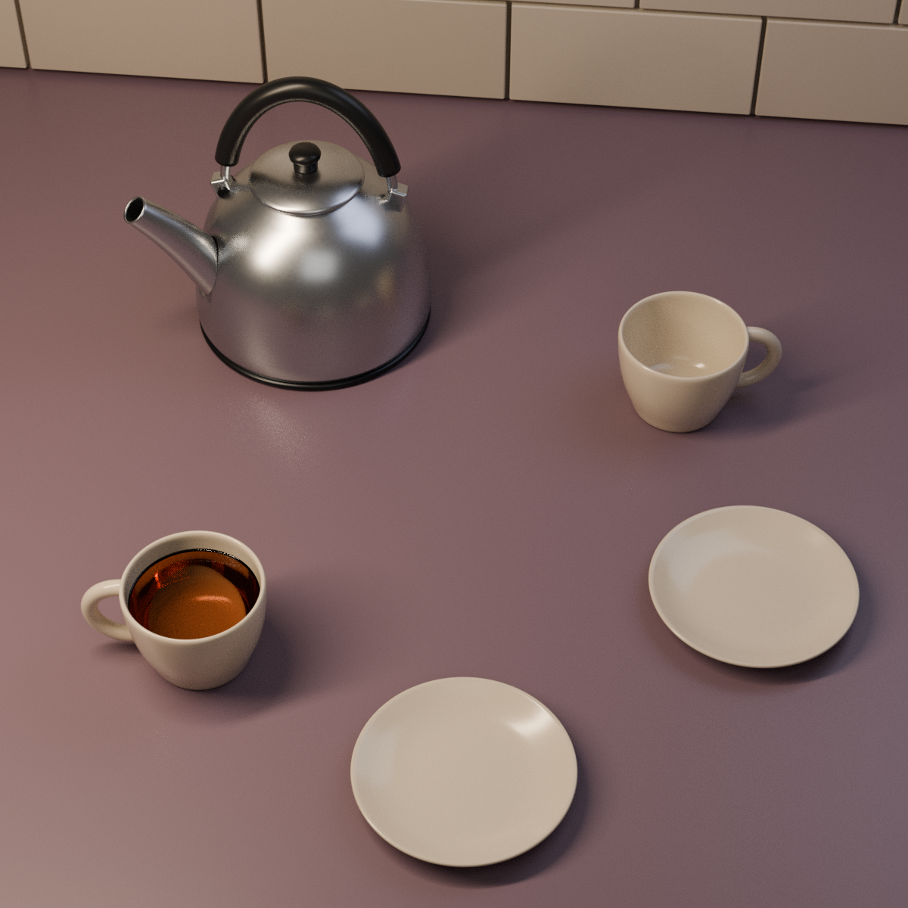

# 두 잔의 자리 · The Second Cup

한 잔에는 먼저 차를 따랐습니다. 다른 잔과 작은 접시 두 개는 아직 비어 있습니다.
소보로 두 개는 집으로 오는 사람의 가방 안에 있습니다.
부엌에서는 주전자를 준비해 두었습니다. 조금 뒤에 함께 먹을 자리입니다.



**위 이미지는 편집 가능한 Blender 장면에서 만든 실제 Cycles 렌더입니다. 생성 콘셉트, 실물 사진, 게임 화면이 아닙니다.**

## 비 오는 동네, 집 안의 작은 준비

이 장면은 [가상의 동네 설정](../after-the-rain/narrative/WORLD_BIBLE.md)의 빵을 든 승객과 연결되는 독립 정물입니다.
승객은 소보로 두 개를 배우자가 차를 준비한 집으로 가져갑니다. 아직 집에 도착하지 않았으므로 빵·봉투·부스러기는 없습니다.
큰 사건이나 오랜 이별이 아니라, 자기 전에 함께 먹는 작은 휴일 의식입니다.
실제 인물·집·사용자의 개인사를 재현하지 않습니다. 게임이나 다른 Blender 작품의 파일을 바꾸지도 않습니다.

소품은 **정확히 다섯 묶음**입니다: 차가 든 잔, 빈 잔, 빈 빵 접시 두 개, 작은 금속 주전자.
컵 손잡이·주전자 뚜껑·주둥이·손잡이 부속은 각 소품의 구성 부품입니다. 식탁과 타일은 배경입니다.
사람, 빈 의자, 시계, 쪽지, 사진, 꽃, 눈에 띄는 수증기는 추가하지 않았습니다.

## 콘셉트를 보고, 다시 모델링하기

- [원본 GPT Image 콘셉트](reference/gpt_image_concept.png)
- [실제로 사용한 정확한 생성 프롬프트](reference/concept_prompt.txt)
- 실제 3D 결과: `The_Second_Cup.blend`, `build.py`, 위 최종 렌더

원본 콘셉트의 실제 픽셀을 확인한 뒤 구도와 재료감을 참고했습니다.
실제 장면은 별도로 정한 치수·메시·회전체 단면·광원으로 구성했습니다. 정확한 이미지 복원이나 이미지→메시 변환이 아닙니다.
두 사람 크기의 작은 주전자, 80mm 카메라, 접시의 크기와 위치, 실제 속이 빈 컵, 액체 단면을 새로 설계했습니다.

생성 PNG 원본 바이트와 포함된 출처 메타데이터/C2PA를 보존했습니다.
같은 바이트를 `.blend` 안에 **참고용으로만 패킹**했으며, 재질·월드·합성 이미지로 사용하지 않았습니다.
최종 렌더의 모든 표면은 실제 3D 지오메트리와 절차적 재질입니다.
다운로드한 메시, 텍스처, HDRI나 제3자 에셋은 없습니다.

## 이번 재질 실험

목재·담요·보이는 작업등 대신, 연한 자두빛 포셀린 상판과 우유빛 도기, 새틴 스테인리스의 조합을 골랐습니다.
화면 밖의 좁고 긴 면광원이 금속 몸통에 긴 반사광을 만들며, 작은 회보라색 보조광이 가장자리를 분리합니다.
낮은 세기의 실내 반사광은 빈 잔의 밝은 바닥을 남깁니다.

- **컵:** 지름 약 100mm, 높이 74.8mm. 몸체가 내벽·바닥·굽으로 이어지는 닫힌 메시이며, 림 쪽 벽 두께는 4mm, 가운데 바닥은 7mm입니다.
- **차:** 수평 액면은 상판 위 59mm, 벽의 메니스커스는 0.8mm 높습니다. 최고 액체점도 컵 림보다 15mm 낮습니다. 표면 한 장이 아니라 닫힌 액체 체적입니다.
- **접시:** 지름 약 150mm. 얇은 원판이 아니라 얕은 안쪽 면과 아래 굽이 있는 별도 빵 접시입니다.
- **주전자:** 금속 몸통과 뚜껑, 열린 주둥이, 금속 손잡이 뼈대와 두꺼운 차콜 그립을 분리했습니다. 약 1.4mm 주둥이 벽과 실제 보어를 만들고, 몸통에는 연결 구멍을 냈습니다.

이 치수들은 디지털 조형 선택입니다. 실제 제품의 제작·안전 사양이 아닙니다.

## 파일과 재생성

| 파일 | 역할 |
| --- | --- |
| `The_Second_Cup.blend` | 이름 있는 컬렉션, 개별 편집 가능한 물체, 저장된 카메라, 패킹한 원본 참고 이미지 |
| `build.py` | 장면·메시·재질·조명을 다시 만드는 결정론적 소스 |
| `renders/the_second_cup_final.png` | 1200 × 1200 실제 최종 렌더 |
| `renders/01_blockout.png` | 첫 600 × 600 / 24샘플 조명·구도 시험. 최종 결과가 아님 |
| `audit.py` / `geometry_audit.json` | 저장 파일을 다시 열어 실행한 기하·접촉·내벽·액면·참조 검사 |
| `checks.json` | 실제 제작·렌더 설정과 한계 |
| `provenance.json` | 콘셉트·독립 모델링·공개 PNG 처리의 출처와 해시 |
| `manifest.json` / `verify_bundle.py` | 공개 파일의 크기·SHA-256 및 검사 결과 검증 |

Blender **4.3.2**, Cycles CPU 두 스레드에서 제작했습니다. 프로젝트 폴더에서 실행합니다.

```sh
mkdir -p work renders
TMPDIR="$PWD/work" blender -b -t 2 --python-exit-code 1 --python build.py -- --draft
TMPDIR="$PWD/work" blender -b -t 2 --python-exit-code 1 --python build.py
TMPDIR="$PWD/work" blender -b The_Second_Cup.blend -t 2 --python-exit-code 1 --python audit.py
python3 verify_bundle.py --sanitize
python3 verify_bundle.py --freeze
python3 verify_bundle.py
```

`--draft`는 `The_Second_Cup_Draft.blend`와 `work/draft.png`를 만듭니다.
첫 블록아웃은 비교용 기록으로 따로 보존되며 최신 코드로 덮어쓰지 않습니다.
`--no-render`는 장면과 설정만 저장합니다. 기본 실행은 최종 `.blend`와 렌더를 교체합니다.
모델링 소스와 기하 감사에는 Blender 이외의 Python 패키지가 필요하지 않습니다.
공개 PNG 정리(`--sanitize`)에는 Pillow가 필요하며, 기본 번들 검증은 Python 표준 라이브러리만 사용합니다.

## 실제 픽셀을 보고 고친 점

첫 시험은 광량이 너무 강해 도자기와 상판이 희게 날아가고 식탁 여백이 지나치게 넓었습니다.
광량과 노출을 낮추고 카메라를 조였으며, 주전자와 접시를 두 사람의 작은 식탁에 맞는 비율로 바꿨습니다.
주둥이는 더 짧게 정리하고, 금속 반사를 길게 분리하도록 주광원의 폭을 줄였습니다.
빈 잔의 바닥과 차가 든 잔의 액면을 실제 렌더에서 구별해 확인했습니다.
1200px 검사에서 손잡이 윗접합 끝이 빈 잔 안쪽에 조금 드러나는 것도 찾아 고쳤습니다.
끝점을 도기 벽 안으로 제한하고 두 손잡이가 컵 공동을 침범하지 않는 검사까지 추가했습니다.

최종은 최대 128샘플, 적응형 샘플링, AgX이며 디노이저를 사용하지 않습니다.
이 실행 환경의 Blender는 사용 가능한 디노이저 항목을 제공하지 않아, 지원되지 않는 후처리를 사용했다고 주장하지 않습니다.

## 검증 범위와 광학적 근사

`geometry_audit.json`은 모디파이어 적용 후의 좌표 유한성, 닫힌 메시, 면 방향, 면적 0인 면을 검사합니다.
다섯 소품의 굽/받침이 상판에 닿는지 확인하고, **실제 메시를 향한 광선 검사**로 두 컵의 열린 내부·바닥·벽 두께를 측정합니다.
액면 수평, 메니스커스 높이, 림 아래 여유, 액체가 하나뿐인 것, 컵/접시 몸체 간격도 확인합니다.
손잡이 꼭짓점과 컵 내부 단면을 대조하고, 주둥이 입구의 실제 벽 두께와 열린 보어도 검사합니다.
원본 참고 이미지와 내장 바이트 일치, 이미지 투영 없음, 상대 경로와 외부 Blender 라이브러리 없음도 검사합니다.

컵 손잡이와 주전자 부속에는 조립을 위한 의도적인 숨은 겹침이 있습니다.
간격 검사는 모든 메시 쌍의 충돌 검사나 모든 접합부의 기밀성 검증이 아닙니다.
주둥이 연결 구멍이 존재한다고 해서 실제로 안전하게 물을 따를 수 있는 설계라고 주장하지 않습니다.

차에는 굴절과 체적 흡수를 사용하지만, 노이즈와 검게 막힌 잔 바닥을 줄이기 위해 **액체의 그림자 광선은 끕니다**.
반사·굴절 코스틱도 끄며 간접광 클램프는 4입니다. 액체 바닥에는 0.15mm의 수치적 여유를 둡니다.
이는 예술적 광학 근사이고, 유체·표면장력·열 시뮬레이션이나 차의 성분·광학 측정이 아닙니다.
금속·도자기·식품 접촉·내열성·손잡이 하중·제품 안전은 검증하지 않았습니다.

## 공개 사본과 개인 정보

두 Blender 렌더의 알려진 렌더러 텍스트 항목 중 파일 경로·시각·통계만 공개 PNG에서 정리했습니다.
원본과 공개 사본의 **IDAT 압축 바이트 및 디코딩 RGB 픽셀은 동일**하며, 해상도·색 정보는 유지했습니다.
알 수 없는 저작자·저작권 항목이 생기면 정리 도구가 중단하도록 했습니다.
원본 생성 콘셉트의 출처 메타데이터는 변경하지 않았습니다.
공개 목록에는 작품 소스·검사 결과·정리된 렌더와 원본 콘셉트만 포함합니다.
`.blend`의 패킹 이미지 내부 경로와 기본 파일 탐색기 경로도 정리했으며, 저장 바이너리에 제작 컴퓨터의 홈·작업 경로가 남지 않는지 검사했습니다.

저장소 다른 작품의 라이선스와 에셋 조건은 그 작품의 범위에 그대로 남습니다.
