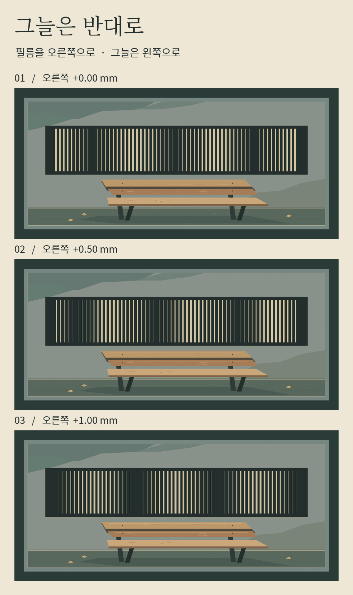

# 그늘은 반대로

손끝은 필름을 오른쪽으로 민다. 빈 벤치 위의 그늘은 왼쪽으로 간다.



[정지 비교 이미지](Shade-Goes-the-Other-Way.jpg) · [A4 실척 도안 PDF](Shade-Goes-the-Other-Way-Print.pdf)

## 책상 위에 놓기

한 PDF가 2쪽입니다. **1쪽 A는 종이**, **2쪽 B는 프린터에 맞는 투명 필름**에 인쇄합니다. 외곽 168×78mm의 그림 카드와 그 위를 미끄러지는 필름 한 장입니다.

1. 두 장을 A4 단면, **실제 크기 100%**로 각각 출력하세요. ‘용지에 맞춤’을 끄고, 두 쪽의 50mm 기준선을 자로 확인하세요. 실측이 다르면 자르기 전에 인쇄 설정부터 맞춥니다.
2. 가는 적갈색 테두리만 따라 A와 B를 자릅니다. 그림이나 검은 세로줄은 자르지 않습니다.
3. B를 A에 올립니다. B의 윗변은 카드 양옆의 작은 가로 눈금에, B의 왼쪽 변은 카드 왼쪽 위 두 세로 눈금 중 **왼쪽**에 맞춥니다. 필름의 인쇄면 방향은 A와 B의 그림을 책상 위에 나란히 놓고 읽을 수 있었던 방향 그대로 유지합니다. 세로줄이 평행해야 합니다.
4. 우선 한 손으로 필름 윗변을 가볍게 짚고, 다른 손으로 필름을 수평으로 미세요. 손을 떼어도 안내가 필요하면 좁은 종이띠 두 개를 격자 바깥의 필름 양 끝 가까이에서 세로로 걸칩니다. 각 띠의 위·아래 끝만 카드에 붙여 작은 고리를 만들고, 필름에는 풀이나 테이프를 붙이지 않습니다.
5. B의 왼쪽 변을 오른쪽 눈금까지 천천히 밀면, 폭이 넓은 어두운 띠 세 개가 반대쪽으로 갑니다. 눈금 사이는 2.10mm로, 한 번 끝까지 밀면 처음 무늬가 되풀이됩니다. 중간에서 멈춰 벤치와 그늘을 따로 보세요.

밝은 데서 평평하게 겹쳐 봅니다. 필름을 비틀면 세로 띠가 기울고, 인쇄된 검정의 투과율이나 배율 차이가 대비를 바꿀 수 있습니다. 출력과 실물 제작은 아직 하지 않았습니다.

## 제작·확인

고정 줄 간격 2.00mm, 이동 줄 간격 2.10mm, 각각 절반 폭의 잉크를 썼습니다. 두 줄무늬가 겹칠 때 밝은 부분이 넓어져 42mm 간격의 띠가 생깁니다. 이상적인 평행 배치에서 필름을 오른쪽으로 0.50mm 밀면 띠는 왼쪽으로 10mm 움직입니다. 줄 간격을 같게 바꾼 대조에서는 넓은 띠가 생기지 않았습니다.

도안은 A4와 50mm 기준선 및 2.00·2.10mm 피치를 PDF 좌표로 확인했고, 두 쪽을 렌더해 재단 테두리와 눈금을 검토했습니다. 정지 비교는 실제 손 움직임을 재생하는 영상이 아니라 같은 좌표로 세 위치를 그린 것입니다. 원본과 휴대폰 크기 축소본에서 세 장면을 확인했습니다.

벤치 그림과 도안은 직접 그리고 외부 이미지를 사용하지 않았습니다. 서로 다른 줄 간격의 겹침 원리는 [콜로라도대 볼더의 물리 실험 안내](https://physicslabs.colorado.edu/demos/oscillations-and-waves/wave-motion/phase-and-group-velocity/group-velocity/)를 참고했습니다.

## 재생성

Python 3, ReportLab·Pillow·NumPy·pdfplumber, Poppler의 `pdftoppm`, Noto Sans CJK·Noto Serif CJK가 필요합니다. 새 폴더로 생성하면 보관본을 덮어쓰지 않습니다. 같은 환경의 별도 사본에서 두 결과물의 바이트 일치를 확인했습니다.

```sh
python3 build.py /tmp/shade-other-way
cmp Shade-Goes-the-Other-Way.jpg /tmp/shade-other-way/Shade-Goes-the-Other-Way.jpg
cmp Shade-Goes-the-Other-Way-Print.pdf /tmp/shade-other-way/Shade-Goes-the-Other-Way-Print.pdf
python3 verify.py
```
