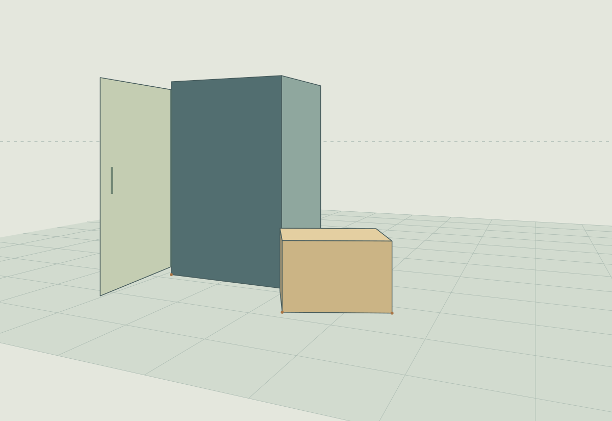

# 같은 눈높이 · 별도 원근 연습

기존 빨래방 그림을 고치지 않고 만든 작은 검토용 시제품이다. 그림의 분위기보다 공통 카메라, 접지, 열린 판과 회전된 상자의 방향을 검증하는 데 목적을 두었다. 발표용 완성 작품이나 게임 구현은 아니다.

## 설계

원본 화면은 1600 × 1100, 수평 카메라의 높이는 가상 1단위, 지평선은 y=370이다. 큰 상자형 본체의 두 수평 소실점은 (-2350,370), (1400,370)이다. 25도 회전한 작은 상자의 소실점은 다르지만 같은 지평선에 있다. 그중 하나가 매우 멀리 있어 화면에서는 해당 변이 거의 평행하게 보인다. 이 현상은 임의의 평행선 혼합이 아니라 동일한 투영식의 결과다.

큰 본체 앞 왼쪽에 힌지로 연결한 판을 85도 열었다. 판과 손잡이는 같은 월드 좌표에서 변환한다. 본체와 작은 상자의 밑면은 z=0이고, 보이는 접점 세 곳만 갈색 점으로 표시한다. 작은 상자를 본체의 오른쪽 앞에 놓아 실제 화면 겹침도 검사할 수 있게 했다. 회색 앞면은 단순한 기준 평면이며 내부까지 모델링한 가구가 아니다.

## 확인과 시행착오

처음의 55도 열린 판은 이 카메라에서 거의 옆면만 보여 학습 목적에 맞지 않았다. 판 자체를 왜곡하지 않고 힌지 회전각을 85도로 바꿨다. 작은 상자는 가정한 오른쪽 면이 아니라 왼쪽 면이 보여야 함을 확인했고, 면 법선과 카메라 위치로 보이는 면을 선택하도록 수정했다.

모든 수평 소실점의 공통 높이, 직교 방향 소실점의 초점거리 관계, 바닥 접점, 91개 회전각에서의 힌지 고정을 검사했다. 문이 움직일 수 있는 범위와 작은 상자는 x방향 경계로 분리됨을 확인했다. 이것은 가상 배치 검사이며 제작·동선 안전 인증은 아니다.

10px 간격의 화면 격자에서 SVG 면의 그리기 순서와 카메라 광선-평면 교차 깊이를 비교했다. 면 위의 표본 3523개 중 겹침 표본은 137개이며, 잘못된 앞뒤 순서는 0개였다. 유한 표본 검사로 모든 픽셀을 증명하지는 않는다. 실제 1200 × 825 PNG도 직접 확인했다. 빛과 그림자는 검증 목적에서 제외했다.

## 파일과 재현

- `build.py`: 좌표·카메라로 SVG를 만들고 Inkscape로 PNG를 렌더한다.
- `study.svg`, `study.png`: 편집 가능한 벡터 시제품과 실제 렌더.
- `verification.json`: 카메라, 소실점, 접지·힌지 검사.
- `check_occlusion.py`, `occlusion_check.json`: 다시 빌드한 뒤 표본 앞뒤 관계를 검사한다.
- `public_review.json`: 의존성·외부 참조·메타데이터와 반복 생성 검사 기록.
- `SHA256SUMS`: 공개 파일의 해시. 재생성 후 검증 기록을 바꾸면 해시도 별도로 갱신해야 한다.

설치된 Python 3와 Inkscape 1.4에서 `python check_occlusion.py`를 실행한다. 같은 폴더의 결과 파일을 덮어쓴다. 외부 이미지, 폰트, 이미지 생성, 네트워크 자원은 사용하지 않는다. 원본 [회전이 멎은 뒤](../after-the-turn/README.md)의 수정본이 아니다. 기존 그림의 구도와 파일을 유지하고 별도의 도형으로 투영 조건을 연습했다.

## 의존성 및 해석의 한계

Python 3 표준 라이브러리와 설치된 Inkscape 1.4만 사용한다. `check_occlusion.py`는 같은 폴더의 `build.py`를 가져오며 이때 SVG·PNG·수치 결과를 다시 생성한다. 명령 실행 시 이 연구 폴더의 결과가 덮어써진다. 빌드 과정에서 다운로드하거나 패키지를 설치하지 않는다. 글꼴, 외부 이미지, 생성형 이미지 및 비공개 입력은 없다.

기하 검사와 화면 겹침 검사는 같은 카메라 정의를 공유하므로 카메라 식 전체를 독립적으로 증명한 것은 아니다. 겹침 검사는 그리기 순서와 광선-평면 교차의 깊이를 비교하는 별도 방법이다. 10px 격자 사이의 누락, 경계선, 선 굵기, 모든 가능한 문 각도의 화면 겹침은 검증하지 않았다. 91개 문 각도의 검사는 힌지 좌표 고정에만 해당한다. 문과 상자의 x경계 분리는 구성한 -90°~0° 범위에 대한 단순 경계 검사다.

이 시제품은 광학적 사실감이나 완성 작품의 미적 품질을 입증하지 않는다. 바닥 격자와 접점 표시는 검토용 보조선이며 실제 재료가 아니다. 연구 결과를 기존 빨래방 그림이 정확했다는 근거로 사용하지 않는다.
