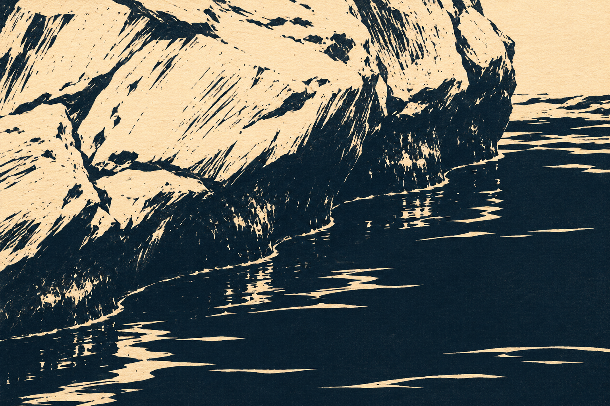

# 잠긴 가장자리

짙은 청흑색과 따뜻한 바탕색을 중심으로 그린 판화풍 이미지입니다. 마른 바위의 거친 자국, 젖은 아래쪽의 짙은 면, 길고 가는 물의 반사를 서로 다른 선과 면으로 나누었습니다. 풍경 전체보다 바위와 물이 만나는 가장자리에 가까이 다가갔습니다.



## 원본과 제작

이미지 생성 도구로 제작했습니다. `prompt.txt`에 전체 생성 지시를 원문 그대로 보존했습니다. `Submerged-Edge.png`는 생성된 결과를 바이트 변경 없이 복사한 원본이며 이후 색 보정이나 합성을 하지 않았습니다.

`verify.py`는 PNG 구조·전체 픽셀 디코드·크기·RGB 모드·SHA-256을 읽기 전용으로 검사합니다. Python과 Pillow가 필요합니다.

```sh
python3 verify.py
```

`--report 경로.json`을 지정한 경우에만 별도 기록을 저장합니다. `qa.json`은 파일 검사 결과이고 `manifest.json`은 보존 파일의 크기와 SHA-256입니다.

같은 프롬프트로 동일한 픽셀을 다시 생성하는 것은 보장되지 않으므로, 보존된 PNG 자체를 원본으로 사용합니다.

## 확인한 범위

마른 돌·젖은 가장자리·수면이 구분되는지, 큰 대각선 구도와 좁은 반사 무늬가 어울리는지 육안 검토했습니다. 오른쪽 위의 밝은 부분은 먼 하늘처럼도 읽힐 수 있으나, 전체 구도를 유지하는 편을 선택했습니다. PNG 전체 디코드와 생성 원본 대비 복사본의 바이트 일치도 확인했습니다.
