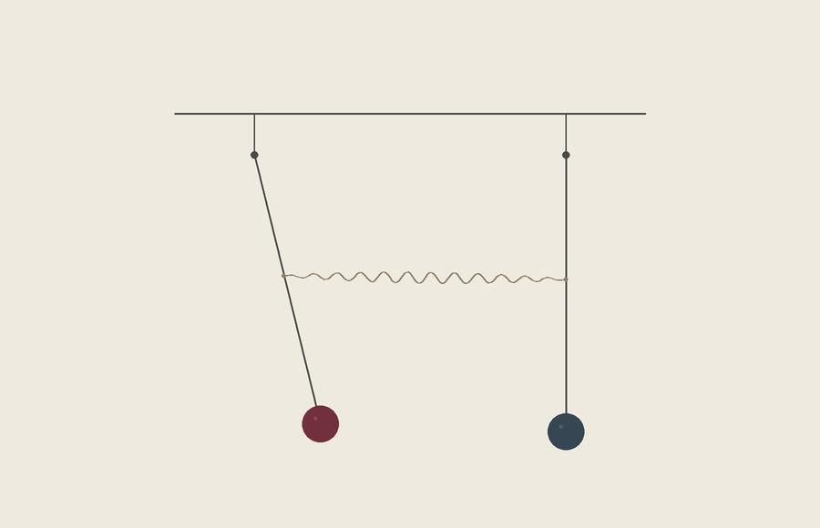

# 번갈아 쉬는 동안

두 진자의 흔들림이 한쪽에서 다른 쪽으로 옮겨갔다가 돌아오는 20초 무성 장면입니다. 첫 순간에는 왼쪽만 기울어 있습니다. 시간이 흐르며 왼쪽의 진폭이 거의 가라앉고 오른쪽이 크게 움직이며, 다시 왼쪽으로 돌아옵니다.

[영상](Taking-Turns-at-Rest.mp4)



## 움직임

길이가 같은 두 진자의 막대 중간을 스프링으로 연결했습니다. 비선형 진자 방정식을 적분한 표본으로 위치를 그렸고, 멈추는 구간을 따로 붙이지 않았습니다. 첫 진폭 교환은 약 9초, 복귀는 약 18초 부근입니다. 진폭이 약해진 쪽에도 작은 움직임은 남습니다.

카메라는 고정했습니다. 화면의 물결선은 스프링 연결을 나타내며 압축과 인장을 모두 허용하는 모델입니다. 끝부분의 짧은 화면 전환은 그림의 농도만 줄입니다. 반복 재생의 이음매를 맞춘 영상은 아닙니다.

## 모델과 한계

질점 두 개, 질량 없는 강체 막대, 질량 없는 선형 스프링, 마찰 없는 평면 모델입니다. 중력 토크와 스프링 힘에 의한 토크를 함께 계산합니다. 중력의 사인 항과 실제 연결점 사이의 거리를 사용합니다.

별도 구현으로 힘·토크 부호, 에너지 보존과 진폭 교환을 확인했습니다. 독립 검사 기록은 24초 구간을 다루고, 영상은 그중 처음 20초를 사용합니다. 스프링의 물결 모양은 도식적 표현이며 실제 코일 치수·응력·피로·제작 안전을 검증한 설계가 아닙니다.

## 원본과 재현

- `parameters.json`: 물리·화면·영상 설정.
- `model.py`, `motion.csv`: 방정식과 영상에 사용한 480개 표본.
- `render.py`, `build_video.py`: 그림과 무음 영상 제작.
- `independent_check.py`, `independent_check_results.json`: 별도 모델 검증.
- `verify.py`, `qa.json`: 표본·영상·대표 프레임 검사.
- `manifest.json`: 보존 파일의 크기와 SHA-256.

Python, NumPy, SciPy, Pillow, FFmpeg와 ffprobe가 필요합니다. 기존 결과를 덮어쓰지 않도록 별도 사본에서 실행합니다.

```sh
python3 build_video.py
python3 verify.py
python3 independent_check.py
```

렌더는 메모리 사용량을 제한하려고 작은 프레임 묶음으로 실행합니다. 기본 검사 명령은 공개 파일을 바꾸지 않습니다. `verify.py --report 파일명.json`을 지정하면 검사 결과를 따로 저장합니다.

## 확인한 범위

480프레임 전체 디코드, 길이·프레임률·무음, 에너지 변화, 원본 표본의 재계산, 대표 프레임의 인코딩 오차를 검사했습니다. 실제 인코딩된 프레임들을 뽑아 구성과 연결을 보았습니다. 보존 대상 파일만 담은 별도 사본에서 전체 영상을 다시 제작해 MP4·PNG·CSV의 바이트가 원본과 일치함을 확인했습니다. 정상 속도로 영상을 육안 재생한 검토와 실제 장치 실험은 하지 않았습니다.
