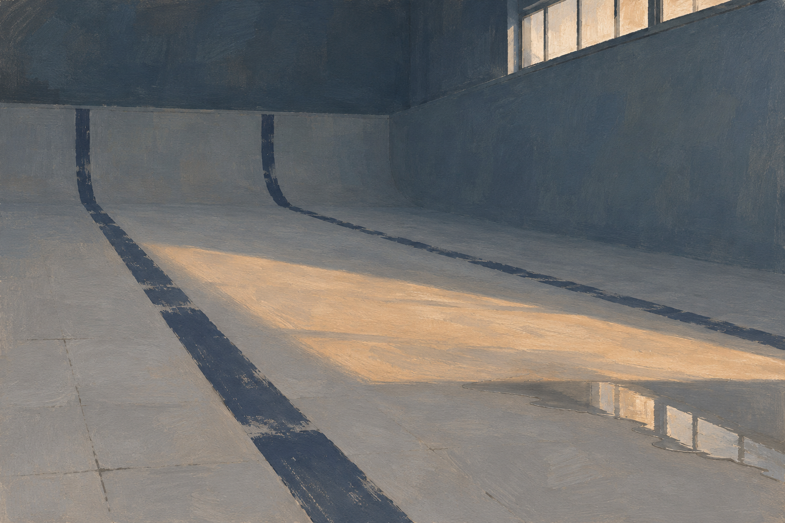

# 오후의 바닥

물이 빠진 실내 수영장에 남은 오후를 그린 회화풍 생성 이미지입니다. 넓은 바닥과 어두운 벽, 두 개의 레인 선, 창에서 들어온 빛과 작은 물웅덩이로 화면을 구성했습니다. 사물을 더하기보다 비어 있는 공간의 깊이를 남기는 쪽을 택했습니다.



## 이어진 소설: 남은 작업

물이 빠진 수영장을 작업 공간으로 바라본 짧은 소설입니다. 반복해서 젖는 한 자리 앞에서, 오늘 작업비를 받아야 하는 도장공과 재개장 안내를 맡은 직원이 같은 완료 확인서를 다르게 읽습니다. 그림을 설명하는 글이 아니라 그 공간에서 새로 쓴 이야기입니다.

- [남은 작업 PDF](output/pdf/Remaining-Work.pdf)
- [남은 작업 TXT](output/text/Remaining-Work.txt)
- [편집 원문](story.txt)

`build_reading.py`는 원문을 읽기용 PDF와 바이트가 같은 TXT로 만듭니다. `verify_reading.py`의 기본 실행은 읽기 전용이며, `--report 경로.json`을 명시할 때만 기록을 저장합니다. `reading_qa.json`은 소설의 조판 검사 기록입니다. 기존 이미지·생성 프롬프트·이미지 검사 파일은 그대로 보존했습니다.

재현은 기존 결과를 덮어쓰지 않도록 별도 사본에서 실행합니다. Python, ReportLab, fontTools, pdfplumber, pypdf와 Noto Serif CJK KR 글꼴이 필요하며, 쪽을 이미지로 볼 때는 Poppler를 사용합니다. 글꼴은 SIL Open Font License 1.1에 따라 사용 글자만 변환·내장합니다.

```sh
python3 build_reading.py
python3 verify_reading.py
```

소설은 인물의 동기와 전달된 정보, 작업·서류 처리의 인과를 독립 검토했습니다. 4쪽 PDF의 글자열·글꼴·경계·겹침과 모든 쪽의 렌더 이미지를 확인했고, 공개 제작 소스만 옮긴 사본에서 PDF·TXT의 바이트와 144dpi 렌더 픽셀이 원본과 일치했습니다. 실제 인쇄와 낭독은 확인하지 않았습니다.

## 원본과 제작

- [The-Bottom-of-Afternoon.png](The-Bottom-of-Afternoon.png): 최종 이미지. 1536×1024, RGB PNG.
- [prompt.txt](prompt.txt): 생성에 사용한 지시문 원문.
- [verify.py](verify.py), [qa.json](qa.json): 파일 무결성·크기·색상 모드 검사와 시각 검토 범위.
- [manifest.json](manifest.json): 보존 파일의 크기와 SHA-256.

내장 이미지 생성 도구로 제작했습니다. 생성된 원본 PNG를 바이트 변경 없이 옮겨 보존했으며, 후처리나 부분 편집은 하지 않았습니다. 손으로 그린 실물 회화나 장소를 촬영한 사진이 아닙니다. 별도의 편집 레이어나 3D 장면 파일은 없으며, 같은 지시문으로 다시 생성해도 동일한 픽셀이 재현되지는 않습니다.

## 확인한 범위

전체 이미지를 직접 보고 공간 구성, 레인 선, 빛과 작은 물웅덩이의 구분, 의도하지 않은 문자·사물 유무를 검토했습니다. 독립적인 시각 검토도 거쳤습니다. 실제 수영장 치수나 광학적으로 정확한 반사를 검증한 결과는 아닙니다.

파일 검사는 Python과 Pillow로 수행할 수 있습니다. 이미지를 수정하지 않는 읽기 전용 검사입니다.

```sh
python3 verify.py
```
