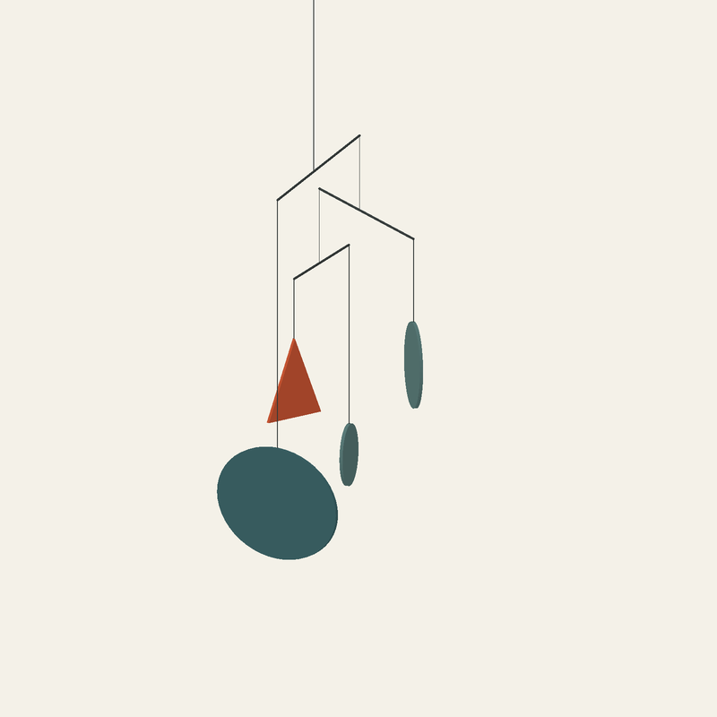

# 가벼운 쪽의 거리

크기와 무게가 다른 네 조각이 각자 돌면서 모였다가 다시 벌어지는 모빌 영상입니다. 붉은 삼각형 하나와 크기가 다른 청록색 조각 세 개를 얇은 막대에 매달았습니다. 카메라는 움직이지 않습니다.

처음에는 가지가 넓게 벌어져 구조가 도표처럼 보였습니다. 가장 위 막대를 짧게 만들고 회전 범위를 바꿔, 중간에 조각들이 한곳으로 모여 보였다가 풀어지는 구간을 남겼습니다. 특정한 그림이나 완벽한 정렬을 만들지는 않았습니다.

[16초 영상 보기](The-Lighter-Side.mp4)



## 결과물과 원본

- `The-Lighter-Side.mp4`: 800 × 800, 24fps, 16초 무성 영상. 끝에서 처음으로 이어지는 움직임입니다.
- `The-Lighter-Side.png`: 8초 지점의 정지 이미지.
- `The-Lighter-Side.obj`, `The-Lighter-Side.mtl`: 같은 지점의 3D 형상과 색상. 두 파일을 함께 둡니다.
- [mobile.py](mobile.py): 판과 막대의 형상, 질량 계산, 움직임을 생성하는 원본.
- [soft_renderer.py](soft_renderer.py): 깊이 버퍼를 사용하는 직교 투영 렌더러.
- `render_film.py`, `build_video.py`: 프레임 제작과 영상 인코딩.
- `export_pose.py`: OBJ와 MTL 내보내기.
- `check_geometry.py`, `test_renderer.py`, `verify_delivery.py`: 형상·렌더러·최종 파일 검사.
- `balance.json`, `geometry-qa.json`, `qa.json`, `manifest.json`: 수치 검사 결과와 파일 해시.

중간 프레임과 검토용 자료는 `tmp/`, `studies/`에 보관하며 배포 파일에 포함하지 않습니다.

## 만들기

Python, NumPy, SciPy, Pillow, FFmpeg가 필요합니다. 외부 모델이나 이미지 자산은 사용하지 않았습니다. 이 폴더에서 실행합니다.

```sh
python3 test_renderer.py
python3 check_geometry.py
python3 build_video.py
python3 export_pose.py
python3 verify_delivery.py
```

프레임은 2배 해상도로 계산한 뒤 축소합니다. 긴 렌더 실행의 메모리 누적을 피하려고 12프레임씩 별도 프로세스에서 만듭니다. 기존 프레임의 제작 조건과 원본 해시가 달라지면 이어 쓰지 않습니다. 재제작할 때는 기존 중간 프레임을 별도로 보존한 뒤 새 폴더에서 시작해야 합니다.

## 확인한 범위

판에는 일정한 두께와 밀도를, 막대에는 균일한 밀도를 부여했습니다. 각 가지의 매다는 지점을 양쪽 하중과 막대 자체의 질량으로 계산했습니다. 실은 질량이 없는 수직 연결로 취급합니다. 길이와 밀도는 모형을 위한 임의 단위입니다.

16초 동안 0.01초 간격의 1,601개 자세에서 정적 무게중심과 토크, 판 사이 및 판과 다른 실·막대 사이의 간섭을 검사했습니다. 검사한 자세에서 충돌은 없었고, 무게중심은 매다는 점 바로 아래에 놓였습니다. 주기의 시작과 끝에서 위치와 속도도 수치 오차 범위 안에서 이어집니다.

회전은 직접 정한 주기 함수입니다. 바람, 관성, 마찰이나 막대의 휨을 계산한 동역학 시뮬레이션은 아니며, 실제 제작물의 안전성을 검증한 것도 아닙니다. 샘플 사이의 모든 순간에 대한 충돌 증명은 하지 않았습니다.

최종 영상 전체 디코딩과 384프레임·24fps·16초·오디오 없음 여부를 확인했습니다. 모든 연속 프레임에 변화가 있고, 가상의 16초 끝 장면은 첫 장면과 픽셀 단위로 같습니다. 인코딩된 표본 프레임과 연속 장면을 이미지로 검토했습니다. 정상 속도로 직접 재생하며 확인하는 환경은 사용할 수 없었습니다.
