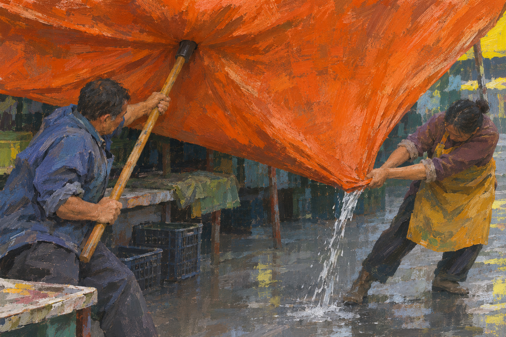

# 낮은 모서리

비가 그친 시장에서 두 사람이 천막에 고인 물을 빼는 장면입니다. 한쪽은 막대로 천막을 밀어 올리고, 다른 쪽은 모서리를 낮춥니다. 큰 주황색 면의 무게와 서로 다른 두 몸짓을 중심에 놓았습니다.



## 제작 원본

이미지 생성 도구로 제작한 디지털 회화입니다. 생성에 사용한 전체 지시는 `prompt.txt`에 원문 그대로 보존했습니다. 선택한 PNG는 생성 결과를 바이트 변경 없이 복사한 파일이며 이후 색 보정이나 합성을 하지 않았습니다.

`verify.py`는 PNG 파일 구조·전체 픽셀 디코드·크기·색상 모드·SHA-256을 확인합니다. Python과 Pillow가 필요합니다.

```sh
python3 verify.py
```

기본 검사는 파일을 바꾸지 않습니다. `--report 경로.json`을 지정한 경우에만 기록을 저장합니다. `qa.json`은 파일 검사 결과, `manifest.json`은 보존 파일의 크기와 SHA-256입니다.

생성 프롬프트는 제작 맥락을 보존하지만 동일한 픽셀을 다시 생성하는 결정적 제작 코드는 아닙니다. 보존된 PNG 자체를 원본으로 사용합니다.

## 확인한 범위

두 사람의 팔다리와 손의 접촉, 막대·천막·물줄기가 이어지는 동작, 화면의 구도와 색면을 두 차례 육안 검토했습니다. 위에서 고인 물은 이 시점에서 직접 보이지 않고, 천막의 주름과 흘러내리는 물이 배수 동작을 보여 줍니다. PNG 구조와 전체 픽셀 디코드, 원본 복사본의 해시 일치도 확인했습니다.
