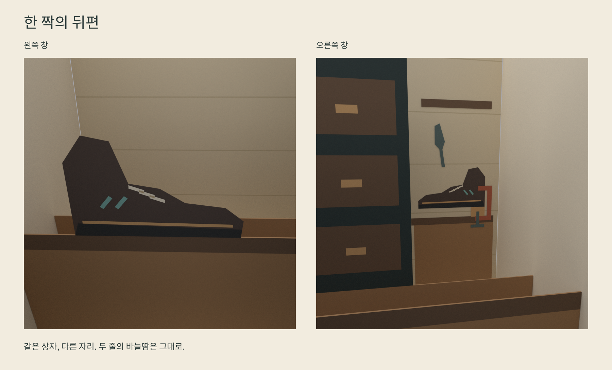

# 한 짝의 뒤편 · The Other Shoe

왼쪽 창에서는 선반에 놓인 구두 한 짝이 보입니다. 오른쪽으로 옮겨 보면, 보관장 뒤에서 다른 한 짝의 새 굽을 집게로 붙잡고 있습니다. 같은 두 줄의 청록색 바늘땀이 짝을 잇습니다.

**두 시점 종이 극장 시제품입니다.** 그림 두 장을 바꾸어 보여 주는 것이 아니라, 같은 네 장의 종이 면과 두 창으로 시야를 나눕니다. 디지털 미리보기와 실척 부품 도안은 완성했고, 실제 출력·재단·접착·관찰은 아직 하지 않았습니다.



- [나란히 보기 PNG](output/The-Other-Shoe.png)
- [왼쪽 시야 원본](output/left.png) · [오른쪽 시야 원본](output/right.png)
- [조립 모습의 네이티브 렌더](output/assembled.png)
- [편집 가능한 Blender 장면](output/The-Other-Shoe.blend)
- [A4 실척 부품 PDF · 3쪽](output/The-Other-Shoe-Parts.pdf)

## 구조

폭 140mm, 깊이 80mm, 높이 110mm입니다. 위는 열어 두어 주변 빛이 들어옵니다. 앞면 A와 공통 뒤판 D 사이에 선반 B, 보관장·작업대 C가 섭니다. 평면 구두 그림도 이 종이 면의 일부이며, 작은 조각을 따로 공중에 매다는 구조가 아닙니다.

앞에서 뒤로 A·B·C·D의 위치는 0·28·48·80mm입니다. 앞면 창 둘은 각각 40×56mm이며 중심은 가로 중앙에서 왼쪽·오른쪽 36mm, 바닥에서 60mm입니다. B의 구두는 선반과 연결된 한 장의 윤곽으로 자릅니다. D의 수리 중 구두·굽·집게는 **뒤판에 인쇄된 그림**이므로 그 윤곽을 따로 자르지 않습니다.

## 만들 때

필요한 것은 A4 카드지 3장, 풀, 자, 가위 또는 종이용 칼, 바닥 보호판입니다. 200–250g/㎡ 카드지를 시작점으로 제안하지만 재료별 조립 시험은 하지 않았습니다. 칼은 보호판 위에서 몸 바깥 방향으로 쓰고, 어린이는 보호자와 함께 작업하세요.

1. PDF를 A4 **단면·실제 크기·100%**로 출력합니다. ‘페이지에 맞춤’을 끄고, 각 쪽 아래 기준선이 실제로 50mm인지 자로 재세요. 다르면 재단하지 말고 출력 배율부터 고칩니다.
2. 붉은 실선을 따라 A~G를 자릅니다. A의 두 창 내부도 제거합니다. 점선은 자르지 않습니다. C는 선반과 세로 보관장을 분리하지 말고 한 장으로 둡니다.
3. A~D의 아래 8mm 탭을 점선에서 접습니다. **A·B·C는 뒤쪽으로, D는 앞쪽으로** 접습니다. 탭 양끝의 8mm 홈은 옆판 탭과 겹치지 않도록 만든 것입니다.
4. 바닥 E는 글자가 있는 면을 위로, A 표시가 있는 가장자리를 앞으로 둡니다. B·C·D의 **접힌 선**을 E의 같은 글자 선에 맞추고 탭을 붙입니다. 그림은 모두 앞쪽 A를 향하게 합니다. D는 바닥 뒤쪽 가장자리에 섭니다.
5. 옆판 F·G의 아래 탭을 **안쪽으로** 접어 E의 좌우 가장자리에 붙입니다. 옆판의 짧은 방향 80mm가 앞뒤 깊이입니다. A를 앞쪽 가장자리에 붙인 뒤, A·D의 세로 가장자리도 옆판에 풀로 고정합니다. B·C 양끝은 옆판 안쪽에 닿게 하며, 얇게 풀을 덧대어 뒤틀림을 줄입니다.
6. 풀이 마르면 밝은 곳에서 한쪽 눈으로 봅니다. 눈을 창 중심 높이 60mm, 앞면에서 약 12mm 떨어뜨립니다. 왼쪽은 선반 구두를, 오른쪽은 뒤 작업대를 향해 시선을 약간 내립니다. 오른쪽 창 가장자리에서는 앞 구두의 끝도 조금 보일 수 있습니다.

완성 치수는 종이 두께를 제외한 공칭값입니다. 두꺼운 풀, 휘어진 종이, 창과 보관장의 재단 오차는 시야를 바꿀 수 있습니다. 디지털 눈 위치 표본은 실물 제작 공차를 보증하지 않습니다.

## 같은 기하로 만든 미리보기

`build.py`의 mm 좌표가 SVG 부품 원본·JSON 좌표와 Blender 장면을 함께 만듭니다. `build_print.py`도 그 좌표를 사용해 자르는 윤곽, 접는 선, 바닥·옆판을 배치합니다. `output/front.svg`, `shelf.svg`, `counter.svg`, `back.svg`는 그림 편집용 부품 원본이고, 재단에는 모든 부품이 있는 PDF를 사용합니다.

Blender의 두 시야 카메라는 지정한 눈 위치에 놓였습니다. 렌더에서는 시야를 좁혀 구두를 보기 좋게 담았으므로 사람의 주변 시야 전체를 그대로 재현한 것은 아닙니다. 종이 그림·두께·면 배치를 그린 가상 미리보기이며 실물 사진이 아닙니다. 풀과 접착 탭의 두께·종이 휨은 모델링하지 않았습니다.

## 확인한 범위

- 두 눈 위치 각각에서 x·y·z를 −1·0·+1mm 옮긴 27개 위치를 검사했습니다. 뒤 구두·새 굽·집게 안쪽의 0.5mm 격자 1,574점에 대해 **왼쪽 42,498광선은 모두 가려지고, 오른쪽 42,498광선은 모두 통과**합니다. 별도 모서리 투영 검토와 Blender 실제 광선 검사도 대조했습니다.
- 앞 구두의 꼭짓점은 위 27개 왼쪽 눈 위치에서 앞 창을 통과합니다. 오른쪽에서 앞 구두가 완전히 사라진다고 주장하지 않습니다.
- PDF는 A4 3쪽, 기준선 50mm, 창 40×56mm, 바닥 140×80mm, 옆판 80×118mm(8mm 탭 포함)를 PDF 좌표에서 확인했습니다. 세 쪽 모두 이미지로 검토했습니다.
- 네이티브 렌더 세 장을 직접 확인했습니다. 구조 검사와 그림에서 짝이 읽히는 판단은 별도로 했습니다. 실제 독자·관찰자 실험은 하지 않았습니다.

[기하 검사 기록](geometry_qa.json) · [통합 검사 기록](qa.json)

## 재생성

Blender 4.3.2, Python 3, ReportLab·Pillow·pdfplumber, Inkscape, Noto Sans CJK KR이 필요합니다. 외부 이미지나 모델은 없습니다. 기존 산출물을 덮어쓰므로 **프로젝트를 별도 사본으로 복사한 뒤** 실행합니다.

```sh
blender -b -t 8 --python build.py
python3 build_print.py
python3 build_preview.py
python3 verify_geometry.py
blender -b output/The-Other-Shoe.blend --python verify_scene.py
python3 verify.py
```

기본 검사는 읽기 전용입니다. `verify_geometry.py --report 파일.json`을 지정하면 기하 보고서만 기록합니다. `manifest.json`은 자신을 제외한 보존 파일의 크기·SHA-256입니다. `.blend1`, 캐시, 중간 렌더와 테스트 로그는 추적하지 않습니다.

## 참고

[V&A의 종이 극장 만들기](https://www.vam.ac.uk/articles/make-your-own-paper-peepshow)를 층을 세우는 방식의 참고로 읽었습니다. 안내의 병풍 접힘 대신 바닥에 고정하는 열린 상자를 설계했습니다. 박물관의 도안·사진·그림은 복사하거나 포함하지 않았습니다. 장면·구두·가림판·부품 치수는 이 작업의 독립 제작입니다.
