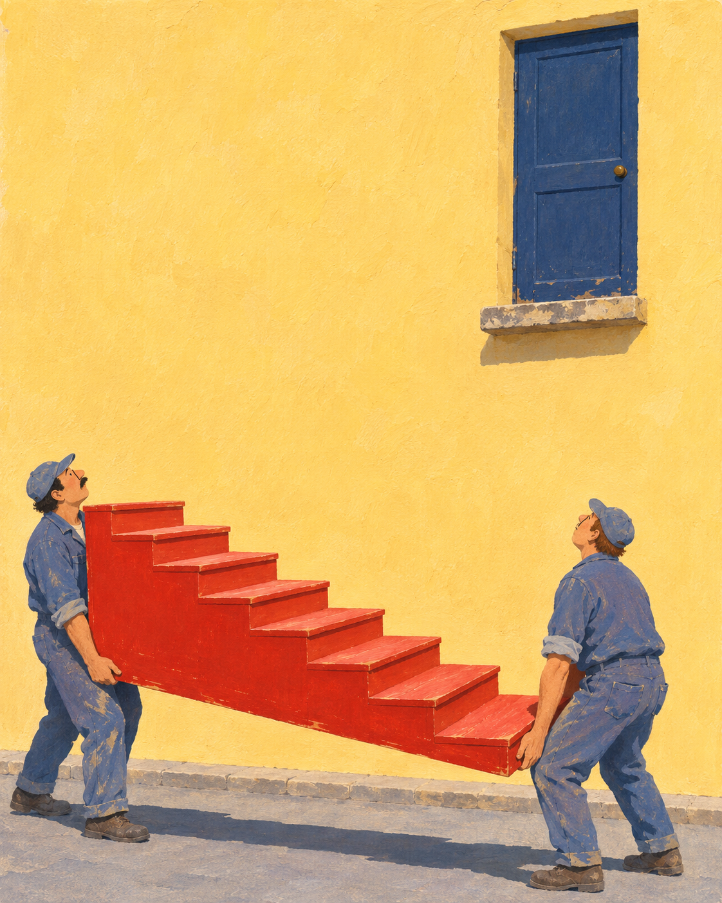

# 계단이 오는 날 · The Staircase Arrives

두 이삿짐꾼이 붉은 계단을 들고 멈췄습니다. 도착할 문은 노란 벽 위에 있고, 아직 그 아래에는 아무것도 없습니다.



**한 장의 독립 서사 일러스트로 채택했습니다.** 아래쪽의 무거운 계단과 위쪽의 빈 문 사이에 넓게 벽을 남겨, 무엇을 옮기고 어디에 놓으려는지 한 화면에서 읽히게 했습니다. 두 사람이 일단 멈춰 위를 보는 순간을 골랐습니다.

- [원본 PNG](output/The-Staircase-Arrives.png), 1122×1402, RGB
- [실제 사용한 생성 프롬프트](prompt.txt)
- [검토·파일 검사 기록](qa.json)

## 제작과 보존

내장 이미지 생성 도구로 한 번 생성했습니다. 외부 참조 이미지는 넣지 않았습니다. 구아슈와 종이 질감을 닮게 요청한 **생성 이미지**이며, 실제 손으로 그린 원화나 현장 사진이 아닙니다. 기존 게임·소설의 장소나 인물과 연결되지 않은 독립적인 환상 장면입니다.

제목·장면·구도·색 관계를 지정한 프롬프트와 생성 원본을 함께 보존합니다. 출력 후 보정·자르기·리사이즈를 하지 않았습니다. 프로젝트에 복사한 PNG는 도구가 저장한 원본과 바이트가 같습니다. 프롬프트를 다시 실행해도 같은 픽셀을 재생성한다는 보장은 없습니다. 편집 가능한 레이어나 3D 장면은 제공하지 않습니다.

## 검토

원본 전체를 직접 확인했습니다. 인물 두 명, 붉은 계단 한 개, 여덟 디딤면, 높은 문 하나가 읽히고, 벽의 빈 공간이 계단과 문을 분리합니다. 두 인물의 시선과 운반 자세가 장면의 정지를 설명합니다. 실제 운반 방법이나 건축 시공을 재현한 그림은 아닙니다.

지면 그림자는 요청한 왼쪽 방향과 달리 오른쪽으로 뻗습니다. 화면 안의 광원 관계와 장면 읽기에 큰 혼란이 없어 이 차이는 유지했습니다. 출력은 프롬프트의 모든 세부사항을 정확히 충족했다는 뜻이 아닙니다.

## 파일 검사

Python과 Pillow로 다음 읽기 전용 검사를 실행합니다.

```sh
python3 verify.py
```

검사는 PNG 디코드·크기·색상 모드와 보존 파일의 SHA-256을 확인합니다. 장면 의미나 미적 판단을 자동 검증하지는 않습니다. `manifest.json`은 자신을 제외한 보존 파일을 기록합니다. 이 프로젝트에는 임시 변형본이나 캐시를 포함하지 않습니다.
