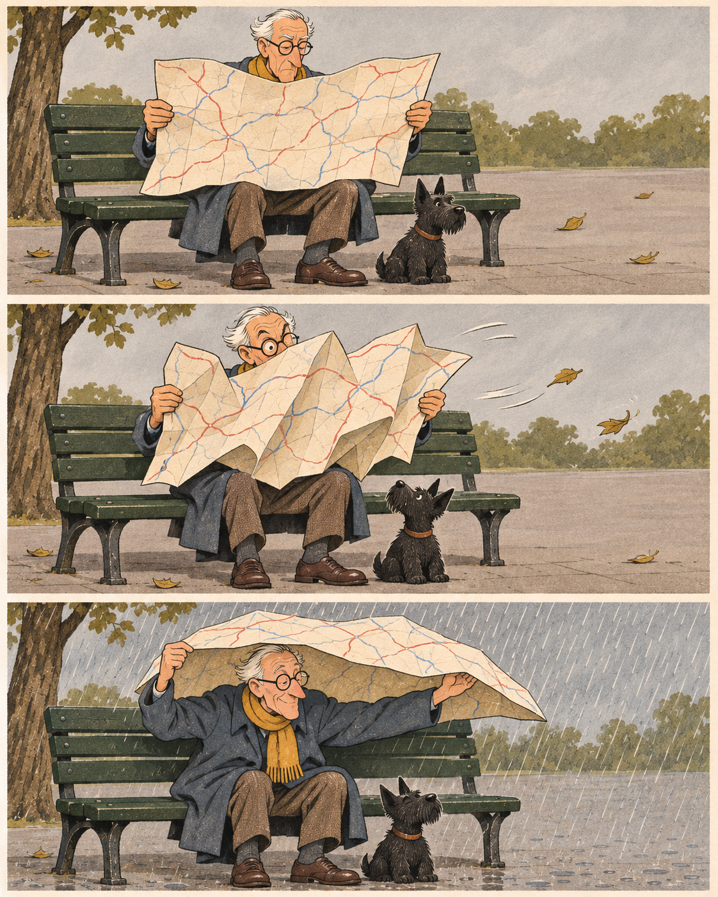

# 접지 못한 지도 · The Unfolded Map

노인이 지도를 읽습니다. 바람이 지도를 부풀립니다. 비가 오자, 아직 펼쳐진 지도 아래에 노인과 작은 개가 함께 들어갑니다.



**완성된 무언 3컷 만화로 채택했습니다.** 같은 벤치와 두 인물을 유지하고, 종이의 역할만 읽는 물건에서 다루기 어려운 물건으로, 다시 잠깐의 가림막으로 바꿨습니다. 설명 문구나 대사를 넣지 않았습니다.

- [원본 PNG](output/The-Unfolded-Map.png), 1122×1402 RGB
- [한국어 장면 설계](storyboard.txt)
- [실제 생성 지시문](prompt.txt)
- [검토·파일 검사 기록](qa.json)

## 제작과 검토

내장 이미지 생성 도구로 참조 이미지 없이 세 컷 전체를 한 번에 생성했습니다. 잉크선과 구아슈를 닮은 질감의 **생성 만화 이미지**이며 실제 손으로 그린 원화나 촬영한 장면은 아닙니다. 개별 컷의 편집 레이어는 제공하지 않습니다.

세 컷을 순서대로 직접 확인했습니다. 노인의 안경·외투·목도리, 작은 검은 개, 벤치와 큰 지도가 이어 읽힙니다. 중간 컷의 부푼 지도와 날리는 잎에서 바람이 드러나고, 마지막 컷의 비와 머리 위 지도가 새로운 쓰임을 설명합니다. 마지막 지도는 두 손으로 받친 얕은 지붕처럼 읽힙니다.

설계에서 의도한 ‘접으려다 실패하는 동작’보다는 ‘바람에 지도를 다루기 어려워진 상황’이 더 분명합니다. 짧은 농담의 흐름은 유지된다고 판단해 고치지 않았습니다. 지도 도로선의 세부와 배경 잎 위치까지 컷마다 동일한 것은 아닙니다. 인물·소품의 시각적 연속성을 검토한 것이지 동일한 3D 장면을 세 번 촬영한 결과가 아닙니다.

이야기 속 비가림은 짧은 순간의 시각적 농담입니다. 종이지도의 내수성이나 실용적인 우천 장비를 제안하는 자료가 아닙니다. 다른 작품의 인물이나 설정과 연결하지 않습니다.

## 보존과 검사

자르기·보정·리사이즈·컷 재배열 없이 생성 원본을 보존했습니다. 프로젝트 PNG는 도구가 저장한 원본과 바이트가 같습니다. 같은 지시문을 다시 실행해도 동일한 픽셀을 재생성한다고 보장하지 않습니다.

Python과 Pillow로 읽기 전용 검사를 실행합니다.

```sh
python3 verify.py
```

검사는 PNG 전체 디코드·크기·색상 모드와 보존 파일의 SHA-256을 확인합니다. 서사 이해·미적 판단·실물 인쇄 품질을 자동 평가하지 않습니다. `manifest.json`은 자신을 제외한 보존 파일을 기록합니다.
