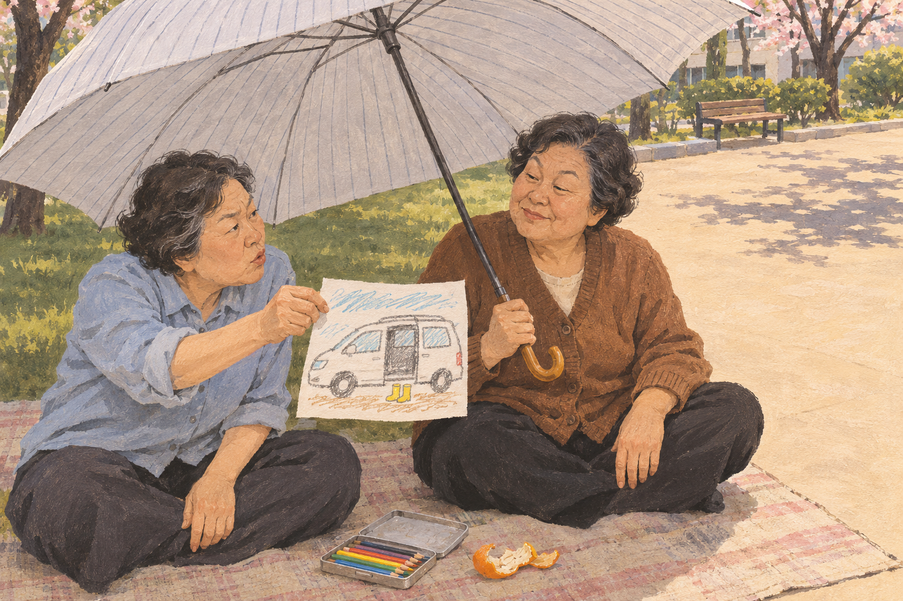

# 삼등 상품 · Third Prize

우산이 필요한 은희는 동네 사생대회의 삼등을 노립니다. 함께 온 경자가 그 우산을 타 버리고, 두 사람은 돗자리에서 값을 흥정합니다.

**완성된 독립 짧은 소설**입니다. 작은 욕심과 친한 사이의 계산을 대화와 행동으로 썼습니다. 실존 인물·대회 기록을 옮긴 이야기가 아니며 기존 게임이나 소설의 설정에 연결하지 않습니다.

- [읽기용 PDF · 4쪽](output/pdf/Third-Prize.pdf)
- [읽기용 TXT](output/text/Third-Prize.txt)
- [편집 원문](story.txt)
- [조판 소스](build_pdf.py) · [검사 기록](qa.json)

## 원고와 검토

삼등을 노린 그림이 특별히 인정받는 결말 대신, 친구가 상품을 받고 둘이 거래하는 장면으로 끝냈습니다. 은희가 놓친 장화를 그림에 남기는 행동과 경자가 이름을 지우지 말라고 하는 말 사이의 의미를 설명하는 문장은 넣지 않았습니다.

검토 중 상품 우산과 지나가는 사람의 우산이 같은 것으로 보일 수 있는 무늬 묘사를 고쳤습니다. 이미 약속한 점심과 추가하는 저녁·그림을 구분하고, 마지막 햇볕 변화에 우산을 접는 동작을 넣었습니다. 문학적 완성도 판단은 파일 검사와 별개이며, 외부 독자 반응·낭독 실연은 확인하지 않았습니다.

## 재현

Python 3, ReportLab, fontTools, pdfplumber, pypdf와 Noto Serif CJK Regular TTC가 필요합니다. 기본 글꼴 경로는 제작 코드에 있고 `--font`로 바꿀 수 있습니다. TTC의 한국어 글꼴을 사용한 문자만 변환해 PDF 안에 넣습니다. [글꼴 배포 고지·라이선스](FONT_LICENSE.txt)를 보존합니다. 별도 글꼴 파일은 동봉하지 않습니다.

조판 코드는 기존 《의자 두 개》의 제작·검사 코드를 이 작품용으로 수정한 독립 사본입니다. 기존 프로젝트는 바꾸지 않았습니다.

아래 명령은 기존 결과를 덮어쓰지 않고 새 경로에 출력합니다.

```sh
python3 build_pdf.py --output-root /tmp/third-prize-check/output
python3 verify.py --output-root /tmp/third-prize-check/output
```

기본 `python3 verify.py`는 보존된 출력과 매니페스트를 읽기 전용으로 검사합니다. 검사 결과를 별도 파일로 저장하려면 `--report /tmp/third-prize-check.json`을 지정합니다.

## 확인 범위

최종 PDF 네 쪽을 모두 PNG로 렌더하여 읽었습니다. 글꼴 누락·행 겹침·잘림이 없고, 쪽 경계에 문단 한 줄이 고립되지 않는지 확인했습니다. TXT는 원문과 바이트가 같으며, PDF는 조판용 공백·줄바꿈을 제외한 글자의 순서가 원문과 같습니다. 쪽 번호·글꼴 내장·본문 경계도 검사했습니다.

제작 소스와 원문만 옮긴 별도 사본에서 PDF와 TXT가 바이트까지 동일하게 재생성되었습니다. 이 결과는 같은 설치 환경에서의 비교이며 다른 글꼴·라이브러리 버전에서도 동일하다고 보장하지 않습니다. 실제 인쇄와 모든 PDF 뷰어는 별도 확인 범위입니다.

`manifest.json`은 자신을 제외한 정식 보존 파일의 크기·SHA-256을 기록합니다. 페이지 렌더·임시 글꼴·캐시·검토 초안은 보존 범위에서 제외했습니다.

## 동반 일러스트



두 친구가 우산과 그림을 흥정하는 대목을 구아슈풍 일러스트로 확장했습니다. 인물 사이에 놓인 종이를 중심으로, 넓은 우산의 그늘과 오른쪽의 햇볕이 대비되게 구성했습니다. 두 사람의 서로 다른 표정과 자동차 아래 노란 장화를 직접 확인하고 **소설의 동반 그림으로 채택**했습니다.

- [원본 PNG](illustration/Third-Prize.png), 1536×1024 RGB
- [실제 생성 지시문](illustration/prompt.txt) · [그림 검토·검사 기록](illustration/qa.json)
- 읽기 전용 이미지 검사: `python3 illustration/verify.py`

내장 이미지 생성 도구로 참조 이미지 없이 한 번 생성했습니다. 실제 손으로 그린 원화나 사진은 아닙니다. 원본을 자르거나 보정하지 않았으며 보존 PNG는 생성 원본과 바이트가 같습니다. 지시문을 다시 실행해도 같은 픽셀이 나오지는 않을 수 있고 편집 레이어·3D 장면은 없습니다.

원문에 없던 인물의 연령·옷차림을 이 그림에서 구체화했습니다. 종이 속 차량은 소형 승합차에 가깝고, 펼쳐진 문짝보다 검은 문 입구가 강조됩니다. 이는 그림의 해석이며 소설 원문을 고친 것은 아닙니다. 원문·읽기용 PDF·TXT·조판 소스와 기존 검사 기록은 바이트를 그대로 보존했습니다. 이미지 추가와 함께 이 안내와 프로젝트 매니페스트만 갱신했습니다.
