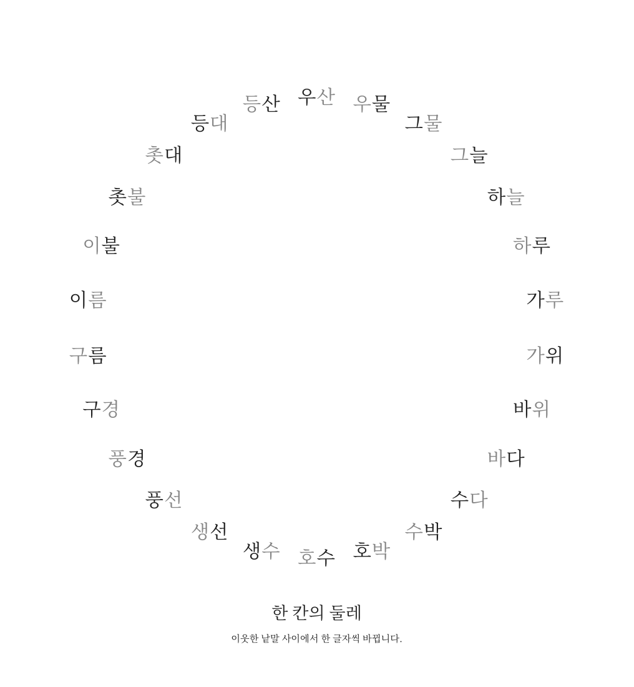

# 한 칸의 둘레

직접 고른 스물여섯 낱말을 원으로 이은 글자 그림입니다. 작은 글자 변화가 서로 다른 장면으로 이어지도록, 낱말을 돌리거나 그림을 덧붙이지 않고 나란히 놓았습니다.



[벡터 PDF](Word-Ring.pdf) · [윤곽선 SVG](Word-Ring.svg)

## 구성

이웃한 두 낱말은 한글 음절 한 칸만 다릅니다. 바뀌는 칸은 왼쪽과 오른쪽이 번갈아 나오고, 마지막 낱말에서 처음으로 돌아갈 때도 같은 규칙을 지킵니다.

시계방향으로 읽을 때 새로 바뀐 글자는 검정, 앞 낱말에서 남은 글자는 회색입니다. 출발점을 가리키는 번호나 화살표는 두지 않았습니다. 어디서 시작해도 한 바퀴를 돌아올 수 있습니다.

## 파일

- [words.json](words.json): 제목과 낱말 순서.
- [build.py](build.py): 글꼴 부분집합과 PDF·SVG·배치 자료를 만드는 코드.
- [Word-Ring.pdf](Word-Ring.pdf): 글자를 선택할 수 있는 벡터 PDF.
- [Word-Ring.svg](Word-Ring.svg): 글꼴 윤곽선을 포함해 외부 글꼴 없이 볼 수 있는 SVG.
- [Word-Ring.png](Word-Ring.png): PDF에서 만든 미리보기.
- [verify.py](verify.py): 고리 규칙, 글자·색, 여백과 SVG 의존성 검사.
- `layout.json`, `qa.json`, `manifest.json`: 배치 자료, 검사 결과, 파일 해시.

## 재현

Python, fontTools, ReportLab, PyMuPDF, Pillow, Poppler가 필요합니다. SVG의 별도 렌더 확인에는 Inkscape를 사용했습니다. 제작에는 설치된 `/usr/share/fonts/opentype/noto/NotoSerifCJK-Regular.ttc`의 한국어 글꼴을 사용합니다. Noto CJK의 라이선스는 SIL Open Font License 1.1입니다.

이 폴더의 별도 사본에서 실행합니다.

```sh
python3 build.py
pdftoppm -singlefile -scale-to 1100 -png Word-Ring.pdf Word-Ring
python3 verify.py
```

PDF는 글꼴을 포함하며, SVG는 글자 윤곽선을 포함합니다. 완성본을 보기 위해 글꼴을 따로 설치할 필요는 없습니다.

## 확인한 범위

26개 낱말이 서로 다르고 두 글자로 되어 있는지, 마지막과 처음을 포함한 모든 연결에서 한 칸만 바뀌는지, 바뀌는 위치가 번갈아 나오는지 검사했습니다. PDF의 낱말·색상·순서가 원본과 일치하고 글자 영역끼리 겹치지 않는 것도 확인했습니다.

PDF와 SVG를 각각 렌더해 전체 배치를 검토했습니다. 서로 다른 렌더러의 글꼴 힌팅과 윤곽선 처리 때문에 픽셀은 완전히 같지 않습니다. 600×650 비교에서 각 렌더의 글자 픽셀 중 99.6% 이상이 다른 렌더의 1픽셀 이웃 안에 놓였습니다.

가능한 모든 낱말 고리를 탐색하거나 독자를 대상으로 지각 실험을 한 결과는 아닙니다. 선택한 낱말과 닫힌 배치를 완성한 한 장의 글자 작품입니다.
